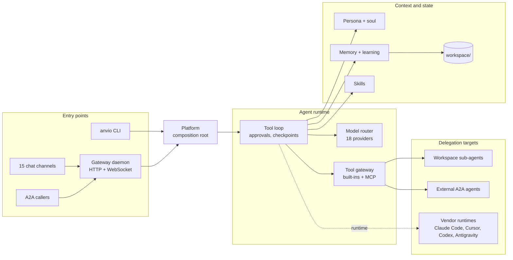

# Anvio

**An extensible AI agent platform.** Anvio runs and manages your agents, delegates work to sub-agents, external A2A agents and vendor agent CLIs, and connects them all to 18 model providers, MCP tool servers, skills, persistent memory and 15 chat channels. Agents are defined in Markdown; infrastructure in YAML.

## Contents

- [Overview](#overview)
- [Key Features](#key-features)
- [Architecture](#architecture)
- [How It Works](#how-it-works)
- [Quick Start](#quick-start)
- [Configuration](#configuration)
- [Model Providers](#model-providers)
- [Agent Management](#agent-management)
- [A2A Integration](#a2a-integration)
- [MCP Integration](#mcp-integration)
- [Plugin System](#plugin-system)
- [Skills](#skills)
- [Channels](#channels)
- [Security](#security)
- [Deployment](#deployment)
- [Development](#development)
- [Documentation](#documentation)
- [Roadmap](#roadmap)
- [Contributing](#contributing)
- [License](#license)

## Overview

Anvio is a TypeScript monorepo (pnpm + Turborepo, Node 20+). It turns a directory of Markdown and YAML files, the **workspace**, into a running agent system. You can drive it from a CLI, from a single gateway daemon (channels + HTTP API + WebSocket), or from an optional REST API and web dashboard.

**What it solves.** Real agent work rarely fits one chatbot. One request may need:

- a model chosen per agent, with fallback when a provider fails;
- tools and external MCP servers with human approval for risky calls;
- specialist sub-agents, or agents that live in another system;
- memory that outlives the session;
- the same agent reachable from Slack, Telegram or an HTTP client.

Anvio provides those pieces behind one runtime, so they compose instead of being re-built per integration.

**Who it is for.** Developers and small teams who want to define, run and connect their own agents. They keep the configuration in a portable directory they control, and add infrastructure only when they need it.

**How it differs from a chatbot.**

- An agent runs a multi-turn **tool loop**: the model calls tools, sees results and continues. The loop has approval checkpoints and cancellation.
- An agent can **hand work to other agents**:
  - workspace sub-agents;
  - external agents over the A2A protocol;
  - vendor agents such as Claude Code, Cursor, Codex and Antigravity, used as execution runtimes.
- Identity (**souls**), memory and a **learning loop** persist across sessions and channels.

**Internal vs external agents.**

| Kind               | Defined where                                | How Anvio uses it                                                           |
| ------------------ | -------------------------------------------- | --------------------------------------------------------------------------- |
| Workspace agent    | `workspace/agents/<name>.md`                 | Runs in Anvio's own tool loop (`local` runtime) or through a vendor runtime |
| Sub-agent          | Another workspace agent                      | Called with `delegate_task` / `mixture_of_agents`                           |
| External A2A agent | Any A2A 1.0 server, listed in `a2a.remotes`  | Called with the `a2a_delegate` tool                                         |
| Vendor agent       | Claude Code, Cursor, Codex, Antigravity CLIs | Selected per agent as its `runtime`, with OAuth from `anvio setup-token`    |
| Anvio as a remote  | Your workspace agents                        | Exposed to other systems through Anvio's A2A server and Agent Card          |

By default everything runs in one process with file-based state, no database and no Docker. SQLite, PostgreSQL, Redis and NATS are opt-in tiers.

## Key Features

Status labels used below:

- **Experimental**: the code path exists but has known gaps.
- **Not verified live**: implemented and tested against simulators or mocks, but not against the real external service.

Everything else is implemented and covered by the test suite.

### Agent runtime and orchestration

- Multi-turn tool loop. Native `tool_use` where the provider supports it, a fenced-block fallback elsewhere, and 5 tool rounds per turn by default.
- Turns are serialised per session and bounded globally (`ANVIO_MAX_CONCURRENT_RUNS`). Stop/cancel and a model idle timeout are built in.
- Approval checkpoints: a run pauses for a human decision and resumes from the checkpoint.
- Detached/background runs, mid-run inbox instructions, git worktree isolation per session.

### Multi-agent and remote agent integration

- `delegate_task` and `mixture_of_agents` (up to 8 agents), with a nesting depth limit (default 3).
- **A2A server.** Publishes an Agent Card and serves A2A JSON-RPC from the gateway.
- **A2A client.** The `a2a_delegate` tool delegates to remote agents. _Experimental:_ configured remote credentials are not yet sent, and cancel does not stop a running task.
- Vendor agent runtimes: Claude Code, Cursor, Codex, Antigravity, with per-agent fallback chains. _Not verified live._
- Editor bridge over ACP (`anvio acp serve`).

### Model providers

- 18 providers: Anthropic, Google Gemini, OpenAI, OpenRouter, DeepSeek, Groq, Mistral, Together, xAI, Fireworks, Moonshot, Cerebras, SambaNova, Perplexity, Cohere, Hugging Face, Ollama, and any OpenAI-compatible `custom` endpoint.
- Per-agent provider and model, opt-in routing, fallback chains, a circuit breaker per provider, spend budgets, and encrypted credential pools.

### Tools and MCP

- About 75 built-in tools (HTTP, files, JSON, datetime, processes, delegation, skills, scheduling, …). They are governed by an allow-list (`tools/gateway.yaml`) and an egress policy.
- MCP client over stdio and HTTP; agents can add and manage MCP servers at runtime; the first call to an MCP tool requires approval.

### Skills and extension

- Prose skills (`SKILL.md`) and composable YAML skills with typed parameters and conditional steps.
- Install from a directory, git or a catalog; upgrade, validate and test.
- The learning loop proposes skill drafts, which you promote manually.
- No plugin system; see [Plugin System](#plugin-system).

### Channels

- One shared runtime behind 15 adapters: Slack, Discord, Telegram, WhatsApp, Microsoft Teams, Matrix, Mattermost, Signal, Google Chat, Feishu, Email (IMAP/SMTP), SMS, web chat, REST and CLI.
- The channel harness adds engagement rules (mentions, DM policy, `/1on1`), per-channel formatting, interactive approvals and cross-channel slash commands. _Not verified live._

### Soul and memory

- **Souls:** long-lived identity with reporting manager, trusted channels, approvers and an evolution policy gated by soul-gate.
- **Memory providers:** filesystem (default), SQLite with FTS5 recall, Honcho, gbrain.
- **Learning loop:** session summaries, memory nudges and skill drafts at session end.

### Planning and task execution

- Cron automations with IANA timezones, event hooks, goals, kanban boards, batch jobs, DAG workflows, blueprints, and a `PLAN → EXECUTE → REVIEW` planner.

### Security and permissions

- Auth is off by default, and HTTP surfaces bind to `127.0.0.1`; the API refuses to be both unauthenticated and network-reachable.
- Webhook authentication, an approval gate for tools, an egress allow-list for network tools, an environment allow-list for the code sandbox, and encrypted credentials and connections.
- _Not yet covered:_ MCP stdio servers and hook scripts still inherit the full environment ([ROADMAP T-047](docs/ROADMAP.md#p0-security-and-correctness)).

### Observability

- Structured pino logs with a `runId` per turn, Prometheus-style token/latency metrics, OpenTelemetry and Langfuse export, and a token-usage ledger (`anvio usage stats`).

## Architecture



| Component                                        | Responsibility                                                           |
| ------------------------------------------------ | ------------------------------------------------------------------------ |
| `apps/cli`                                       | Primary interface; every capability is reachable from it                 |
| `apps/gateway` / `anvio gateway start`           | One daemon: channel hub + run worker + HTTP API + WebSocket + A2A routes |
| `packages/platform`                              | Composition root; builds the system from `workspace/anvio.yaml`          |
| `packages/agents`                                | Multi-turn tool loop, checkpoints, approvals                             |
| `packages/runtimes`                              | Execution backends: `local`, vendor CLIs, ssh, docker, singularity       |
| `packages/models`                                | Provider adapters, routing, fallback, budgets                            |
| `packages/tools` · `packages/integrations`       | Built-in tools · MCP client and registry                                 |
| `packages/a2a` · `packages/acp`                  | Agent-to-agent server/client · editor bridge                             |
| `packages/channels` · `packages/harness`         | Channel adapters · engagement, formatting, approvals                     |
| `packages/souls`, `memory`, `learning`, `skills` | Identity, memory, learning loop, skills                                  |

The dependency rule is `apps → platform → packages → core`. See [docs/02-architecture.md](docs/02-architecture.md) for the full component map and sequence diagrams.

## How It Works

1. **Request → execution.**
   - A message arrives from the CLI, a channel or `POST /api/sessions/:id/messages`.
   - The harness applies engagement rules and the platform publishes a run request.
   - The worker queues it behind any running turn of the same session. It then streams the agent: persona and soul become the system prompt, and skills and recalled memory are added to the context.
2. **Tool invocation.**
   - The model returns tool calls.
   - The tool gateway checks the allow-list, egress policy and approval requirements, executes the calls and feeds the results back.
   - The loop repeats until the model answers without tools, or the round limit is reached.
3. **Agent-to-agent delegation.** `delegate_task` starts the target workspace agent in its own session, runs it to completion and returns its answer as the tool result. Nesting is depth-limited.
4. **External agents.**
   - `a2a_delegate` sends a task to a configured remote A2A agent and returns its reply.
   - In the other direction, external systems discover your agents through `/.well-known/agent.json` and call them through `/a2a` on the gateway.
5. **Model selection.**
   - The agent's frontmatter names a provider and model.
   - If `model.routing` is set, the router picks a route instead.
   - Fallback chains skip providers whose circuit breaker is open. Retryable errors fail over before any output has been streamed.

## Quick Start

### Prerequisites

- Node.js 20 or newer, and pnpm 9 or newer
- git
- Optional: a model API key. Without one, agents answer with a mock provider, which is useful for trying the flow.

### Install

```bash
git clone https://github.com/viantonugroho11/Anvio.git
cd Anvio
pnpm install
pnpm build
```

Or install the CLI globally with the install script. It clones to `~/.anvio/app` and links `~/.local/bin/anvio`:

```bash
curl -fsSL https://raw.githubusercontent.com/viantonugroho11/Anvio/main/scripts/install.sh | bash
source ~/.anvio/env
```

The commands below use `pnpm anvio` from a clone. With the global install, use `anvio`.

### Create a workspace and a first agent

`anvio init` creates the workspace structure but no agents. Add one agent and the persona it uses:

```bash
pnpm anvio init ~/my-agents
export ANVIO_WORKSPACE=~/my-agents

cat > ~/my-agents/personas/assistant.md <<'EOF'
---
name: assistant
description: Concise general-purpose assistant
version: "1.0.0"
---

You are a concise, helpful assistant.
EOF

cat > ~/my-agents/agents/assistant.md <<'EOF'
---
persona: assistant
description: General-purpose assistant
model:
  provider: anthropic
  model: claude-sonnet-4-20250514
---

General-purpose assistant.
EOF
```

The persona body is the system prompt. The agent body is used as its description. To try a ready-made workspace instead, point `ANVIO_WORKSPACE` at the repository's sample `./workspace`, which contains an `architect` agent.

### Configure a model (optional)

```bash
export ANTHROPIC_API_KEY=...        # or OPENAI_API_KEY, DEEPSEEK_API_KEY, OPENROUTER_API_KEY, ...
```

Copy [`.env.example`](.env.example) to `.env` for the full list. To run an agent through Claude Code, Cursor, Codex or Antigravity with your subscription, use `anvio setup-token` instead (see [Model Providers](#model-providers)).

### Run and verify

```bash
pnpm anvio workspace validate        # → Workspace OK: ...
pnpm anvio agents list               # → assistant — General-purpose assistant
pnpm anvio run assistant "Say hello"
pnpm anvio chat --agent assistant    # interactive
pnpm anvio sessions list
```

Without an API key, `run` prints `[Mock — set a model API key] You said: Say hello`.

### Start the gateway (channels + HTTP API + WebSocket)

```bash
pnpm anvio gateway start --foreground     # listens on 127.0.0.1:3001 (ANVIO_GATEWAY_PORT)
curl http://127.0.0.1:3001/health         # → {"status":"ok",...}
```

## Configuration

| What               | Where                                                                                                                   | Reference                                                              |
| ------------------ | ----------------------------------------------------------------------------------------------------------------------- | ---------------------------------------------------------------------- |
| Agents             | `workspace/agents/*.md` (frontmatter: `persona`, `skills`, `model`, `runtime`, `soul`)                                  | [docs/03-runtime.md](docs/03-runtime.md)                               |
| Personas and souls | `workspace/personas/*.md`, `workspace/souls/<slug>/SOUL.md`                                                             | [docs/25-soul-system.md](docs/25-soul-system.md)                       |
| Platform           | `workspace/anvio.yaml`: storage, memory, events, runtime, auth, channels, a2a, acp, worktrees                           | [docs/35-workspace-architecture.md](docs/35-workspace-architecture.md) |
| Tools              | `workspace/tools/gateway.yaml`: enabled tools, egress allow-list                                                        | [docs/44-tool-gateway.md](docs/44-tool-gateway.md)                     |
| MCP servers        | `workspace/mcp/servers.yaml`                                                                                            | [docs/71-mcp-setup-guide.md](docs/71-mcp-setup-guide.md)               |
| Provider routing   | `workspace/providers/routing.yaml`                                                                                      | [docs/36-provider-routing.md](docs/36-provider-routing.md)             |
| Secrets            | Environment variables (see `.env.example`); credential pools (`anvio credentials`); runtime OAuth (`anvio setup-token`) | [docs/33-credential-pools.md](docs/33-credential-pools.md)             |

`anvio.yaml` is validated at startup. A file that does not parse stops the platform with the file path and reason; it does not fall back to defaults. A missing file uses defaults. Environment references such as `${SLACK_BOT_TOKEN}` are expanded at load time. Keep real secrets in the environment, never in the workspace.

Commonly used environment variables:

- `ANVIO_WORKSPACE`
- `ANVIO_GATEWAY_PORT` (default `3001`)
- `ANVIO_GATEWAY_HOST` (default `127.0.0.1`)
- `ANVIO_MAX_CONCURRENT_RUNS`
- `ANVIO_MAX_DELEGATION_DEPTH`
- `ANVIO_CREDENTIALS_PASSPHRASE`
- `ANVIO_CONNECTION_ENCRYPTION_KEY`
- provider keys

## Model Providers

| Provider                                                                                                                               | Configured by                                       | Notes                          |
| -------------------------------------------------------------------------------------------------------------------------------------- | --------------------------------------------------- | ------------------------------ |
| Anthropic                                                                                                                              | `ANTHROPIC_API_KEY`                                 | Native tools, prompt caching   |
| Google Gemini                                                                                                                          | `GEMINI_API_KEY` / `GOOGLE_API_KEY`                 | Native function calling        |
| OpenAI, OpenRouter, DeepSeek, Groq, Mistral, Together, xAI, Fireworks, Moonshot, Cerebras, SambaNova, Perplexity, Cohere, Hugging Face | `<PROVIDER>_API_KEY` (`HF_TOKEN` for Hugging Face)  | OpenAI-compatible adapter      |
| Ollama                                                                                                                                 | `OLLAMA_BASE_URL` / `OLLAMA_ENABLED`                | Local models                   |
| Custom                                                                                                                                 | `provider: custom` + `baseUrl` in agent frontmatter | Any OpenAI-compatible endpoint |

Each agent declares `model.provider` and `model.model`. That choice wins over keyword routing. Routing is opt-in through `model.routing: <route>`. Inspect providers and routing with `anvio routing providers|show|catalog|test`.

Capabilities differ per provider, for example native tools and caching. The provider catalog in `packages/models` records them ([ADR-0015](docs/adr/0015-provider-capability-catalog.md)).

**Two authentication layers.**

- **Model API keys** power the built-in `local` runtime.
- **Vendor runtimes** use OAuth from `anvio setup-token --claude|--cursor|--codex|--antigravity`, stored encrypted in `workspace/connections/`.

Do not set `ANTHROPIC_API_KEY` together with `runtime.provider: claude-code`: the key shadows OAuth and bills API credits ([ADR-0009](docs/adr/0009-runtime-oauth-authentication.md)).

## Agent Management

- **Create.** Add `workspace/agents/<name>.md` and its persona. Agents are picked up on the next run; there is no registration step. Check them with `anvio agents list` and `anvio workspace validate`.
- **Run.**
  - `anvio run <agent> [message]`, with `--detach` for background runs;
  - `anvio chat --agent <name>`;
  - a channel message to the gateway;
  - an A2A call.
- **Control.**
  - `anvio sessions list`, `anvio status [sessionId]`, `anvio logs <sessionId>`;
  - `anvio stop <sessionId>`, `anvio inbox <sessionId> "<instruction>"`;
  - `anvio approve <session> <requestId>`.
- **Lifecycle.**
  - Session states move through `assembling_context → calling_model → tool_executing / awaiting_approval → completed | failed`.
  - A crashed process leaves interrupted sessions in progress; on the next start they are marked `failed` with `interruptedAt`.
  - Each turn has a `runId` that appears on every log line.
- **Runtime per agent.** Set `runtime` in frontmatter to `local` (default), `claude-code`, `cursor`, `codex`, `antigravity`, `ssh`, `docker` or `singularity`, with optional fallbacks. Check them with `anvio runtime list|test`. `daytona` and `modal` currently support remote exec only.

## A2A Integration

Anvio implements the [A2A protocol](https://a2a-protocol.org/) with the official `@a2a-js/sdk`.

| Capability                  | Status                                                                                                                                      |
| --------------------------- | ------------------------------------------------------------------------------------------------------------------------------------------- |
| **A2A server**              | Enabled with `a2a.enabled: true`. Served by the gateway at `/a2a` (JSON-RPC)                                                                |
| **Agent Card**              | `/.well-known/agent.json` and `/.well-known/agent-card.json`                                                                                |
| **Agent selection**         | `a2a.agents: '*'` or a list. Only the first exposed agent is currently reachable ([T-053](docs/ROADMAP.md#p2-and-below))                    |
| **Server auth**             | API keys with scopes, or JWT (`a2a.auth`). **Off by default**; enable it before exposing the gateway                                        |
| **A2A client / delegation** | `a2a_delegate` tool (enable in `tools/gateway.yaml`) to remotes in `a2a.remotes` (`alias`, `url`)                                           |
| **Discovery**               | Remotes are configured statically; the client reads their Agent Card. There is no registry or health checking                               |
| **Known gaps**              | Client does not send configured `apiKey`/`bearerToken` (T-048); cancel does not stop the run (T-051); each message is a new session (T-049) |

```yaml
# workspace/anvio.yaml (excerpt)
spec:
  a2a:
    enabled: true
    auth:
      enabled: true
      apiKeys:
        - name: partner
          key: ${A2A_PARTNER_KEY}
    remotes:
      - alias: researcher
        url: https://agents.example.com
```

Details: [docs/78-a2a-protocol.md](docs/78-a2a-protocol.md), [ADR-0026…0031](docs/adr/README.md).

## MCP Integration

Anvio is an **MCP client**. It does not act as an MCP server.

- **Transports:** stdio (newline-delimited JSON, tested against servers built with the official MCP SDK) and HTTP.
- **Configuration:** `workspace/mcp/servers.yaml`. Agents can add, enable or disable servers at runtime through `mcp_manage` (off by default).
- **Tool naming and approval:** tools appear as `anvio_mcp__<server>__<tool>`. The first call to each tool needs approval from an approver in the agent's soul.
- **Failure handling:** a missing or crashing server does not stop the platform. Server processes are stopped on shutdown.
- **CLI:** `anvio mcp list|test|health|preset`.

Details: [docs/07-mcp.md](docs/07-mcp.md), [docs/71-mcp-setup-guide.md](docs/71-mcp-setup-guide.md).

## Plugin System

Anvio does **not** have a plugin system: there is no plugin manager, manifest, registry or plugin lifecycle. Extend it through these mechanisms, each with its own install and enable path:

| Mechanism                | Install / activate                              | Update / remove                           | Permissions                                                                |
| ------------------------ | ----------------------------------------------- | ----------------------------------------- | -------------------------------------------------------------------------- |
| Skills                   | `anvio skill install                            | import`, or a file in `workspace/skills/` | `anvio skill upgrade`; delete the file                                     | A skill's declared `permissions` are not enforced yet |
| MCP servers              | `workspace/mcp/servers.yaml` or `mcp_manage`    | `enabled: false` / remove the entry       | Per-tool first-call approval; the process inherits the environment (T-047) |
| Event hooks              | `workspace/hooks/hooks.yaml`                    | Edit the file                             | `script` handlers inherit the environment (T-047)                          |
| Blueprints and workflows | `workspace/blueprints/`, `workspace/workflows/` | Edit the files                            | Run as normal agent tasks                                                  |
| Model endpoints          | `provider: custom` + `baseUrl`                  | Edit the frontmatter                      | —                                                                          |

New channels, runtimes, non-OpenAI-compatible providers and built-in tools require code changes. A plugin manager is tracked as [T-058](docs/ROADMAP.md#p2-and-below).

## Skills

- **Discovery.**
  - Skills listed in an agent's `skills:` are always loaded.
  - Others are matched by trigger.
  - Agents can list, view and call skills (`skills_list`, `skill_view`, `skill_call`).
- **Kinds.** Prose skills (`SKILL.md` instructions) and composable YAML skills (`composable: true`). Composable skills have typed parameters and run steps that call tools, with conditions.
- **Manual management.** `anvio skill catalog|install|import|validate|upgrade|test`.
- **Automatic creation.**
  - At session end, the learning loop can write a skill **draft** to `workspace/skills/_drafts/`. The soul's `evolution.allowAutoUpdate` governs this.
  - Drafts are not live until promoted: `anvio learning drafts|promote`.

Details: [docs/05-skills.md](docs/05-skills.md), [docs/77-skill-execution-engine.md](docs/77-skill-execution-engine.md), [docs/43-learning-loop.md](docs/43-learning-loop.md).

## Channels

Supported adapters:

- Slack, Discord, Telegram, WhatsApp
- Microsoft Teams, Matrix, Mattermost, Signal, Google Chat, Feishu
- Email (IMAP/SMTP), SMS
- web chat, REST, CLI

Enable them under `spec.channels` in `anvio.yaml`, then run `anvio gateway start`.

Every adapter feeds the same channel hub, so one agent and one session store serve all channels. A thread maps to a session. The harness decides when to engage (mention, DM policy, `/1on1` thread lock), formats replies per channel, renders approval buttons and routes slash commands. Check adapters with `anvio channels status`.

Channel behaviour is tested with an in-process simulated channel. Live vendor APIs have not been verified in this repository's test suite.

Details: [docs/10-channels.md](docs/10-channels.md), [docs/41-channel-harness.md](docs/41-channel-harness.md), [docs/76-unified-gateway.md](docs/76-unified-gateway.md).

## Security

- **Authentication.** Auth is off by default. The gateway and API bind to `127.0.0.1`. The API refuses to start unauthenticated on a reachable interface ([ADR-0018](docs/adr/0018-api-network-exposure.md)). Channel webhooks are authenticated ([ADR-0021](docs/adr/0021-channel-webhook-authentication.md)). A2A server auth is separate and also off by default.
- **Authorization.** Approvers, the reporting manager and trusted channels in SOUL.md decide who may approve tool calls and who can talk to an agent on a channel.
- **Tool execution.**
  - Built-in tools need an explicit allow-list.
  - Network tools obey an egress policy, with private networks blocked by default.
  - File tools refuse paths outside the workspace.
  - Code execution runs in a sandbox with an environment allow-list.
  - HTTP request bodies are capped at 1 MB.
- **Secrets.** Provider keys come from the environment or encrypted credential pools. OAuth tokens and connections are encrypted at rest.
- **Known gaps.**
  - MCP stdio servers and hook scripts inherit the full environment (T-047).
  - The A2A client does not send remote credentials (T-048).

See [docs/12-security.md](docs/12-security.md).

## Deployment

| Mode                  | How                                                                                                  | Verified                                                                                                                |
| --------------------- | ---------------------------------------------------------------------------------------------------- | ----------------------------------------------------------------------------------------------------------------------- |
| CLI                   | `anvio run` / `anvio chat`                                                                           | Yes                                                                                                                     |
| Single-process daemon | `anvio gateway start` (channels + worker + HTTP + WS + A2A)                                          | Yes, Level 1, single process ([post-refactoring verification](docs/audits/post-refactoring/06-production-readiness.md)) |
| Containers            | `docker/Dockerfile.{api,gateway,worker}`, `docker/docker-compose.yml` (PostgreSQL, Redis, NATS, API) | Files provided; not verified in the latest audit                                                                        |

Run one Anvio process per workspace directory. Shutdown does not drain in-flight turns, so plan restarts accordingly ([R-01](docs/ROADMAP.md#p1-reliability-and-interoperability)). There are no Kubernetes manifests in this repository.

## Development

```bash
pnpm install
pnpm build                     # required before tests: tests import packages' dist/
pnpm typecheck
pnpm lint
ANTHROPIC_API_KEY=test-key pnpm test         # unit + integration (vitest)
pnpm test:integration          # tests/integration only
npx vitest run tests/integration/e2e         # end-to-end suite (scripted model)
pnpm cli <args>                # run the CLI from source (tsx)
```

Unit tests sit next to the source as `*.spec.ts`. Integration and E2E tests live in `tests/integration/`. CI runs lint, build and typecheck, tests on Node 22 and 24, and a dependency audit. See [docs/21-development-guide.md](docs/21-development-guide.md).

## Documentation

Start at [docs/README.md](docs/README.md), the canonical documentation index. Architecture decisions are in [docs/adr/](docs/adr/README.md), and release history in [CHANGELOG.md](CHANGELOG.md).

## Roadmap

Open work is consolidated in [docs/ROADMAP.md](docs/ROADMAP.md). The main items:

- isolating secrets from MCP servers and hooks;
- A2A client credentials and cancel semantics;
- graceful shutdown with drain;
- a plugin manager;
- the zod 4 migration.

The vNext plan of record is [docs/plans/engineering-backlog-vnext.md](docs/plans/engineering-backlog-vnext.md).

## Contributing

See [docs/22-contributing.md](docs/22-contributing.md) and [docs/21-development-guide.md](docs/21-development-guide.md). Please run `pnpm build && pnpm lint && pnpm typecheck && pnpm test` before opening a pull request.

## License

[MIT](LICENSE) © 2026 Muhammad Novianto Nugroho
