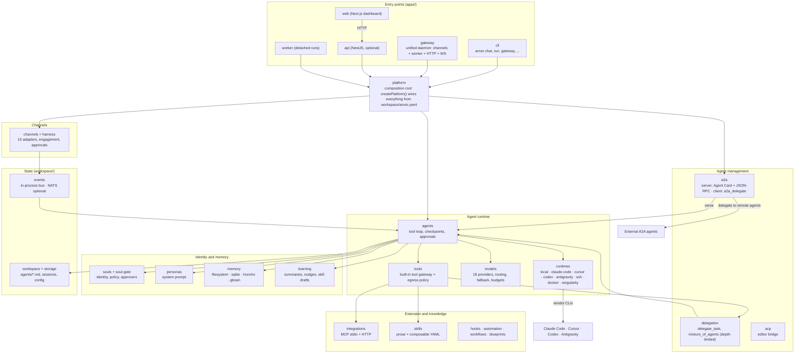
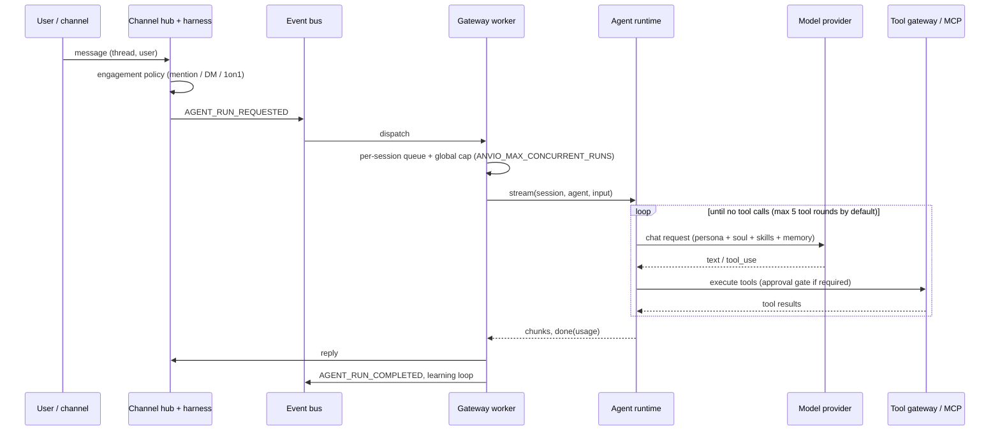

# Architecture

Anvio is an extensible AI agent platform ([ADR-0038](adr/0038-extensible-agent-platform-positioning.md)). It runs workspace agents in a multi-turn tool loop. It also delegates work to sub-agents, to external A2A agents and to vendor agent CLIs, and connects all of them to models, tools (built-in and MCP), skills, memory and chat channels.

By default it is one process with file-based state. Heavier infrastructure is opt-in ([ADR-0007](adr/0007-local-first-architecture.md)).

This page describes the code as of 2026-10-25. Where a capability is partial, the gap is stated and linked to [ROADMAP.md](ROADMAP.md).

## System map



## Dependency rule

```text
apps → platform → packages → core
```

- `packages/core` holds schemas (zod), ports and shared primitives. It has no internal dependencies.
- `packages/platform` is the composition root. Apps never assemble subsystems themselves.
- Domain logic lives in `packages/*`, never in NestJS controllers or CLI command handlers.

## Packages by role

| Role                    | Packages                                                                                                                                                    |
| ----------------------- | ----------------------------------------------------------------------------------------------------------------------------------------------------------- |
| Foundation              | `core`, `workspace`, `storage`, `auth` (optional, off by default), `events`, `observability`, `db` (Level 3+)                                               |
| Agent runtime           | `agents` (tool loop), `runtimes` (execution backends), `models` (provider routing), `tools` (built-in tool gateway), `memory`, `execution` (sandboxed code) |
| Agent management        | `platform` (delegation, gateway worker), `a2a`, `acp`, `harness`                                                                                            |
| Identity and learning   | `souls`, `soul-gate`, `personas`, `learning`, `skills`, `knowledge`                                                                                         |
| Planning and automation | `goals`, `automation`, `workflows`, `blueprints`, `kanban`, `batch`, `hooks`                                                                                |
| Connectivity            | `channels`, `integrations` (MCP), `voice`, `credentials`                                                                                                    |
| Not wired               | `tool-bus` (see audit CQ-024)                                                                                                                               |

## How a request is executed



Key properties, verified by the E2E suite in `tests/integration/e2e/`:

- **Turn ordering.** Turns on one session are serialised. Turns across sessions are bounded by a semaphore.
- **Stopping a turn.** A user stop or an idle model timeout aborts the in-flight call.
- **Tool failures stay inside the turn.** Unknown tools, bad arguments and refused paths are reported to the model rather than ending the turn.
- **First-use MCP calls can require human approval.** The run is checkpointed and resumes after the decision.
- **Run failures are visible.** A failing run marks the session `failed`, publishes `AGENT_RUN_FAILED` and sends a notice to the user.
- **Crash recovery.** After a crash, sessions left in `calling_model` are repaired to `failed`. The run itself is not resumed ([ROADMAP T-011](ROADMAP.md#p1-reliability-and-interoperability)).

## Agents, personas and souls

- **Agent:** `workspace/agents/<name>.md`. Its frontmatter selects `persona`, `skills`, `model`, `runtime` and `soul`.
- **Persona:** `workspace/personas/<name>.md`. Its body becomes the **system prompt**. The agent's own Markdown body is used as its description, not as the prompt ([ROADMAP R-07](ROADMAP.md#p2-and-below)). If no persona is set, the agent name is used and the persona file must exist.
- **Soul:** `workspace/souls/<slug>/SOUL.md`. It holds long-lived identity, the reporting manager, trusted channels and approvers, and the evolution policy. Self-evolution is gated by `evolution.allowAutoUpdate` and by soul-gate policy ([25](25-soul-system.md), [42](42-soul-gate.md)).

## Managing other agents

| Mechanism            | What it does                                                                                                                                                                                               | Where                                                                                                                                        |
| -------------------- | ---------------------------------------------------------------------------------------------------------------------------------------------------------------------------------------------------------- | -------------------------------------------------------------------------------------------------------------------------------------------- |
| Sub-agent delegation | `delegate_task` runs another workspace agent in its own session and returns its answer. `mixture_of_agents` fans out to up to 8 agents. Nesting depth is limited to 3 (`ANVIO_MAX_DELEGATION_DEPTH`)       | `packages/platform/src/delegation-depth.ts`, [40](40-subagent-delegation.md)                                                                 |
| A2A server           | Publishes `/.well-known/agent.json` (also `agent-card.json`) and serves A2A JSON-RPC on `/a2a`. API-key/JWT auth is available but **off by default**                                                       | `packages/a2a/src/server`, [78](78-a2a-protocol.md)                                                                                          |
| A2A client           | The `a2a_delegate` tool (disabled by default) sends tasks to remotes listed in `a2a.remotes`. Configured remote credentials are **not yet sent** ([T-048](ROADMAP.md#p1-reliability-and-interoperability)) | `packages/a2a/src/client`                                                                                                                    |
| Vendor runtimes      | An agent can run on Claude Code, Cursor, Codex or Antigravity through their CLIs/SDKs with vendor OAuth, with per-agent fallback chains                                                                    | `packages/runtimes`, [ADR-0009](adr/0009-runtime-oauth-authentication.md)                                                                    |
| Coordination         | Kanban lanes, goals, batch jobs, DAG workflows, blueprints and cron automations dispatch agent runs                                                                                                        | [26](26-goal-system.md), [27](27-automation-engine.md), [28](28-kanban-system.md), [32](32-batch-processing.md), [45](45-workflow-engine.md) |

## Two authentication layers

Keep these apart:

1. **Model API keys** (`ANTHROPIC_API_KEY`, `OPENAI_API_KEY`, …). They power the `local` runtime's direct SDK/HTTP calls.
2. **Runtime OAuth** (`anvio setup-token --claude|--cursor|--codex|--antigravity`). It powers vendor-CLI runtimes and is stored encrypted under `workspace/connections/`.

Do not set `ANTHROPIC_API_KEY` alongside `runtime.provider: claude-code`: the key shadows OAuth and bills API credits ([ADR-0009](adr/0009-runtime-oauth-authentication.md), [ADR-0011](adr/0011-model-provider-auth-and-switching.md)).

## Progressive tiers

| Level       | Storage                                              | Events     | Auth                                   | Requires                        |
| ----------- | ---------------------------------------------------- | ---------- | -------------------------------------- | ------------------------------- |
| 1 (default) | Filesystem (`workspace/sessions/*.json`, `memory/`)  | In-process | Off; HTTP surfaces bind to `127.0.0.1` | Node 20+ only                   |
| 2           | `storage.provider: sqlite` (`state.db`, FTS5 search) | In-process | Optional                               | —                               |
| 3+          | PostgreSQL (`packages/db`), Redis, NATS JetStream    | NATS       | JWT                                    | `docker/docker-compose.dev.yml` |

Level 1 was verified under load on 2026-10-24 ([post-refactoring/03](audits/post-refactoring/03-concurrency-performance.md)). Levels 2 and 3+ were not load-tested. Code meant for Level 1 must not take a Level 3+ dependency.

## Extension points

There is **no plugin system** ([ROADMAP T-058](ROADMAP.md#p2-and-below)). The supported ways to extend Anvio without changing code:

- **Skills.** Install from a directory, git or a catalog URL; upgrade and remove ([05](05-skills.md), [37](37-skills-catalog.md)).
- **MCP servers.** Configure in `workspace/mcp/servers.yaml`, or let an agent add them through `mcp_manage` ([07](07-mcp.md)).
- **Event hooks.** `script` and `webhook` handlers ([31](31-event-hooks.md)).
- **Blueprints and workflows** ([34](34-blueprint-catalog.md), [45](45-workflow-engine.md)).
- **Model endpoints.** Any OpenAI-compatible endpoint, through `provider: custom` + `baseUrl`.

New channel adapters, runtimes, non-OpenAI-compatible providers or built-in tools require code changes.

## Related decisions

- Positioning: [0038](adr/0038-extensible-agent-platform-positioning.md).
- Defaults: [0007](adr/0007-local-first-architecture.md).
- Channels: [0008](adr/0008-channel-hub-architecture.md).
- Runtime OAuth: [0009](adr/0009-runtime-oauth-authentication.md).
- Model gateway evolution: [0013](adr/0013-model-gateway-evolution.md).
- Network exposure: [0018](adr/0018-api-network-exposure.md).
- A2A: [0026](adr/0026-a2a-protocol-integration.md)–[0031](adr/0031-a2a-authentication.md).
- MCP: [0036](adr/0036-agent-managed-skills-and-mcp-servers.md), [0037](adr/0037-remote-mcp-servers-over-http.md), [0039](adr/0039-in-house-mcp-client.md).
- Full list: [adr/README.md](adr/README.md).
