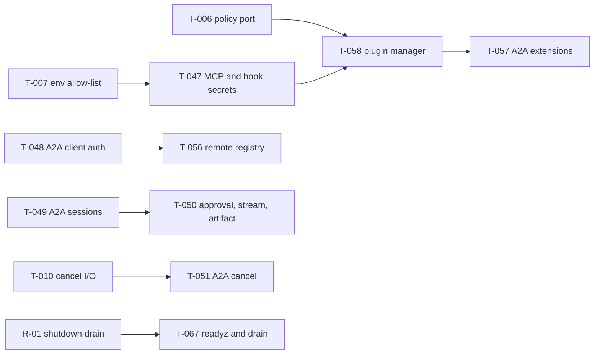

# Roadmap

This is the single canonical roadmap. It consolidates open work from the audits and the vNext plan of record. It contains **no dates or delivery commitments**.

**Last reconciled:** 2026-10-25, against `main` at `e027717`.

Task IDs from the source documents are preserved:

- `T-0xx`: unified audit backlog;
- `CQ-0xx`: code-quality audit;
- `R-0x`: post-refactoring risks;
- `E*.F*.S*` / `P1.S*`: vNext backlog.

**Status legend:**

| Status         | Meaning                                                            |
| -------------- | ------------------------------------------------------------------ |
| **OPEN**       | Verified still present in current code                             |
| **PARTIAL**    | Some of it is fixed, with evidence cited                           |
| **FIXED**      | Fixed, with evidence cited; kept here for one reconciliation cycle |
| **UNVERIFIED** | Not re-checked in this pass                                        |

## 1. Current capabilities

See [README § Key Features](../README.md#key-features). Implementation status per subsystem, as verified on 2026-10-24, is in [audits/post-refactoring/08-final-verification-matrix.md](audits/post-refactoring/08-final-verification-matrix.md).

## 2. Priority gaps

### P0: security and correctness

| ID    | Area                | Gap                                                                                                                                                 | Status         | Evidence / source                                                                                                                                                                                                                                                         |
| ----- | ------------------- | --------------------------------------------------------------------------------------------------------------------------------------------------- | -------------- | ------------------------------------------------------------------------------------------------------------------------------------------------------------------------------------------------------------------------------------------------------------------------- |
| T-047 | integrations, hooks | MCP stdio servers and hook `script` handlers inherit the full `process.env` (every API key). `${VAR}` in MCP headers can export secrets to any host | **OPEN**       | `packages/integrations/src/mcp-stdio-client.ts` spreads `process.env`; `packages/hooks/src/handlers/script.ts` passes `env: process.env`. Sources: [phase-3/06](audit/phase-3/06-plugin-security-isolation.md), [phase-3/10](audit/phase-3/10-remaining-gap-breakdown.md) |
| T-007 | execution           | Sandboxed processes inherited the environment                                                                                                       | **PARTIAL**    | Fixed for the code-execution sandbox (`packages/core/src/sandbox-env.ts`, used by `packages/execution`, PR #117). The MCP and hook paths are T-047                                                                                                                        |
| T-052 | a2a                 | A2A server auth is off by default; push notifications are on by default; the Agent Card has no `securitySchemes`                                    | **OPEN**       | `packages/core/src/schemas/workspace.schema.ts` (`a2a.auth.enabled` default `false`, `pushNotifications` default `true`)                                                                                                                                                  |
| T-006 | tools               | Tool policy and approval exist only in the schema for some paths; no single policy port                                                             | **UNVERIFIED** | [phase-2/07](audit/phase-2/07-remaining-gap-breakdown.md)                                                                                                                                                                                                                 |
| T-046 | integrations        | MCP stdio framing incompatible with official servers (G-33)                                                                                         | **FIXED**      | PR #118 (PR-02); E2E MCP-01..05 against an official-SDK server                                                                                                                                                                                                            |

### P1: reliability and interoperability

| ID           | Area               | Gap                                                                                                              | Status         | Evidence / source                                                                                                                                                          |
| ------------ | ------------------ | ---------------------------------------------------------------------------------------------------------------- | -------------- | -------------------------------------------------------------------------------------------------------------------------------------------------------------------------- |
| R-01 / T-067 | platform           | Shutdown neither drains nor aborts in-flight turns; messages queued behind the concurrency cap are lost          | **OPEN**       | [post-refactoring/07](audits/post-refactoring/07-remaining-risks.md) (LOAD-04)                                                                                             |
| T-011        | platform           | Runs are lost on crash                                                                                           | **PARTIAL**    | Sessions stuck in `calling_model` are now repaired to `failed` on start (PR #118, PR-15); the run itself is not resumed                                                    |
| T-048        | a2a                | The A2A client does not send the configured `apiKey`/`bearerToken`; `timeoutMs` is ignored                       | **OPEN**       | `packages/a2a/src/client/a2a-client.ts` (`ClientFactory` built without auth)                                                                                               |
| T-051        | a2a                | A2A `cancelTask` marks the task canceled but does not stop the run                                               | **OPEN**       | `packages/a2a/src/server/anvio-agent-executor.ts`                                                                                                                          |
| T-049, T-050 | a2a                | Each A2A message starts a new session; approvals are reported as completed; streaming is advertised but not real | **UNVERIFIED** | [phase-3/01](audit/phase-3/01-a2a-protocol-compliance.md)                                                                                                                  |
| T-064        | agents             | Immutable runtime baseline in the system prompt                                                                  | **UNVERIFIED** | [phase-4/14](audit/phase-4/14-prioritized-roadmap.md)                                                                                                                      |
| T-065        | harness            | Durable, guarded approvals (survive restart; non-approver clicks rejected; empty approver list fails closed)     | **UNVERIFIED** | [phase-4/14](audit/phase-4/14-prioritized-roadmap.md)                                                                                                                      |
| T-004        | platform, channels | Agent turns run on the inbound path (head-of-line blocking, slow webhook acks)                                   | **PARTIAL**    | HTTP `POST /messages` no longer waits for the turn (PR #118, PR-04); per-session serialisation plus a global cap (PR #117, CQ-007). Channel adapters still dispatch inline |
| T-036        | agents             | Orchestrator concurrency limit                                                                                   | **FIXED**      | `ANVIO_MAX_CONCURRENT_RUNS` semaphore; enforced exactly under load (post-refactoring LOAD-01)                                                                              |
| T-021        | platform           | Delegation guard                                                                                                 | **FIXED**      | Depth limit 3 and mixture fan-out 8 (PR #118, PR-01; `delegation-depth.spec.ts`)                                                                                           |
| T-045        | platform           | Sanitise `cronjob create`                                                                                        | **FIXED**      | PR #118, PR-11; E2E SCH-06                                                                                                                                                 |
| T-027        | automation         | Cron timezone, overlap guard, misfire policy                                                                     | **PARTIAL**    | Timezone fixed (PR #118, PR-08); overlap and misfire policy open                                                                                                           |
| R-03         | platform           | Startup session repair is unsafe with several worker processes per workspace                                     | **OPEN**       | [post-refactoring/07](audits/post-refactoring/07-remaining-risks.md)                                                                                                       |
| R-06         | memory             | gbrain MCP client not closed on shutdown                                                                         | **OPEN**       | [post-refactoring/07](audits/post-refactoring/07-remaining-risks.md)                                                                                                       |

### P2 and below

| ID                                                             | Area         | Gap                                                                                                                         | Status                                                                                            |
| -------------------------------------------------------------- | ------------ | --------------------------------------------------------------------------------------------------------------------------- | ------------------------------------------------------------------------------------------------- |
| T-058                                                          | platform     | **No plugin manager.** Extension today is via skills, MCP servers, hooks, blueprints and OpenAI-compatible endpoints        | **OPEN** (`plugin` appears nowhere in `packages/` or `apps/`)                                     |
| T-053 … T-057, T-060                                           | a2a          | Expose more than one agent; persistent task store; remote registry and health; A2A extensions; encrypted remote credentials | **UNVERIFIED** ([phase-3/10](audit/phase-3/10-remaining-gap-breakdown.md))                        |
| T-061                                                          | skills       | Git skill import has no SHA pin                                                                                             | **UNVERIFIED**                                                                                    |
| T-029 / R-04                                                   | agents       | Independent read-only tool calls run sequentially                                                                           | **OPEN** (`packages/agents/src/tool-round.ts`)                                                    |
| R-02                                                           | storage      | Level 1 throughput ceiling of about 90–200 turns/s (filesystem I/O)                                                         | **OPEN**, measured ([post-refactoring/03](audits/post-refactoring/03-concurrency-performance.md)) |
| R-05                                                           | workspace    | The first message of a new thread still scans all session files                                                             | **OPEN**                                                                                          |
| R-07                                                           | agents, docs | Agent Markdown body is not the system prompt (the persona is)                                                               | **OPEN**, needs an owner decision                                                                 |
| CQ-016                                                         | deps         | zod 3 high advisory; zod 4 migration deferred ([ADR-0012](adr/0012-zod-4-migration-deferred.md))                            | **OPEN**                                                                                          |
| CQ-017                                                         | tooling      | Prettier non-compliance repo-wide (about 380 files); `format:check` not in CI                                               | **OPEN**                                                                                          |
| CQ-011, CQ-012, CQ-018, CQ-021, CQ-024, CQ-026, CQ-028, CQ-029 | various      | See [remediation/05](audits/code-quality/remediation/05-remaining-issues.md)                                                | **OPEN**                                                                                          |
| ADR-0004                                                       | memory       | Semantic vector memory: `qdrant` provider is a stub                                                                         | **OPEN**, implement or deprecate                                                                  |
| —                                                              | runtimes     | Daytona and Modal runtimes support remote exec only; agent `run`/`stream` throw "not configured"                            | **OPEN** (`packages/runtimes/src/remote/remote-runtime-stub.ts`)                                  |

The full Phase 1+2 backlog T-001…T-045 is in [phase-2/07](audit/phase-2/07-remaining-gap-breakdown.md). PR #112 fixed T-001, T-002, T-003, T-005, T-012 and T-020 (per [phase-3/10](audit/phase-3/10-remaining-gap-breakdown.md)).

## 3. Not verified (needs live infrastructure)

- Live LLM providers and cross-provider fallback.
- Live chat channels (Slack, Discord, Telegram, WhatsApp, Email, …).
- Vendor-CLI runtimes.
- Level 2 SQLite under load; Level 3+ (PostgreSQL, NATS).
- Multi-process deployments.
- Soak behaviour.

Source: [post-refactoring/06](audits/post-refactoring/06-production-readiness.md).

## 4. Planned enhancements (plan of record)

The vNext programme is tracked story by story, with status markers, in [plans/engineering-backlog-vnext.md](plans/engineering-backlog-vnext.md). Design and blueprint: [plans/architecture-vnext-design.md](plans/architecture-vnext-design.md), [plans/implementation-blueprint-vnext.md](plans/implementation-blueprint-vnext.md).

Execution is incremental on the existing packages, not a greenfield repository layout ([ADR-0013](adr/0013-model-gateway-evolution.md)). The target package names in the vNext design (`packages/contracts`, `substrate`, `surfaces/*`) are therefore not the current layout.

## 5. Owner decisions pending

| Decision                                                                             | Reference                                                     |
| ------------------------------------------------------------------------------------ | ------------------------------------------------------------- |
| Accept or reject the implemented PROPOSED ADRs (0026, 0032, 0033, 0035)              | [adr/README.md](adr/README.md#owner-decisions-pending)        |
| Keep the in-house MCP client or migrate to the SDK client                            | [ADR-0039](adr/0039-in-house-mcp-client.md)                   |
| Semantic memory: implement or deprecate                                              | [ADR-0004](adr/0004-qdrant.md)                                |
| Agent body vs persona as system prompt                                               | R-07                                                          |
| Update user-facing "Local-First" strings in the CLI help banner and package metadata | [ADR-0038](adr/0038-extensible-agent-platform-positioning.md) |

## 6. Dependencies

