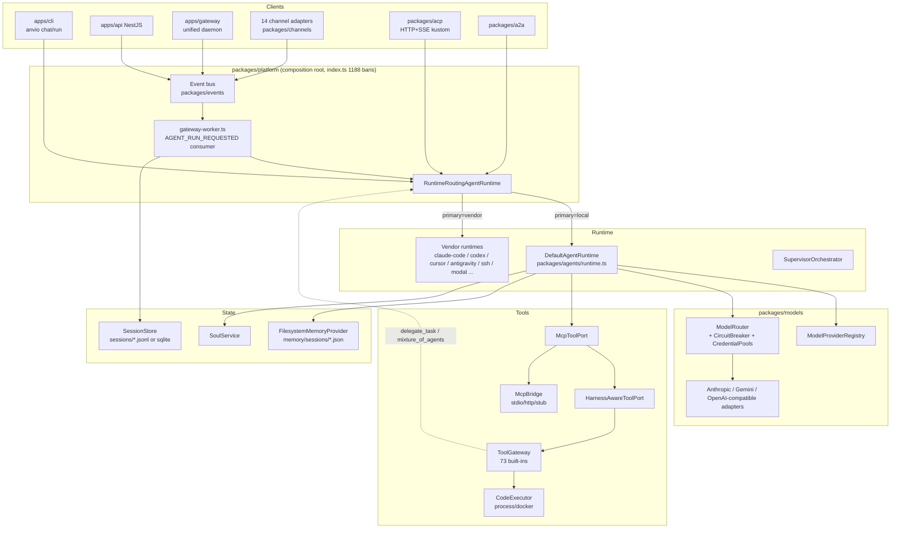
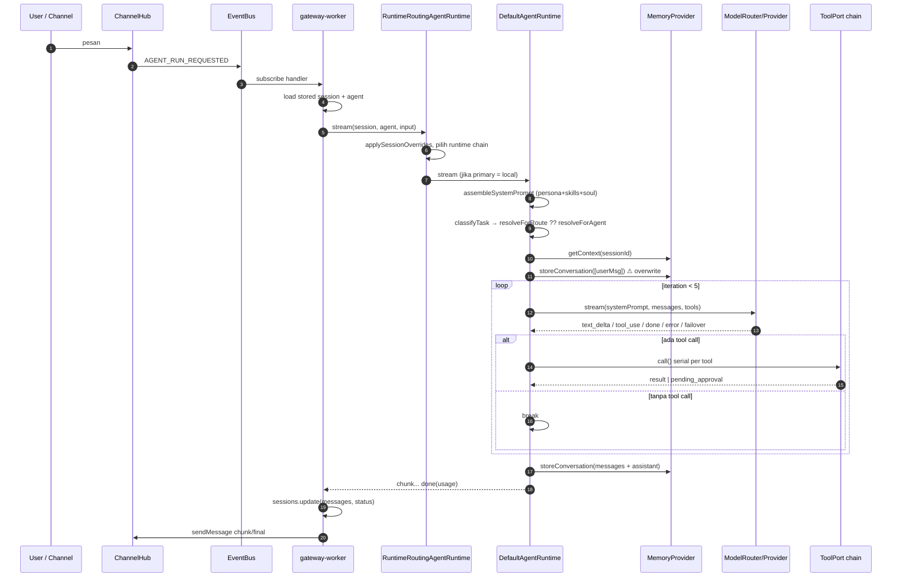

# 01 — Arsitektur Aktual (Codebase-first)

Commit: `952fda3`. Semua rujukan `file:line` relatif terhadap root repo.

## 1. Lapisan & dependency rule

Aturan `apps → platform → packages → core` (CLAUDE.md) **dipatuhi** di jalur yang diaudit: `apps/cli/src/main.ts` memanggil `getPlatform()` dan `platform.runtime`, bukan merakit subsistem sendiri — dengan satu pengecualian: `cmdAcp` (`apps/cli/src/main.ts:1644-1720`) merakit handler sesi ACP sendiri (create session, convert, run) alih-alih memakai layanan di `platform`.

## 2. Diagram komponen

Catatan: tanda panah `TG -.-> RR` adalah rekursi — tool `delegate_task` memanggil `runtime.run` lagi (`packages/platform/src/index.ts:715-729`).

## 3. Runtime bootstrap

`createPlatform` (`packages/platform/src/index.ts`) secara berurutan:

| Langkah                   | Lokasi             | Catatan                                                                                                                                        |
| ------------------------- | ------------------ | ---------------------------------------------------------------------------------------------------------------------------------------------- |
| Memory provider           | `index.ts:147-158` | `maxShortTermMessages` dari `anvio.yaml`; default schema 0 (unlimited)                                                                         |
| Provider map dari env     | `index.ts:165-173` | Bila **tidak ada API key**, _semua_ id provider dipetakan ke mock provider — degradasi diam-diam                                               |
| ToolGateway               | `index.ts:311-367` | Baca `tools/gateway.yaml` atau default YAML (`packages/tools/src/gateway.ts:17-176`); parse error juga jatuh ke default (`gateway.ts:206-211`) |
| MCP gate + port           | `index.ts:402-439` | Selalu dibungkus walau katalog kosong                                                                                                          |
| ModelRouter               | `index.ts:453-458` | Breaker + credential pool (hanya jika `ANVIO_CREDENTIALS_PASSPHRASE`)                                                                          |
| `DefaultAgentRuntime`     | `index.ts:460-485` | `maxToolIterations` **tidak di-set** → default 5                                                                                               |
| Runtime factory + routing | `index.ts:521-553` | Vendor runtime menerima `toolPort` & approval port                                                                                             |

## 4. Jalur eksekusi yang ditrace (User Request → Response)

Ditrace untuk channel gateway (jalur paling lengkap). CLI `anvio chat` dan ACP melewati langkah 1–3 secara berbeda tetapi bertemu di langkah 4.

Verifikasi tiap transisi:

| Transisi                   | Bukti                                                                                          | Status                                                                    |
| -------------------------- | ---------------------------------------------------------------------------------------------- | ------------------------------------------------------------------------- |
| Request handling           | `gateway-worker.ts:153-200` (subscribe `AGENT_RUN_REQUESTED`)                                  | Implemented                                                               |
| Session resolution         | worker: `workspace.sessions.get`; ACP: `main.ts:1659-1672` membuat sesi baru bila id tidak ada | Implemented (tanpa validasi kepemilikan)                                  |
| Context construction       | `runtime.ts:128` + `runtime.ts:189-190`                                                        | Partial — hanya `shortTerm` dipakai, `longTerm`/recall dibuang (probe P6) |
| Model selection            | `runtime.ts:163-166`                                                                           | Partial — bug override (probe P3)                                         |
| LLM invocation             | `runtime.ts:221-236`                                                                           | Implemented (tanpa `signal`)                                              |
| Reasoning / tool decision  | Model-driven; parsing `runtime.ts:248-259` dan `tool-loop.ts:30`                               | Implemented                                                               |
| Tool execution             | `native-tool-loop.ts:14-39`, `tool-loop.ts:36-57`                                              | Implemented, serial                                                       |
| Result processing          | `formatToolResultMessage`, truncation 8000 char (`tool-loop.ts:4`)                             | Implemented                                                               |
| Context update             | `runtime.ts:322-328`, `360-361`                                                                | Implemented (in-memory per turn)                                          |
| Continuation / termination | `runtime.ts:201`, `292-295`, `355-358`, `364-366`                                              | Partial — exhaustion diam (probe P1)                                      |
| Response                   | `runtime.ts:368-374`; worker `gateway-worker.ts:286-300`                                       | Implemented                                                               |

## 5. Dua sumber kebenaran untuk history

| Store                                                     | Ditulis oleh                                          | Dibaca oleh                                                  |
| --------------------------------------------------------- | ----------------------------------------------------- | ------------------------------------------------------------ |
| `MemoryProvider` short-term (`memory/sessions/<id>.json`) | `DefaultAgentRuntime` (`runtime.ts:191`, `369`)       | `DefaultAgentRuntime` saat membangun prompt                  |
| `SessionStore.messages` (`sessions/*.jsonl` / sqlite)     | `gateway-worker.ts:286-293` (hanya user + final text) | UI, session search, `/fork`, vendor `buildPromptWithHistory` |

Keduanya bisa divergen: memory provider menyimpan tool messages lengkap, session store hanya ringkasan user/assistant; pada jalur error, memory provider dipotong (probe P5) sementara session store tidak.

## 6. Subsistem yang diinspeksi dan statusnya

| Subsistem                 | Lokasi utama                                                   | Status                                           |
| ------------------------- | -------------------------------------------------------------- | ------------------------------------------------ |
| Runtime bootstrap         | `packages/platform/src/index.ts`                               | Implemented                                      |
| Agent manager / loader    | `packages/workspace` (loader), `loadAgent` di platform         | Implemented                                      |
| Agent execution engine    | `packages/agents/src/runtime.ts`                               | Partial (lihat [02](02-agent-brain-and-loop.md)) |
| Session manager           | `packages/workspace` session store + `gateway-worker.ts`       | Partial — tanpa lock per-sesi                    |
| Tool registry             | `ToolGateway` (YAML global) + MCP catalog                      | Implemented, **global, bukan per-agent**         |
| Tool executor             | `runBuiltinTool` (`packages/tools/src/builtins/index.ts:152`)  | Implemented                                      |
| Model abstraction         | `@anvio/core` `ModelProvider` + `packages/models`              | Implemented                                      |
| Memory                    | `packages/memory`                                              | Partial                                          |
| Event processing          | `packages/events` + worker                                     | Implemented                                      |
| Task scheduler            | `packages/automation` (cron)                                   | Unverified (di luar fokus)                       |
| Multi-agent               | `SupervisorOrchestrator`, `delegate_task`, `mixture_of_agents` | Partial                                          |
| Error handling & recovery | `runtime.ts:270-283`, `375-380`; router failover               | Partial                                          |
