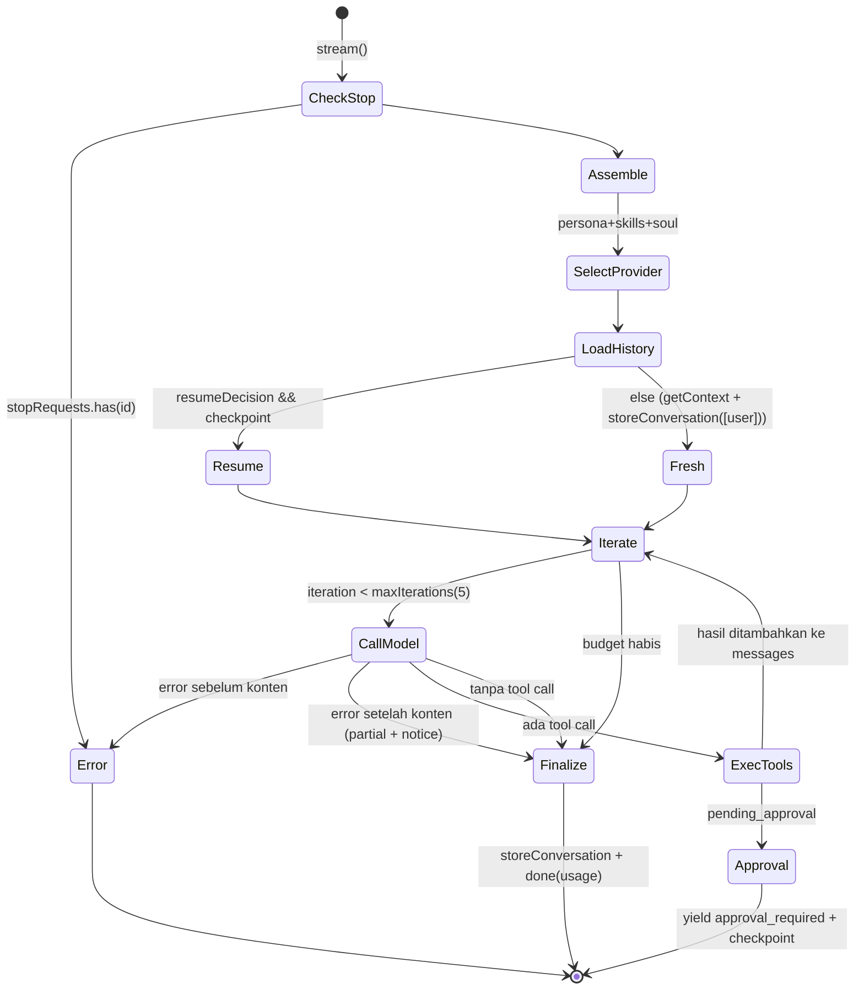

# 02 — Agent Brain & Reasoning Loop

Area prioritas tertinggi. Fokus pada runtime `local` (`DefaultAgentRuntime`). Runtime vendor (Claude Code, Codex, Cursor, Antigravity) menjalankan loop **milik vendor**; Anvio hanya meneruskan prompt dan menerima hasil — loop-nya tidak diaudit di sini karena bukan kode Anvio.

## 1. Anatomi loop

Satu-satunya loop agent milik Anvio: `DefaultAgentRuntime.stream()` di `packages/agents/src/runtime.ts:114-381`.

### Fakta implementasi

| Pertanyaan                           | Jawaban                                                                                                                                 | Bukti                                                                                   | Status                          |
| ------------------------------------ | --------------------------------------------------------------------------------------------------------------------------------------- | --------------------------------------------------------------------------------------- | ------------------------------- |
| Ada loop iteratif nyata?             | Ya                                                                                                                                      | `runtime.ts:201` `for (let iteration = startIteration; iteration < maxIterations; ...)` | Implemented                     |
| Banyak tool call?                    | Ya, per iterasi bisa >1                                                                                                                 | `runtime.ts:220`, `native-tool-loop.ts:14`                                              | Implemented                     |
| Lanjut reasoning setelah hasil tool? | Ya                                                                                                                                      | `runtime.ts:322-328` lalu `continue`                                                    | Implemented                     |
| Tool call dependen (sekuensial)?     | Ya, lintas iterasi, maks 5 ronde                                                                                                        | probe P1                                                                                | Partial                         |
| Eksekusi paralel?                    | **Tidak** — `for ... await` serial                                                                                                      | `native-tool-loop.ts:14-39`, `tool-loop.ts:36-57`; probe P2                             | Missing                         |
| Penentuan selesai?                   | Tidak ada tool call di respons                                                                                                          | `runtime.ts:292-295`, `355-358`                                                         | Implemented (model-driven)      |
| Pencegah infinite loop?              | `maxToolIterations` default **5**                                                                                                       | `tool-loop.ts:68`; platform tidak meng-override (`platform/src/index.ts:460-485`)       | Implemented, sangat konservatif |
| Budget token/waktu?                  | Tidak ada per-run. Ada budget USD opsional di router, **tidak di-wire** di platform (`spendBudget` tidak diberikan, `index.ts:453-458`) | `model-router.ts:328`                                                                   | Configured Only                 |
| Tool gagal?                          | Error diformat ke pesan tool dan model melanjutkan                                                                                      | `formatToolResultMessage(..., result.error)` `native-tool-loop.ts:35`                   | Implemented                     |
| Recovery dari aksi gagal?            | Hanya bila model memutuskan mencoba lagi; tidak ada retry runtime                                                                       | —                                                                                       | Partial (model-driven)          |
| Resume eksekusi terputus?            | Hanya untuk approval (checkpoint), dan hanya di jalur gateway-worker                                                                    | `gateway-worker.ts:245-253`; CLI/ACP tidak menyimpan checkpoint                         | Partial                         |

### Temuan korektness loop (terverifikasi probe)

**F-LOOP-1 — Hasil ronde tool terakhir tidak pernah dilihat model; budget habis diam-diam.** _(P0, confidence tinggi, probe P1)_

- Observasi: pada iterasi ke-5, tool dieksekusi (`runtime.ts:299-328`), lalu loop berakhir karena kondisi `for`. `fullContent` kosong sehingga diisi `stripToolCalls(lastIterationContent)` (`runtime.ts:364-366`). Probe: 5 model call, 5 tool call, event terakhir `done`, tidak ada teks "budget/limit".
- Dampak: efek samping tool ke-5 terjadi tetapi model tidak pernah merangkumnya; user menerima teks iterasi terakhir saja tanpa tahu tugas terpotong. Yang disimpan ke memory (`runtime.ts:371`) hanya teks iterasi terakhir, padahal user melihat seluruh stream dari 5 iterasi — transkrip tersimpan ≠ yang dilihat user.
- Referensi: Hermes — pada 100% budget agent berhenti dan mengembalikan ringkasan, ada budget warning yang diinjeksi sebelum tiap API call; OpenClaw — output-limit saat tool call menyelesaikan tool lalu retry dari hasilnya.
- Expected: setelah budget habis, satu panggilan final **tanpa tools** agar model merangkum, plus notice eksplisit; budget configurable per agent.

**F-LOOP-2 — Approval di tengah batch membuang hasil tool yang sudah dieksekusi.** _(P0, probe P2)_

- Observasi: `executeNativeToolCalls` mengeksekusi call A (sukses, efek samping terjadi), lalu call B mengembalikan `pending_approval`; fungsi return dengan `toolMessages` berisi hasil A, tetapi `runtime.ts:308-320` membangun checkpoint dari `messages` **tanpa** pesan assistant (tool_calls) dan tanpa hasil A. Probe: checkpoint hanya `["user"]`.
- Dampak: saat resume, model tidak tahu A sudah dijalankan → kemungkinan menjalankan A dua kali (non-idempotent: kirim pesan, tulis file, buat issue).
- Expected: checkpoint menyimpan assistant message + hasil tool yang sudah selesai; resume langsung mengeksekusi tool yang disetujui, bukan sekadar menyisipkan teks "Proceed" (`runtime.ts:184-187`) dan berharap model memanggil ulang.

**F-LOOP-3 — Stop flag basi membunuh turn berikutnya.** _(P1, probe P4)_

- `stop()` hanya `stopRequests.add(id)` (`runtime.ts:95-97`). Jika tidak ada run aktif, flag tertinggal dan run berikutnya langsung error "Session stopped by user" (`runtime.ts:115-119`).
- Selain itu stop hanya dicek di antara chunk (`runtime.ts:239`); tidak ada `AbortSignal` di `modelRequest` (`runtime.ts:221-228`) walau provider mendukung `request.signal` (`anthropic.provider.ts:119`, `openai-compatible.provider.ts:152`). Tool yang sedang berjalan tidak dibatalkan.
- `RuntimeRoutingAgentRuntime.stop()` hanya meneruskan ke runtime lokal (`platform/src/runtime-routing-agent-runtime.ts:24-26`) — runtime vendor tidak dapat dihentikan.

**F-LOOP-4 — Turn gagal menghapus history sesi.** _(P0, probe P5)_

- `runtime.ts:191-193` memanggil `storeConversation(session, user, [userMsg])` **di awal** turn. Implementasi `FilesystemMemoryProvider.storeConversation` → `setMessages` (overwrite, `packages/memory/src/provider-factory.ts:98-103`). History lengkap baru ditulis ulang di akhir (`runtime.ts:369-372`). Bila turn berakhir lewat `error` (`runtime.ts:272-275`), `approval_required`, stop, atau exception, file short-term tinggal berisi satu pesan.
- Probe: history 4 pesan + provider error → tersisa `[{"role":"user","content":"turn3"}]`.
- Dampak: satu error provider (HTTP 5xx, rate limit tanpa fallback) menghapus seluruh konteks percakapan sesi itu secara permanen di store yang dipakai prompt. Ini juga terjadi pada setiap approval pause (dipulihkan hanya jika checkpoint dipakai).

## 2. Reasoning & planning

| Kapabilitas                                                                          | Status                | Bukti / catatan                                                                                                                                                                                                                                            |
| ------------------------------------------------------------------------------------ | --------------------- | ---------------------------------------------------------------------------------------------------------------------------------------------------------------------------------------------------------------------------------------------------------- |
| Planning eksplisit                                                                   | Missing di loop lokal | Tidak ada planner/step dalam `runtime.ts`. Tool `todo` ada di gateway (default enabled, `gateway.ts:89-90`) — planning bisa dilakukan model lewat tool.                                                                                                    |
| Plan DAG untuk multi-agent                                                           | Implemented           | `task-planner.ts` (topological sort, cycle detection) dipakai `SupervisorOrchestrator`                                                                                                                                                                     |
| Revisi plan saat eksekusi                                                            | Model-driven saja     | —                                                                                                                                                                                                                                                          |
| Evaluasi hasil tool                                                                  | Model-driven          | Tidak ada verifier/critic                                                                                                                                                                                                                                  |
| Pemisahan reasoning/action/observation                                               | Implisit              | Native mode: `assistant{toolCalls}` + `tool` messages (`runtime.ts:322-327`). Parsed mode: hasil tool dikirim sebagai **role `user`** (`tool-loop.ts:51-56`) — observasi tidak dibedakan dari input user, membuka jalur prompt injection dari output tool. |
| Fitur reasoning model (Anthropic thinking, OpenAI reasoning effort, Gemini thinking) | Missing               | Tidak ada referensi `thinking`/`reasoning` di `packages/models/src` (grep). Tidak ada penanganan blok thinking dalam stream.                                                                                                                               |
| Truncation `max_tokens`                                                              | Implemented           | Notice ditambahkan (`runtime.ts:40-48`, `260-263`), tetapi tidak ada auto-continue                                                                                                                                                                         |

## 3. Agent state

| Pertanyaan                       | Jawaban                                                                  | Bukti                                                                                                                                 |
| -------------------------------- | ------------------------------------------------------------------------ | ------------------------------------------------------------------------------------------------------------------------------------- |
| State eksekusi disimpan di mana? | Variabel lokal di generator (`messages`, `usage`, `iteration`)           | `runtime.ts:176-199`                                                                                                                  |
| Durable?                         | Hanya di akhir turn sukses, dan saat approval (via worker)               | `runtime.ts:369`; `gateway-worker.ts:245-253`                                                                                         |
| Resume setelah restart proses?   | Hanya approval yang sudah di-checkpoint di gateway; run in-flight hilang | —                                                                                                                                     |
| Hasil tool dipersist?            | Ya, di short-term memory di akhir turn (pesan `tool`)                    | `runtime.ts:369-372`                                                                                                                  |
| Checkpoint                       | Hanya `AgentRunCheckpoint` untuk approval                                | `run-checkpoint.ts:3-10`                                                                                                              |
| Lock/serialisasi per sesi        | **Missing**                                                              | Tidak ada mutex di worker (`gateway-worker.ts`); dua pesan cepat di sesi yang sama → dua loop paralel, `setMessages` last-writer-wins |

## 4. Context & memory

| Aspek                       | Status                   | Bukti                                                                                                                                                                                                                                                                                      |
| --------------------------- | ------------------------ | ------------------------------------------------------------------------------------------------------------------------------------------------------------------------------------------------------------------------------------------------------------------------------------------ |
| Short-term context          | Implemented              | `getContext().shortTerm` (`runtime.ts:189-190`) — seluruh history dikirim tiap turn                                                                                                                                                                                                        |
| Long-term persistent memory | Partial                  | Disimpan (`provider-factory.ts:104-111`, 2 pesan terakhir per turn sebagai entry `conversation`). Diinjeksi **hanya** lewat soul: `SoulService` mengambil 20 entry tipe `fact` (`packages/souls/src/index.ts:123`) bila agent punya `soul`.                                                |
| Semantic/keyword retrieval  | Configured but discarded | `getContext` menghitung recall FTS5/keyword (`provider-factory.ts:79-93`) dan mengembalikan `longTerm`, tetapi runtime **hanya memakai `shortTerm`** (`runtime.ts:190`). Probe P6: entry recall tidak muncul di request model. Recall hanya bisa diakses model lewat tool `memory_recall`. |
| Context compaction          | Partial                  | Sliding window berbasis **jumlah pesan** (`provider-factory.ts:114-141`), default `maxShortTermMessages=0` (off). Ringkasan LLM opsional via `SessionSummarizer`.                                                                                                                          |
| Token budget management     | Missing                  | `contextWindow` ada di `model-descriptor.ts:32+` tetapi tidak dibaca oleh `packages/agents`.                                                                                                                                                                                               |
| Tool-result truncation      | Implemented              | 8000 char default, `ANVIO_MAX_TOOL_OUTPUT_CHARS` (`tool-loop.ts:4-11`)                                                                                                                                                                                                                     |
| Overflow handling           | Missing                  | Tidak ada deteksi error context-length dari provider → tidak ada kompaksi+retry                                                                                                                                                                                                            |
| Session isolation           | Partial                  | Memory per `sessionId`; tetapi `delegate_task` membuat sesi dengan `spec.defaultUserId`, bukan user pemanggil (`platform/src/index.ts:717-718`)                                                                                                                                            |
| Memory injection            | Partial                  | Lihat baris long-term di atas                                                                                                                                                                                                                                                              |

Sliding window juga memotong tanpa memperhatikan pasangan `assistant{toolCalls}` ↔ `tool` (`provider-factory.ts:118-121` memotong pada indeks murni). Tail yang dimulai dengan pesan `tool` yatim akan ditolak Anthropic/OpenAI. _(Confidence sedang — dideduksi dari kode, tidak diprobe.)_

## 5. Tabel perbandingan kapabilitas

Referensi: Hermes `bf0203a`, OpenClaw `c2ee4ec`, Orca `2f2a0bc`. Detail sumber di [03](03-framework-comparison.md).

| Capability           | Anvio (current)                                      | Hermes                                                                        | OpenClaw                                                                       | Orca                                     | Gap                        |
| -------------------- | ---------------------------------------------------- | ----------------------------------------------------------------------------- | ------------------------------------------------------------------------------ | ---------------------------------------- | -------------------------- |
| Agent execution loop | Loop ReAct, maks 5 iterasi, single function          | Loop modular (`agent/conversation_loop.py`, turn phases), default 500 iterasi | Loop embedded via `runEmbeddedAgent` dengan session controller, queue, timeout | N/A — menjalankan agent CLI pihak ketiga | High                       |
| Multi-step reasoning | Ya, ≤5 ronde, model-driven                           | Ya, ratusan ronde + budget warning                                            | Ya, dibatasi timeout per attempt (default 48 jam)                              | N/A                                      | High                       |
| Tool continuation    | Ya; ronde terakhir hilang (P1)                       | Ya; ringkasan saat budget habis                                               | Ya; retry dari hasil tool tercatat                                             | N/A                                      | High                       |
| Planning             | Implisit + tool `todo`; DAG hanya untuk orchestrator | Implisit + todo tool                                                          | Implisit                                                                       | N/A                                      | Low (pilihan desain wajar) |
| Context compaction   | Count-based window, default off                      | Token-based (50% window), head/tail protection, tool-output pruning           | Auto-compaction + retry, event `compaction`                                    | N/A                                      | High                       |
| Persistent memory    | File JSON + FTS5 opsional; recall tidak diinjeksi    | MEMORY/USER + provider plugin (Honcho dsb.), FTS5 session recall              | SQLite session store, writer claims                                            | N/A                                      | Medium                     |
| Session recovery     | Wipe pada error (P5); checkpoint approval saja       | SQLite, lineage parent/child, atomic writes                                   | `activeWriterRunId` mencegah run usang commit; persist sebelum run             | Worktree state per agent                 | Critical                   |
| Subagent execution   | Orchestrator DAG + `delegate_task` tanpa depth limit | `delegate_tool.py`, subagent dengan budget sendiri (default 50)               | Agent runtimes plugin                                                          | Paralel agent di worktree                | Medium                     |
| Error recovery       | Failover pra-chunk; partial answer dipertahankan     | Fallback provider 429/5xx/401 + credential refresh                            | Retry budget, fallback setelah attempt settle                                  | N/A                                      | Medium                     |
| Execution budgets    | 5 iterasi; budget USD tidak di-wire                  | Iterasi + warning                                                             | Timeout per attempt, idle 120s/300s                                            | N/A                                      | High                       |

## 6. Kesimpulan: agent runtime otonom atau LLM wrapper?

**Kesimpulan: Anvio memiliki agent runtime nyata tetapi minimal — "tool-calling loop dengan batas sempit", bukan runtime otonom untuk tugas panjang.**

Bukti bahwa ini _bukan_ sekadar wrapper:

- Loop multi-iterasi dengan umpan balik hasil tool ke model (`runtime.ts:201-362`), terverifikasi oleh probe P1 (5 ronde model↔tool).
- Dua format tool call (native & fenced) dengan normalisasi.
- Approval pause/resume dengan checkpoint.
- Failover provider sebelum chunk pertama dan penyelamatan jawaban parsial.

Bukti bahwa ini _belum_ runtime otonom yang robust:

- Budget 5 iterasi tanpa warning dan tanpa langkah penutup (P1).
- Tidak ada manajemen context berbasis token, tidak ada overflow recovery.
- State hanya in-memory selama turn; error menghapus history (P5).
- Tidak ada paralelisme, timeout, atau pembatalan I/O.
- Planning, verifikasi, dan recovery sepenuhnya diserahkan ke model.

Untuk tugas multi-langkah yang serius, desain Anvio saat ini secara de facto mengandalkan **runtime vendor** (Claude Code SDK / Codex) sebagai "otak" — ini konsisten dengan dokumen ADR-0009 dan fitur vendor runtime yang jauh lebih banyak kodenya (`packages/runtimes`, 3246 baris) dibanding `packages/agents` (1100 baris). Itu adalah tradeoff yang sah, tetapi harus dinyatakan eksplisit, dan runtime `local` harus tetap benar (P0 di atas) karena ia adalah default dan fallback terakhir.
