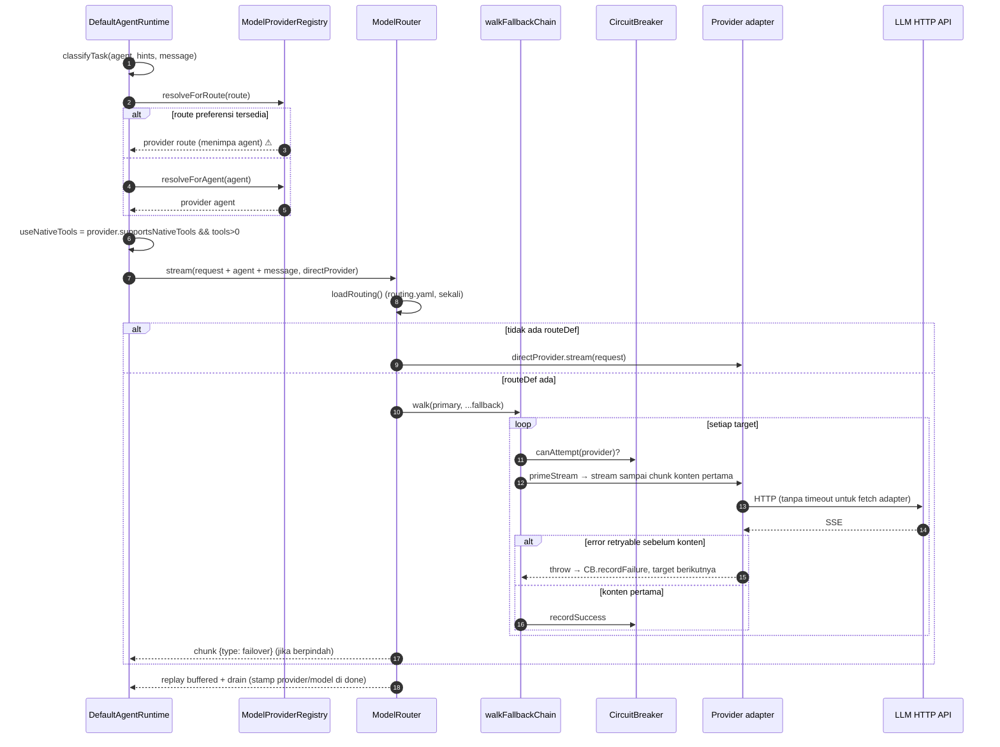

# 04 — Model Integration Audit

## 1. Kontrak abstraksi

`ModelProvider` (`@anvio/core`) — dipakai oleh semua adapter:

| Member                 | Peran                                                                                                                                       |
| ---------------------- | ------------------------------------------------------------------------------------------------------------------------------------------- |
| `providerId`           | id registry                                                                                                                                 |
| `supportsNativeTools?` | menentukan native `tools` vs instruksi fenced-block                                                                                         |
| `chat(ChatRequest)`    | non-streaming                                                                                                                               |
| `stream(ChatRequest)`  | `AsyncIterable<StreamChunk>`: `text_delta`, `tool_use`, `done{usage,toolCalls,finishReason,provider,model}`, `error{retryable}`, `failover` |

`ChatRequest` membawa `systemPrompt`, `messages`, `model`, `maxTokens`, `temperature`, `tools`, `signal`. **Tidak ada** field untuk reasoning/thinking, `response_format`/JSON schema, `tool_choice`, `parallel_tool_calls`, atau parameter khusus provider.

## 2. Adapter yang ada

| Adapter           | File                                                  | Client                                   | Catatan                                                                                                                                                                                                                                                                                                                              |
| ----------------- | ----------------------------------------------------- | ---------------------------------------- | ------------------------------------------------------------------------------------------------------------------------------------------------------------------------------------------------------------------------------------------------------------------------------------------------------------------------------------ |
| Anthropic         | `packages/models/src/providers/anthropic.provider.ts` | SDK resmi `@anthropic-ai/sdk`            | Prompt caching default on (`:96-99`); `signal` diteruskan (`:119`, `:152`); retry/timeout = default SDK (tidak dikonfigurasi)                                                                                                                                                                                                        |
| Gemini            | `providers/gemini.provider.ts`                        | `fetch` REST + SSE                       | **API key di query string** (`:235` `?key=...`) — bocor ke log proxy/URL; safety block → non-retryable (`:157-161`)                                                                                                                                                                                                                  |
| OpenAI-compatible | `providers/openai-compatible.provider.ts`             | `fetch` generik                          | Akumulasi tool_call delta per `index` (stream `:100-105` relatif blok stream) → mendukung multiple tool calls; deteksi stream terpotong tanpa `[DONE]` sebagai retryable; `stream_options.include_usage`; clamp `maxOutputTokens`; **tanpa timeout** — `post()` hanya memakai `request.signal`, yang tidak pernah diisi oleh runtime |
| Custom            | `provider-factory.ts:94-105`                          | OpenAI-compatible dengan `baseUrl` wajib | via frontmatter `provider: custom` / `baseUrl` / `apiKeyEnv`                                                                                                                                                                                                                                                                         |
| Mock              | `createMockModelProvider`                             | —                                        | Dipakai otomatis untuk **semua** id provider bila tidak ada API key (`platform/src/index.ts:165-173`)                                                                                                                                                                                                                                |

Katalog OpenAI-compatible (`provider-catalog.ts`): openai, openrouter, deepseek, groq, mistral, together, xai, fireworks, moonshot, cerebras, sambanova, perplexity (`supportsNativeTools: false`), cohere, huggingface, ollama.

## 3. Model integration matrix

"Executable" = jalur kode dari registry ke HTTP ada dan diuji unit (mock HTTP), **bukan** diuji terhadap API berbayar (tidak dilakukan tanpa izin).

| Provider                                                                                                        | Configured                           | Executable                           | Streaming       | Tool Calling                                            | Reasoning                                   | Fallback                                                                       |
| --------------------------------------------------------------------------------------------------------------- | ------------------------------------ | ------------------------------------ | --------------- | ------------------------------------------------------- | ------------------------------------------- | ------------------------------------------------------------------------------ |
| Anthropic                                                                                                       | Env `ANTHROPIC_API_KEY`              | Ya (unit)                            | Ya (SDK stream) | Native                                                  | Missing (thinking tidak dikirim/diparse)    | Via routing.yaml                                                               |
| Gemini                                                                                                          | `GEMINI_API_KEY`/`GOOGLE_API_KEY`    | Ya (unit, `gemini-messages.spec.ts`) | Ya (SSE)        | Native                                                  | Missing                                     | Via routing.yaml                                                               |
| OpenAI                                                                                                          | env catalog                          | Ya (unit, `openai-messages.spec.ts`) | Ya              | Native                                                  | Missing (`reasoning_effort` tidak didukung) | Via routing.yaml                                                               |
| OpenRouter                                                                                                      | env                                  | Ya (generik)                         | Ya              | Native                                                  | Missing                                     | Ya                                                                             |
| DeepSeek / Groq / Mistral / Together / xAI / Fireworks / Moonshot / Cerebras / SambaNova / Cohere / HuggingFace | env                                  | Generik, tidak diuji per-provider    | Ya              | Native (asumsi `supportsNativeTools ?? true`)           | Missing                                     | Ya                                                                             |
| Perplexity                                                                                                      | env                                  | Generik                              | Ya              | **Fenced-block** (native off)                           | Missing                                     | Ya                                                                             |
| Ollama                                                                                                          | `OLLAMA_BASE_URL` / `OLLAMA_ENABLED` | Generik                              | Ya              | Native diasumsikan — banyak model lokal tidak mendukung | Missing                                     | Ya                                                                             |
| Custom                                                                                                          | frontmatter                          | Ya                                   | Ya              | Native diasumsikan                                      | Missing                                     | Tidak lewat registry utama (dibuat ad hoc, `model-provider-registry.ts:35-42`) |
| Vendor runtimes (Claude Code, Codex, Cursor, Antigravity)                                                       | OAuth `setup-token`                  | Ya (CLI/SDK vendor)                  | Bervariasi      | Loop vendor                                             | Vendor                                      | Runtime fallback chain (`runtimes`)                                            |

## 4. Penanganan kapabilitas model

| Kapabilitas                     | Status                                                    | Mekanisme                                                                                                                                                                |
| ------------------------------- | --------------------------------------------------------- | ------------------------------------------------------------------------------------------------------------------------------------------------------------------------ |
| Tool-calling vs non-tool        | Partial                                                   | Flag boolean per **provider**, bukan per **model** (`supportsNativeTools`). Model tanpa tool calling pada provider "native" akan menerima `tools` dan kemungkinan error. |
| Reasoning models                | Missing                                                   | Tidak ada field/handling.                                                                                                                                                |
| Text-only vs multimodal         | Missing di loop                                           | `ChatMessage.content` string; tool `vision_analyze` terpisah.                                                                                                            |
| Structured output / JSON schema | Missing                                                   | Learning memakai parsing JSON dari teks (`packages/learning/src/llm-json.ts`).                                                                                           |
| Streaming                       | Implemented                                               | Semua adapter.                                                                                                                                                           |
| Parallel tool calls             | Parse: Implemented; eksekusi: Missing (serial di runtime) | —                                                                                                                                                                        |
| Provider-specific params        | Missing                                                   | Hanya `maxTokens`, `temperature`.                                                                                                                                        |
| Token usage accounting          | Implemented                                               | `usage` di `done`, termasuk cache tokens (`model-router.ts:329-331`), metrics emitter.                                                                                   |
| Context-window limits           | Configured Only                                           | `model-descriptor.ts` punya `contextWindow` untuk ±10 model, tidak dipakai runtime.                                                                                      |

Kesimpulan: kapabilitas **diasumsikan** (flag per-provider), tidak diregistrasi per-model dan tidak didiscover.

## 5. Model routing

### 5.1 Tiga mekanisme pemilihan yang tumpang tindih

1. `ModelProviderRegistry.resolveForAgent(agent)` — provider dari frontmatter (`model-provider-registry.ts:33-44`).
2. `ModelProviderRegistry.resolveForRoute(route)` — preferensi hardcoded per route (`:7-13`, `:47-55`), route dari `classifyTask` yang memakai regex pada pesan (`task-classifier.ts:27-30`: `implement|refactor|fix bug|code`, `review|audit|pr`, `research|analyze|investigate`).
3. `ModelRouter` — `providers/routing.yaml` dengan primary + fallback + breaker (`model-router.ts`).

Di runtime: `const modelProvider = routeProvider ?? resolveForAgent(agent)` (`agents/src/runtime.ts:165-166`). Route (2) **menang** atas konfigurasi agent (1).

**F-MODEL-1 (P0, probe P3):** agent `provider: anthropic, model: claude-x`, pesan "please implement a parser", kunci OpenAI tersedia → provider `openai` dipanggil dengan `model: "claude-x"`. Hasil nyata di produksi: HTTP 404/400 "model not found" atau, lebih buruk, model lain yang tidak diminta. Pemicu hanya kata "code"/"review"/"pr"/"analyze" di pesan pengguna — kata yang sangat umum. Satu-satunya cara menghindarinya adalah `model.routing: default` di frontmatter (karena `resolveForRoute('default')` → undefined).

**F-MODEL-2 (P1):** `ModelRouter.chat()` menghormati `agent.spec.model.override` (`model-router.ts:99-119`); `ModelRouter.stream()` — jalur yang dipakai runtime — **tidak** (`:187-245`). Perilaku berbeda antara jalur chat (learning, probe) dan jalur agent.

**F-MODEL-3 (P1):** keputusan `useNativeTools` dihitung dari provider awal (`runtime.ts:167-170`). Bila router failover ke target lain (mis. Perplexity, native off), request tetap membawa `tools` native dan system prompt tidak berisi instruksi fenced-block → tool calling gagal diam-diam setelah failover.

**F-MODEL-4 (P2):** bila `routing.yaml` ada tetapi route tidak terdefinisi, router memakai `routes.coding` sebagai fallback untuk _semua_ route (`model-router.ts:129`, `:201`).

### 5.2 Ringkasan kapabilitas routing

| Fitur                     | Status                                                    | Bukti                                                                                            |
| ------------------------- | --------------------------------------------------------- | ------------------------------------------------------------------------------------------------ |
| Default model             | Implemented                                               | frontmatter `model.model` wajib (`core/src/schemas/agent.schema.ts:7`)                           |
| Per agent                 | Implemented (tapi dapat ditimpa, F-MODEL-1)               | —                                                                                                |
| Per sesi                  | Implemented                                               | `/provider`, `/model` overrides (`applySessionOverrides`, `runtime-routing-agent-runtime.ts:32`) |
| Dynamic switching mid-run | Missing                                                   | —                                                                                                |
| Task-based routing        | Implemented (regex)                                       | `task-classifier.ts`                                                                             |
| Fallback providers        | Implemented                                               | `fallback-chain.ts:24-70`                                                                        |
| Failover                  | Implemented, pre-first-chunk                              | `model-router.ts:256-288`; teruji `model-router-stream.spec.ts`                                  |
| Availability check        | Partial                                                   | Circuit breaker (`circuit-breaker.ts`), tanpa health probe aktif                                 |
| Rate limit handling       | Partial                                                   | Klasifikasi 429 retryable → failover; tanpa backoff/retry ke provider yang sama                  |
| Cost-aware routing        | Missing (hanya budget cap, dan tidak di-wire di platform) | `spend-budget.ts`; `platform/src/index.ts:453-458` tanpa `spendBudget`                           |
| Latency-aware routing     | Missing                                                   | —                                                                                                |

Breaker hanya mencatat kegagalan yang terjadi saat priming (`fallback-chain.ts:51-58`); kegagalan setelah chunk pertama tidak memengaruhi status circuit.

## 6. Kualitas integrasi

| Pola                                      | Ada?                                                                                                                         |
| ----------------------------------------- | ---------------------------------------------------------------------------------------------------------------------------- |
| Unified provider abstraction              | Ya (`ModelProvider`)                                                                                                         |
| Provider-specific adapters                | Ya (3)                                                                                                                       |
| Direct provider SDK calls dari agent core | Tidak (bagus)                                                                                                                |
| Hardcoded model behavior                  | Ya — route preference hardcoded, `TRUNCATED_FINISH_REASONS` di runtime (`runtime.ts:40`), `supportsNativeTools` per provider |
| Shared capability normalization           | Partial — stream chunk dinormalisasi; kapabilitas tidak                                                                      |

**Biaya menambah provider baru:** provider OpenAI-compatible = 1 entri katalog (rendah, tanpa sentuh agent core). Provider non-OpenAI (mis. Bedrock, Vertex Anthropic, OpenAI Responses API) = adapter baru + entri factory; agent core tidak berubah. Menambah _kapabilitas_ (reasoning, structured output) = ubah `ChatRequest` di core + semua adapter + runtime — **kopling sedang**.

## 7. Sequence diagram: invokasi model aktual

## 8. Kopling runtime ↔ provider

1. `runtime.ts:40` — daftar finish reason (`max_tokens`, `length`) di runtime, bukan di adapter.
2. `runtime.ts:165-170` — runtime membuat keputusan provider dan kapabilitas sendiri, lalu router mungkin mengganti provider tanpa runtime tahu (F-MODEL-3).
3. `platform/src/index.ts:165-176` — "mock untuk semua provider bila tak ada key" menyembunyikan salah konfigurasi di produksi.
4. Pemisahan auth model API key vs OAuth runtime (CLAUDE.md, ADR-0009) **dipatuhi** di kode yang diaudit: `ANTHROPIC_API_KEY` hanya dibaca di `provider-factory.ts:133`; runtime claude-code memakai OAuth payload (`platform/src/index.ts:533-543`).
