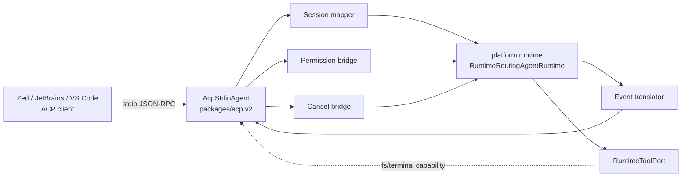

# 05 — ACP (Agent Client Protocol) Compatibility

## 1. Spesifikasi yang dipakai sebagai acuan

| Item                   | Nilai terverifikasi                                                                                                                                                                                                             |
| ---------------------- | ------------------------------------------------------------------------------------------------------------------------------------------------------------------------------------------------------------------------------- |
| Protokol               | Agent Client Protocol — `agentclientprotocol.com` (diinisiasi Zed Industries). **Bukan** IBM/BeeAI "Agent Communication Protocol", dan bukan MCP.                                                                               |
| Repo spec              | `agentclientprotocol/agent-client-protocol@bd8f1af8e8b7`                                                                                                                                                                        |
| SDK TypeScript         | `@agentclientprotocol/sdk@2.0.1` (npm); paket lama `@zed-industries/agent-client-protocol@0.4.5`                                                                                                                                |
| `protocolVersion`      | `1` (integer MAJOR)                                                                                                                                                                                                             |
| Format pesan           | JSON-RPC 2.0 (methods + notifications), UTF-8                                                                                                                                                                                   |
| Transport              | **stdio**: client men-spawn agent sebagai subprocess, pesan newline-delimited di stdin/stdout, stderr untuk log. Streamable HTTP masih draft. Custom transport diizinkan bila mempertahankan format JSON-RPC dan lifecycle ACP. |
| Method agent wajib     | `initialize`, `authenticate`, `session/new`, `session/prompt`                                                                                                                                                                   |
| Method agent opsional  | `session/load` (cap `loadSession`), `session/set_mode`, `logout`                                                                                                                                                                |
| Notifikasi             | `session/cancel` (client→agent), `session/update` (agent→client)                                                                                                                                                                |
| Method client wajib    | `session/request_permission`                                                                                                                                                                                                    |
| Method client opsional | `fs/read_text_file`, `fs/write_text_file`, `terminal/create                                                                                                                                                                     | output | release | wait_for_exit | kill`, `elicitation/create` |
| Negosiasi versi        | Client kirim versi terbaru; agent balas versi sama bila didukung, jika tidak versi terbaru miliknya; client menutup koneksi bila tidak cocok                                                                                    |
| Capability agent       | `loadSession`, `promptCapabilities{image,audio,embeddedContext}`, `mcpCapabilities{http,sse}`, `auth`, `agentInfo`, `authMethods`                                                                                               |

## 2. Implementasi Anvio

| Komponen    | Lokasi                                                     | Perilaku                                                                                                         |
| ----------- | ---------------------------------------------------------- | ---------------------------------------------------------------------------------------------------------------- |
| Server      | `packages/acp/src/acp-server.ts:12-128`                    | `node:http` server: `GET /health`, `POST /prompt` (JSON), `POST /prompt/stream` (SSE `data: {...}`), lainnya 404 |
| Tipe pesan  | `packages/acp/src/protocol/messages.ts`                    | `{agent, message, userId?, sessionId?}` → `{sessionId, content, status}`; health `protocol: 'anvio-acp/v1'`      |
| Entry point | `apps/cli/src/main.ts:1644-1720` (`anvio acp serve`)       | Membuat/memuat sesi lalu `platform.runtime.run/stream`                                                           |
| Config      | `packages/core/src/schemas/workspace.schema.ts:216`        | default `{enabled:false, port:8765, host:'127.0.0.1'}`                                                           |
| Konsumen    | `packages/runtimes/src/cursor/cursor-runtime.ts:51-200`    | Runtime "cursor" memanggil endpoint ini via HTTP bila `acpEndpoint` di-set                                       |
| Test        | `tests/integration/acp.integration.spec.ts` (3 test, PASS) | Menguji `/health`, `/prompt`, stop — **API kustom**, bukan spec ACP                                              |

## 3. Klasifikasi

**Not Compatible — Adapter Required.**

Probe P8: `POST /` dengan `{"jsonrpc":"2.0","id":0,"method":"initialize","params":{"protocolVersion":1,...}}` → `404 {"error":"Not found"}`. Tidak ada jalur stdio sama sekali.

| Dimensi                                       | Penilaian                                                                                                                                             |
| --------------------------------------------- | ----------------------------------------------------------------------------------------------------------------------------------------------------- |
| Protocol compatibility                        | **Tidak ada.** Tidak ada JSON-RPC, stdio, `initialize`, versi negosiasi, `session/*`.                                                                 |
| Functional interoperability                   | **Nol** dengan Zed / JetBrains / VS Code ACP client / `acp` CLI; semua gagal di handshake. Interop hanya dengan runtime `cursor` milik Anvio sendiri. |
| Production readiness (API kustom itu sendiri) | Rendah: tanpa autentikasi, `sessionId` arbitrer diterima, status stream di-hardcode `completed`, approval diabaikan.                                  |

## 4. Protocol compliance per item

| Item                                                                                | Status           | Bukti                                                                                                              |
| ----------------------------------------------------------------------------------- | ---------------- | ------------------------------------------------------------------------------------------------------------------ |
| Entry point agent ACP (stdio subprocess)                                            | Missing          | Hanya `http.createServer` (`acp-server.ts:41`)                                                                     |
| Transport                                                                           | Mismatch         | HTTP+SSE kustom                                                                                                    |
| JSON-RPC handling                                                                   | Missing          | Body JSON bebas (`acp-server.ts:138-152`)                                                                          |
| `initialize` + negosiasi versi                                                      | Missing          | —                                                                                                                  |
| Capability advertisement                                                            | Missing          | `/health` hanya `{status, version:'1.0.0', protocol}`                                                              |
| `authenticate`                                                                      | Missing          | Tidak ada auth apa pun                                                                                             |
| `session/new`                                                                       | Mismatch         | Implisit di `/prompt` bila `sessionId` tidak ditemukan (`main.ts:1659-1672`)                                       |
| `session/load` (replay history via `session/update`)                                | Missing          | —                                                                                                                  |
| `session/prompt` + stop reason                                                      | Mismatch         | `status: 'completed'` di-hardcode untuk stream (`main.ts:1700`) bahkan setelah event `error`                       |
| `session/cancel`                                                                    | Missing          | Tidak ada endpoint; disconnect klien tidak menghentikan run                                                        |
| `session/update` streaming (agent_message_chunk, tool_call, tool_call_update, plan) | Partial-mismatch | Hanya `chunk` teks; event `progress`, tool, dan `approval_required` dari runtime **dibuang** (`main.ts:1694-1699`) |
| Representasi tool call & progress                                                   | Missing          | —                                                                                                                  |
| `session/request_permission`                                                        | Missing          | Approval runtime tidak diteruskan; run berhenti dengan konten kosong tanpa memberi tahu klien                      |
| `fs/*`, `terminal/*` capabilities klien                                             | Missing          | Tool Anvio memakai FS host langsung                                                                                |
| MCP server yang dikirim klien di `session/new` (`mcpServers`)                       | Missing          | —                                                                                                                  |
| Error response (JSON-RPC error object)                                              | Mismatch         | HTTP 500 `{error}`                                                                                                 |
| Connection termination                                                              | Partial          | `stop()` menutup server; run in-flight tidak dibatalkan                                                            |
| Concurrent sessions                                                                 | Partial          | HTTP concurrent, tetapi tanpa lock per-sesi (lihat [08](08-runtime-security-reliability.md))                       |

## 5. Masalah tambahan pada implementasi saat ini

1. **Loop rekursif potensial**: platform mengisi `acpEndpoint` untuk runtime cursor bila `spec.acp.enabled` (`platform/src/index.ts:527-529`). Runtime cursor lalu memanggil `POST /prompt` di server ACP Anvio sendiri, yang memanggil `platform.runtime.run` lagi. Bila agent ber-runtime `cursor`, request kembali ke runtime cursor → loop tanpa batas. Bergantung konfigurasi; confidence sedang (dideduksi dari kode, tidak dieksekusi).
2. **Tanpa autentikasi + `sessionId` arbitrer**: siapa pun yang mencapai port dapat menjalankan agent dengan tool workspace dan melanjutkan sesi orang lain bila tahu id-nya (probe P8 menerima `sessionId: "someone-elses-session"`). Default bind `127.0.0.1` mengurangi eksposur, tetapi browser lokal (CSRF ke localhost — `Content-Type: application/json` memicu preflight, namun `text/plain` tidak; `readJson` tidak mengecek content-type) tetap vektor.
3. **Nama menyesatkan**: health melaporkan `protocol: 'anvio-acp/v1'` dan dokumentasi `docs/39-editor-integration.md` menyebut integrasi editor; pengguna wajar mengira ini Agent Client Protocol.

## 6. Komponen adapter yang dibutuhkan

| Komponen                                  | Tanggung jawab                                                                                                                                        |
| ----------------------------------------- | ----------------------------------------------------------------------------------------------------------------------------------------------------- |
| `AcpStdioAgent` (entry `anvio acp stdio`) | Pakai `@agentclientprotocol/sdk` `AgentSideConnection` di atas stdin/stdout; semua log ke stderr                                                      |
| Session mapper                            | `session/new` → `workspace.sessions.create` (+ `cwd`, `mcpServers` dari klien); `session/load` → replay pesan dari session store via `session/update` |
| Event translator                          | `progress`/`chunk`/tool events runtime → `session/update` (`agent_message_chunk`, `tool_call`, `tool_call_update`, `plan`)                            |
| Permission bridge                         | `approval_required` → `session/request_permission` → `ApprovalDecision` → `runtime.resume`                                                            |
| Cancellation bridge                       | `session/cancel` → `runtime.stop(sessionId)` + `AbortController` (memerlukan perbaikan F-LOOP-3) → stop reason `cancelled`                            |
| Client capability tool port (opsional)    | Bila klien mengiklankan `fs`/`terminal`, rutekan `file_read`/`edit_file`/`run_shell` ke klien (editor) alih-alih host                                 |
| Auth                                      | `authMethods: []` untuk lokal, atau map ke setup-token bila runtime vendor                                                                            |

## 7. Arsitektur integrasi yang direkomendasikan

Prinsip: adapter **tidak** menduplikasi logika agent; ia hanya menerjemahkan protokol ke port yang sudah ada (`AgentRuntime.stream/resume/stop`, `RuntimeToolPort`). API HTTP kustom yang ada sebaiknya di-rename (mis. `editor-bridge`) atau dipertahankan di belakang flag dengan token auth.

## 8. Rencana test kompatibilitas

| #   | Test                 | Metode                                                                | Kriteria lulus                                                                                    |
| --- | -------------------- | --------------------------------------------------------------------- | ------------------------------------------------------------------------------------------------- |
| A1  | Handshake            | Spawn `anvio acp stdio`, kirim `initialize{protocolVersion:1}`        | Respons `protocolVersion:1`, `agentCapabilities`, `agentInfo`; stdout hanya JSON-RPC valid        |
| A2  | Versi tidak didukung | `initialize{protocolVersion:99}`                                      | Balas versi terbaru yang didukung (1)                                                             |
| A3  | Session baru         | `session/new{cwd, mcpServers:[]}`                                     | `sessionId` dikembalikan; sesi tercipta di store                                                  |
| A4  | Prompt streaming     | `session/prompt` teks                                                 | ≥1 `session/update agent_message_chunk`, respons `stopReason: end_turn`                           |
| A5  | Tool call events     | Prompt yang memicu tool                                               | `tool_call` (pending→in_progress→completed) dengan `toolCallId` konsisten                         |
| A6  | Permission           | Prompt memicu approval                                                | Agent memanggil `session/request_permission`; `reject` → tool tidak jalan; `allow` → jalan sekali |
| A7  | Cancel               | `session/cancel` saat streaming                                       | Respons prompt `stopReason: cancelled`; HTTP ke provider dibatalkan; tidak ada tool baru dimulai  |
| A8  | Load                 | `session/load`                                                        | History direplay via `session/update` sebelum respons                                             |
| A9  | Error                | Method tak dikenal                                                    | JSON-RPC error `-32601`                                                                           |
| A10 | Concurrent           | Dua sesi paralel                                                      | Output tidak bercampur                                                                            |
| A11 | Interop nyata        | Zed (custom agent server) + `@agentclientprotocol/sdk` example client | Sesi end-to-end berhasil                                                                          |
