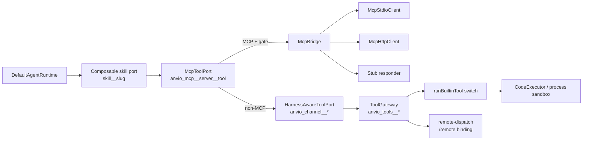

# 06 — MCP & Tool Execution

## 1. Rantai tool port

Urutan pembungkus (`packages/platform/src/index.ts:420-431`), dari luar ke dalam:

Satu `RuntimeToolPort` dipakai bersama oleh runtime lokal **dan** runtime vendor (`runtimeToolPort: toolPort`, `platform/src/index.ts:525`) — jadi ACP adapter di masa depan juga dapat memakainya tanpa duplikasi logika.

## 2. MCP

### 2.1 Client

| Aspek                                 | Status                     | Bukti                                                                                                                                                                    |
| ------------------------------------- | -------------------------- | ------------------------------------------------------------------------------------------------------------------------------------------------------------------------ |
| MCP client stdio                      | Implemented                | `mcp-stdio-client.ts`; `initialize` dengan `protocolVersion: '2024-11-05'` (`:96-97`)                                                                                    |
| MCP client Streamable HTTP            | Implemented                | `mcp-http-client.ts`; fallback ke legacy `2024-11-05` bila initialize ditolak (`:96-111`), timeout 30 s (`:23`)                                                          |
| MCP server (Anvio sebagai server MCP) | Unverified / di luar fokus | Tidak ditemukan di jalur yang diaudit                                                                                                                                    |
| Discovery (`tools/list`)              | Implemented                | `mcp-bridge.ts:46-54`, katalog dimuat saat boot + `reloadMcpCatalog` (ADR-0036)                                                                                          |
| Dynamic loading                       | Implemented                | `mcp_manage` + `McpToolPort.setCatalog` (`mcp-tool-port.ts:68-71`)                                                                                                       |
| Allow-list per server                 | Implemented                | `allowedTools` (`mcp-tool-port.ts:154`)                                                                                                                                  |
| First-call approval per sesi          | Implemented                | `McpFirstCallGate` + persist ke `session.metadata.mcpApprovedTools`; approve via `onApproval` (`platform/src/index.ts:270-274`) dan worker (`gateway-worker.ts:128-130`) |

### 2.2 Temuan MCP

**F-MCP-1 — `inputSchema` server MCP dibuang.** _(P1, confidence tinggi, code-read)_

- `McpToolDescriptor` hanya `{name, description}` (`mcp-bridge.ts:23-26`); `tryListStdioTools` memetakan hanya dua field (`:155-158`); `loadMcpToolCatalog` menulis schema generik `{type:'object', properties:{}, additionalProperties:true}` (`mcp-tool-port.ts:159-167`).
- Dampak: model tidak tahu argumen apa yang wajib → tebakan argumen, error berulang, pemborosan iterasi (yang hanya 5). Referensi: OpenClaw memvalidasi argumen terhadap schema sebelum dispatch.

**F-MCP-2 — `isError` hilang pada hasil satu-teks.** _(P1, probe P7)_

- `unwrapCallToolResult` (`mcp-stdio-client.ts:20-35`) mengembalikan string/JSON polos bila ada tepat satu part teks, membuang `isError`. `tryCallStdioTool` lalu menandai `status: 'completed'` (`mcp-bridge.ts:190-197`). Probe: `{content:[{type:'text',text:'permission denied'}], isError:true}` → `"permission denied"`.
- Dampak: kegagalan tool MCP dilaporkan ke model, event `onToolCompleted`, dan learning loop sebagai **sukses**.

**F-MCP-3 — Stub transport memalsukan keberhasilan.** _(P2)_

- Bila `transport: stub` atau `ANVIO_MCP_STUB=1`, `callTool` mengembalikan `{ok:true, message:'[MCP stub] ... executed'}` dengan `status: 'completed'` (`mcp-bridge.ts:80-93`). Bila stdio gagal `listTools`, katalog diisi tool stub (`create_issue` dsb., `:50-53`, `:229-235`).
- Dampak: agent dapat "membuat issue GitHub" yang tidak pernah ada. Harus diberi status eksplisit `skipped`/`simulated` dan tidak pernah aktif di luar test.

**F-MCP-4 — Hanya konten teks.** Part `image`/`resource` dikembalikan mentah bila >1 part, tanpa normalisasi untuk model (`mcp-stdio-client.ts:34`). _(P3)_

**F-MCP-5 — Versi protokol stdio lama.** stdio selalu `2024-11-05`; HTTP mencoba versi lebih baru. Tidak ada negosiasi/penanganan versi balasan server. _(P3)_

### 2.3 Integrasi MCP ke agent loop

MCP tool diperlakukan identik dengan built-in di loop (`RuntimeToolPort.call`). First-call gate menghasilkan `pending_approval` → loop pause (dengan bug checkpoint F-LOOP-2). Setelah approve, gate mengingat per sesi, dan resume menyisipkan teks "Proceed" sehingga model harus memanggil ulang tool tersebut.

## 3. Built-in tools (`ToolGateway`)

| Aspek                     | Status                                                                                                                                                                                                                                                         | Bukti                                                                                                                                                                  |
| ------------------------- | -------------------------------------------------------------------------------------------------------------------------------------------------------------------------------------------------------------------------------------------------------------- | ---------------------------------------------------------------------------------------------------------------------------------------------------------------------- |
| Registry                  | Implemented — YAML global `tools/gateway.yaml`, default di `gateway.ts:17-176`                                                                                                                                                                                 | —                                                                                                                                                                      |
| Default aktif             | `web_fetch`, `http_request`, `file_read`, `glob_files`, `grep_search`, `list_dir`, `memory_recall`, `json_parse`, `datetime_now`, `web_extract`, `search_files`, `todo`, `clarify`, `session_search`, `skills_list`, `skill_view`, `skill_call`, `path_exists` | `gateway.ts:23-172`                                                                                                                                                    |
| Tool permission per agent | **Configured Only**                                                                                                                                                                                                                                            | `agent.spec.tools` (`core/src/schemas/agent.schema.ts:73`) tidak dibaca di mana pun (grep `agent.spec.tools` → 0 hit)                                                  |
| Policy layer              | **Configured Only**                                                                                                                                                                                                                                            | `packages/tool-bus/src/policy.ts` (allow/deny/requireApproval berlapis) tidak di-import oleh package/app mana pun                                                      |
| Schema validation argumen | Missing                                                                                                                                                                                                                                                        | `runBuiltinTool` cast `String(call.arguments.x ?? '')` (`builtins/index.ts:165-178`)                                                                                   |
| Isolasi eksekusi          | Partial                                                                                                                                                                                                                                                        | lihat [08](08-runtime-security-reliability.md) (env leak)                                                                                                              |
| Normalisasi hasil         | Implemented                                                                                                                                                                                                                                                    | `BuiltinToolResult{name,output,status,error}`; `formatToolResultMessage` + truncation 8000 char                                                                        |
| Timeout                   | Partial                                                                                                                                                                                                                                                        | `web_fetch` 15 s (`web-fetch.ts:7`); executor punya `timeoutMs`; **gateway tidak punya timeout umum** (`gateway.ts:268-277`) — tool yang hang menggantung seluruh turn |
| Retry                     | Missing (by design: model memutuskan)                                                                                                                                                                                                                          | —                                                                                                                                                                      |
| Cancellation              | Missing                                                                                                                                                                                                                                                        | Tidak ada `AbortSignal` di `RuntimeToolContext`                                                                                                                        |
| Error propagation         | Implemented                                                                                                                                                                                                                                                    | `error` diteruskan ke model                                                                                                                                            |
| Concurrent calls          | Missing di runtime (serial)                                                                                                                                                                                                                                    | `native-tool-loop.ts:14`                                                                                                                                               |
| Logging/audit             | Partial                                                                                                                                                                                                                                                        | `onToolCompleted` → learning (`platform/src/index.ts:369-400`) hanya untuk status `completed`; `packages/execution/src/audit-log.ts` untuk code exec                   |
| Konfigurasi rusak         | Silent fallback                                                                                                                                                                                                                                                | Parse error YAML → default (`gateway.ts:206-211`) tanpa log; operator yang menonaktifkan tool via YAML yang typo akan mendapatkan default **diam-diam**                |

### Path confinement

`resolveWorkspacePath` (`builtins/filesystem.ts:5-9`) memakai `resolved.startsWith(path.resolve(workspaceRoot))` tanpa separator dan tanpa `realpath`: workspace `/srv/ws` lolos untuk `/srv/ws-other/secret`, dan symlink di dalam workspace dapat menunjuk ke luar. _(P2, code-read)_

### Network

`web_fetch` (`web-fetch.ts:3-8`) dan `http_request` aktif default tanpa blokir `localhost`/`169.254.169.254`/RFC1918 → SSRF dari prompt injection (mis. isi halaman web yang di-fetch). _(P1 untuk deploy server/cloud, P2 untuk desktop lokal)_

## 4. Apakah agent dapat menjalankan workflow multi-langkah dengan tool eksternal secara aman?

**Belum.** Secara fungsional bisa (≤5 ronde), tetapi:

- Keamanan bergantung pada konfigurasi YAML global + approval yang **model-driven** (harness meminta model memanggil `anvio_channel__request_approval` sebelum aksi mutasi — `harness/src/runtime-tool-port.ts:58-63`; tidak ada enforcement di sisi gateway kecuali MCP first-call gate).
- `approvals.requiredFor: ['destructive']` di schema agent (`agent.schema.ts:42`, `:77`) tidak ditegakkan.
- Kegagalan MCP dapat terbaca sebagai sukses (F-MCP-2).

## 5. Dapatkah ACP memakai ulang tool execution yang sama?

**Ya.** `RuntimeToolPort` sudah menjadi titik tunggal yang dipakai runtime lokal dan vendor. Adapter ACP cukup:

1. Memakai `platform.runtime` (yang membawa tool port).
2. Menambahkan _decorator_ `RuntimeToolPort` opsional untuk merutekan `fs`/`terminal` ke kapabilitas klien ACP.
3. Menerjemahkan `pending_approval` ke `session/request_permission`.

Rekomendasi: letakkan enforcement policy (F-TOOL di [09](09-gap-analysis.md)) sebagai decorator di titik yang sama, agar CLI, channel, ACP, A2A, dan vendor runtime mendapat perlindungan identik.
