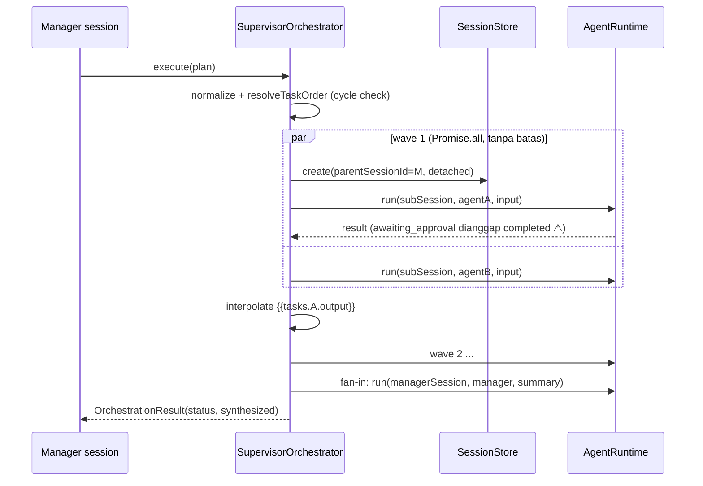

# 07 — Multi-Agent & Orchestration

## 1. Mekanisme yang ada

| Mekanisme                           | Lokasi                                         | Pemicu                                                                                           | Model                               |
| ----------------------------------- | ---------------------------------------------- | ------------------------------------------------------------------------------------------------ | ----------------------------------- |
| `SupervisorOrchestrator`            | `packages/agents/src/orchestrator.ts`          | Rencana `OrchestrationPlan` (mode `sequential`, `hierarchical`, `parallel`, `fan-out`, `fan-in`) | DAG terstruktur, deterministik      |
| Tool `delegate_task`                | `packages/platform/src/index.ts:715-729`       | Model memanggil tool (default **off**, `gateway.ts:125-126`)                                     | Delegasi ad hoc, sinkron            |
| Tool `mixture_of_agents`            | `platform/src/index.ts:783-`                   | Model (default off)                                                                              | N agent paralel + synthesizer       |
| Tool `a2a_delegate` / package `a2a` | `packages/a2a`                                 | Agent eksternal via A2A                                                                          | Antar-proses                        |
| Runtime fallback chain              | `packages/runtimes` (`runWithRuntimeFallback`) | Kegagalan auth/runtime                                                                           | Bukan multi-agent; failover backend |

## 2. Penilaian kapabilitas

| Kapabilitas                  | Status                                                                                                                                                                                                                       | Bukti / catatan                                                                                                   |
| ---------------------------- | ---------------------------------------------------------------------------------------------------------------------------------------------------------------------------------------------------------------------------- | ----------------------------------------------------------------------------------------------------------------- |
| Banyak agent independen      | Implemented                                                                                                                                                                                                                  | `workspace/agents/*.md`                                                                                           |
| Peran khusus                 | Implemented                                                                                                                                                                                                                  | persona + skills per agent                                                                                        |
| Delegasi                     | Implemented                                                                                                                                                                                                                  | orchestrator & `delegate_task`                                                                                    |
| Spawn subagent               | Implemented (sesi `detached`)                                                                                                                                                                                                | `orchestrator.ts:117-125`                                                                                         |
| Relasi parent-child          | Partial                                                                                                                                                                                                                      | Orchestrator set `parentSessionId` (`:123`); **`delegate_task` dan MoA tidak** (`index.ts:716-723`)               |
| Komunikasi agent-ke-agent    | Partial                                                                                                                                                                                                                      | Hanya lewat output→input (`{{tasks.X.output}}` interpolation, `task-planner.ts:82-89`); tidak ada channel/mailbox |
| Memory bersama/terisolasi    | Terisolasi per sesi (memory per `sessionId`); long-term per `userId` — tetapi `delegate_task` memakai `spec.defaultUserId`, sehingga subagent membaca/menulis memory **user default**, bukan user pemanggil (`index.ts:718`) |
| Izin tool bersama/terisolasi | **Bersama** — satu `ToolGateway` global; tidak ada pembatasan per subagent                                                                                                                                                   |
| Eksekusi paralel             | Implemented                                                                                                                                                                                                                  | `runParallelWaves` → `Promise.all` per wave (`orchestrator.ts:210-238`), tanpa batas konkurensi                   |
| Agregasi hasil               | Implemented                                                                                                                                                                                                                  | `fan-in` synthesis (`:182-200`), MoA synthesizer                                                                  |
| Cancellation                 | Missing                                                                                                                                                                                                                      | Tidak ada abort untuk tugas yang sedang berjalan; `aborted` hanya mencegah tugas _berikutnya_ (`:66-77`)          |
| Lifecycle management         | Partial                                                                                                                                                                                                                      | Event `DELEGATION_TASK_*` (`delegation-progress.ts`); tidak ada timeout per tugas                                 |
| Retry                        | Implemented                                                                                                                                                                                                                  | `onFailure: retry`, backoff eksponensial ≤8 s, maks 3 (`orchestrator.ts:109-146`)                                 |

Verifikasi: `tests/integration/delegation.integration.spec.ts` — 7 test (sequential+deps, parallel fan-out, abort, continue/skip, fan-in, events, ordering) **PASS** pada audit ini.

## 3. Temuan

**F-MA-1 — `delegate_task` tanpa batas kedalaman.** _(P1, code-read, confidence tinggi)_
Subagent memakai `runtime` dan tool gateway yang sama; bila `delegate_task` aktif, subagent dapat mendelegasikan lagi tanpa batas kedalaman, masing-masing hingga 5 iterasi model. Tidak ada `depth`/`parentSessionId` dalam konteks tool. Hermes membatasi budget subagent (default 50 iterasi) terpisah dari parent.

**F-MA-2 — Identitas user salah pada delegasi.** _(P1)_ `userId: spec.defaultUserId` (`index.ts:718`, juga MoA). Di deploy multi-user (Slack/Telegram), subagent dari user A memakai memory/soul facts milik user default, dan output-nya tercatat di bawah user lain — kebocoran lintas user.

**F-MA-3 — `awaiting_approval` dihitung sebagai `completed`.** _(P1)_ `runtime.run()` mengembalikan `status: 'awaiting_approval'` tanpa throw (`agents/src/runtime.ts:107`); orchestrator mencatat `status: 'completed'` dan meneruskan konten parsial ke tugas dependen (`orchestrator.ts:127-138`). Approval subagent juga tidak pernah dipersist (checkpoint hanya dipersist oleh gateway-worker untuk sesi utama).

**F-MA-4 — Nested `subPlan` tanpa batas rekursi.** _(P3)_ `orchestrator.ts:91-92` rekursif tanpa depth guard; cycle detection hanya per level.

**F-MA-5 — Paralel tanpa batas.** _(P2)_ fan-out 50 tugas = 50 run model simultan; rate limit provider → failover berantai.

## 4. Genuine orchestration vs konfigurasi multi-agent

**Kesimpulan:** Anvio memiliki **orkestrasi multi-agent yang nyata** (DAG, dependensi, kebijakan kegagalan, sintesis, event) — bukan sekadar beberapa file agent. Kelemahannya ada pada _guardrail_: kedalaman, identitas, approval, cancel, konkurensi.

## 5. Perbandingan

| Aspek                      | Anvio                       | Hermes                                                                                   | OpenClaw                   | Orca                                                   |
| -------------------------- | --------------------------- | ---------------------------------------------------------------------------------------- | -------------------------- | ------------------------------------------------------ |
| Model delegasi             | DAG terencana + tool ad hoc | Tool `delegate` (`tools/delegate_tool.py`), subagent terisolasi untuk workstream paralel | Agent runtimes / sesi      | Banyak agent CLI paralel, masing-masing worktree       |
| Budget subagent            | Sama dengan parent (5)      | Terpisah (default 50)                                                                    | Timeout per attempt        | Ditangani agent CLI                                    |
| Isolasi                    | Sesi terpisah, tool global  | Subagent terisolasi                                                                      | Sesi per agent             | Worktree git per agent                                 |
| Relevansi pola untuk Anvio | —                           | Depth/budget subagent                                                                    | Serialisasi & writer claim | `isolatedWorktree` (sudah di schema, belum ditegakkan) |

