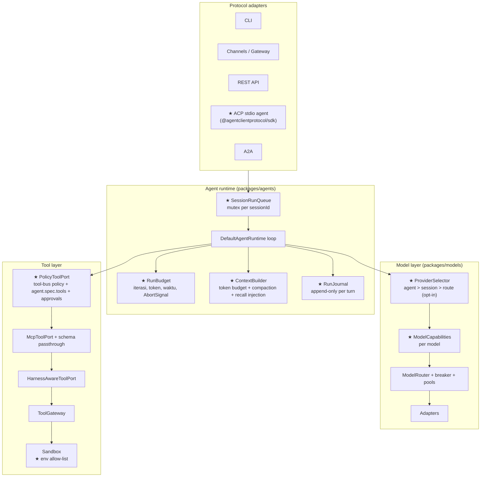

# 10 — Recommended Target Architecture

Prinsip: **pertahankan yang sudah bekerja**, tambahkan perubahan terkecil yang menutup gap Critical/High. Tidak ada rewrite.

## 1. Apa yang dipertahankan

| Komponen                                          | Alasan                                                                |
| ------------------------------------------------- | --------------------------------------------------------------------- |
| `ModelProvider` port + 3 adapter                  | Abstraksi bersih; agent core tidak memanggil SDK langsung             |
| `ModelRouter` failover pra-chunk + breaker + pool | Desain benar, teruji                                                  |
| `RuntimeToolPort` sebagai titik tunggal tool      | Sudah dipakai lokal & vendor runtime — tempat ideal untuk enforcement |
| `RuntimeRoutingAgentRuntime` + vendor runtimes    | Tradeoff sah: otak berat didelegasikan ke vendor                      |
| `SupervisorOrchestrator` + task planner           | Teruji, model DAG jelas                                               |
| Event bus + gateway-worker                        | Pola gateway OpenClaw-like yang sesuai                                |

## 2. Konsep target (disesuaikan dengan codebase)

Diagram kandidat di brief **sebagian besar sudah ada**. Yang perlu ditambahkan hanya kotak bertanda ★.

## 3. Perubahan minimal per area

### 3.1 Agent loop (`packages/agents`)

1. **Hapus write awal** `storeConversation([userMsg])` (`runtime.ts:191-193`). Ganti dengan journal append-only atau tulis `[...history, userMsg]` (bukan overwrite dengan 1 pesan).
2. **RunBudget**: `maxIterations` dari frontmatter/`anvio.yaml` (default moderat, mis. 20), budget warning ke model di N-2, dan _final summarization call tanpa tools_ saat habis. Emit `progress` "budget exhausted".
3. **Checkpoint lengkap**: sertakan assistant message + hasil tool selesai; saat resume dengan `approved: true`, eksekusi tool tertunda langsung (bukan pesan "Proceed").
4. **AbortController per run**: `stop()` → `abort()`; teruskan `signal` ke `modelRequest` dan `RuntimeToolContext`. Hapus flag set basi (hanya berlaku saat ada run aktif).
5. **Eksekusi tool paralel opsional** untuk tool yang ditandai `readOnly` (urutan hasil dipertahankan, seperti Hermes); tool mutasi tetap serial.

### 3.2 Context (`packages/agents` + `packages/memory`)

- `ContextBuilder`: hitung token kasar (chars/4 atau tokenizer), pakai `contextWindow` dari `model-descriptor.ts`, compaction saat >X% (ringkasan via `SessionSummarizer` yang sudah ada), jaga pasangan `tool_use`↔`tool_result`, injeksi recall `longTerm` sebagai blok system terpisah ber-label "retrieved memory (untrusted)".

### 3.3 Model selection (`packages/models`)

- `ProviderSelector` dengan urutan presedensi eksplisit: **session override > agent.model > routing.yaml route (bila agent opt-in `model.routing`) > default**. `resolveForRoute` hanya dipakai bila agent opt-in, dan selalu memilih model yang valid untuk provider tersebut (bukan model id agent).
- `ModelCapabilities` per model: `nativeTools`, `parallelTools`, `reasoning`, `vision`, `structuredOutput`, `contextWindow`. Runtime menanyakan kapabilitas **dari provider yang benar-benar melayani** (router mengembalikan target terpilih sebelum request dibentuk, atau router membangun ulang `tools`/instruksi sesuai target).
- Timeout default di adapter fetch (`AbortSignal.any([request.signal, AbortSignal.timeout(idle)])`).

### 3.4 Tool layer

- `PolicyToolPort` (decorator di atas `McpToolPort`): pakai `@anvio/tool-bus` `mergeToolPolicies` + `agent.spec.tools` sebagai allow-list + `approvals.requiredFor` → `pending_approval` dari gateway (bukan dari model). Satu tempat untuk CLI, channel, ACP, A2A, vendor.
- MCP: teruskan `inputSchema`; hormati `isError`; stub hanya dengan flag test dan status `simulated`.
- Sandbox: env allow-list (`PATH`, `HOME`, `LANG`, + `options.env`), bukan `...process.env`.
- `web_fetch`/`http_request`: tolak loopback, link-local, RFC1918 kecuali di-allow.

### 3.5 Sesi

- `SessionRunQueue`: `Map<sessionId, Promise>` in-process (cukup untuk Level 1), di gateway-worker, CLI, dan ACP. Level 3+ dapat memakai lock NATS/Postgres kemudian.
- Satukan sumber kebenaran: memory provider menjadi transkrip kanonik; session store menyimpan ringkasan/metadata (atau sebaliknya) — dokumentasikan.

### 3.6 ACP

- Package `acp` v2: `anvio acp stdio` dengan `@agentclientprotocol/sdk`. API HTTP lama di-rename atau dilindungi token. Detail di [05](05-acp-compatibility.md#6-komponen-adapter-yang-dibutuhkan).

## 4. Yang sengaja tidak diubah

- Tidak memindahkan orchestrator ke engine workflow terpisah.
- Tidak memperkenalkan dependensi Level 3+ ke jalur Level 1.
- Tidak mengganti loop dengan framework pihak ketiga.
