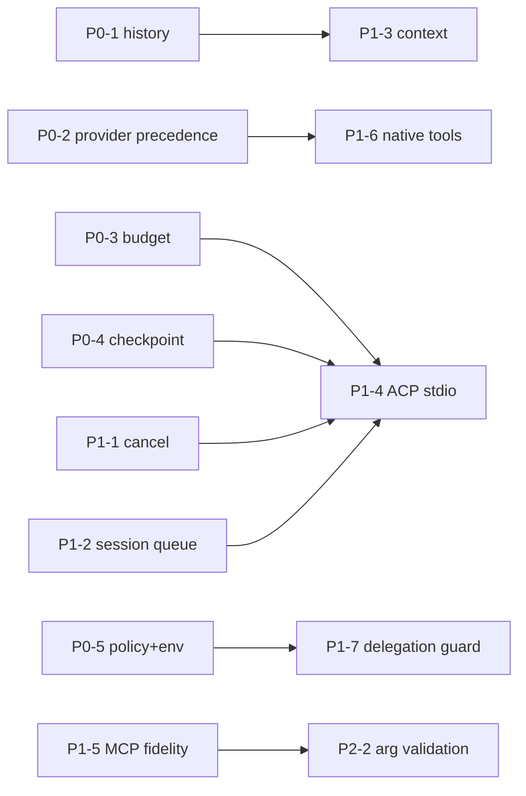

# 11 — Implementation Roadmap

Setiap item: Problem · Evidence · Proposed change · Affected modules · Dependencies · Complexity (S/M/L) · Regression risk · Acceptance criteria. Probe yang disebut ada di [12](12-validation-results.md) dan dapat diangkat menjadi regression test.

## P0 — Correctness & arsitektur kritis

### P0-1 Hentikan penghapusan history saat turn gagal (G-01)

- **Problem:** turn yang error/pause menyisakan 1 pesan di short-term memory.
- **Evidence:** `agents/src/runtime.ts:191-193`; `memory/src/provider-factory.ts:98-103`; probe P5.
- **Change:** hapus write di awal turn, atau tulis `[...memoryContext.shortTerm, userMsg]`. Pada jalur error, simpan `[...history, userMsg]` (tanpa jawaban) agar input user tidak hilang.
- **Modules:** `packages/agents`.
- **Dependencies:** —
- **Complexity:** S · **Regression risk:** Low (pastikan learning loop yang membaca 2 pesan terakhir tetap benar).
- **Acceptance:** probe P5 dibalik: history 4 pesan + provider error → 5 pesan (4 lama + user baru).

### P0-2 Presedensi pemilihan provider (G-02, G-22)

- **Problem:** regex pesan menimpa provider agent dan mengirim model id yang salah.
- **Evidence:** `runtime.ts:165-166`; `model-provider-registry.ts:7-13,47-55`; probe P3.
- **Change:** `resolveForRoute` hanya dipakai bila agent opt-in (`model.routing` di-set eksplisit); bila dipakai, jangan teruskan `agent.spec.model.model` ke provider lain — pakai default model provider tersebut. Samakan perlakuan `override` di `ModelRouter.stream` dengan `chat`.
- **Modules:** `packages/agents`, `packages/models`.
- **Complexity:** S · **Regression risk:** Medium (perilaku routing berubah untuk user yang tanpa sadar bergantung padanya) — catat di CHANGELOG.
- **Acceptance:** probe P3 → provider `anthropic`, model `claude-x`. Test baru: agent dengan `model.routing: coding` tetap memakai preferensi route dengan model valid.

### P0-3 Budget iterasi: penutup + configurable (G-03)

- **Problem:** ronde tool terakhir tidak diobservasi; tidak ada notice.
- **Evidence:** `runtime.ts:201,364-372`; probe P1.
- **Change:** `maxToolIterations` dari frontmatter (`model.maxToolIterations` atau `runtime.maxIterations`) dan `anvio.yaml`; warning di sisa 2 iterasi; saat habis, satu model call tanpa `tools` untuk merangkum; emit notice; simpan transkrip yang sama dengan yang di-stream.
- **Modules:** `packages/agents`, `packages/core` (schema).
- **Complexity:** M · **Regression risk:** Low–Medium (biaya token sedikit naik).
- **Acceptance:** probe P1: model call ke-6 tanpa tools terjadi, teks akhir menyebut batas, assistant tersimpan == teks yang di-stream.

### P0-4 Checkpoint approval lengkap (G-04)

- **Problem:** hasil tool yang sudah jalan hilang; resume bergantung model memanggil ulang.
- **Evidence:** `runtime.ts:308-320,184-187`; probe P2.
- **Change:** checkpoint = `messages + assistant{toolCalls} + toolMessages selesai + pendingCall`; resume `approved` → eksekusi `pendingCall` langsung lalu lanjut loop; `denied` → tool message "denied".
- **Modules:** `packages/agents`, `packages/platform` (worker).
- **Dependencies:** —
- **Complexity:** M · **Regression risk:** Medium (format checkpoint berubah; tangani checkpoint lama).
- **Acceptance:** probe P2: checkpoint berisi hasil `echo`; resume menjalankan `danger` sekali, `echo` tidak diulang.

### P0-5 Tegakkan kebijakan tool (G-05) & scrub env sandbox (G-06)

- **Problem:** keamanan hanya di schema; secret bocor ke kode model.
- **Evidence:** `agent.schema.ts:42-48,73`; `tool-bus` tanpa konsumen; `process-sandbox.ts:37`.
- **Change:** `PolicyToolPort` decorator (lihat [10 §3.4](10-recommended-architecture.md#34-tool-layer)) memfilter `listTools`/`getModelToolDefinitions` dan memblokir `call`; `approvals.requiredFor` → `pending_approval` dari gateway. Sandbox: env allow-list.
- **Modules:** `packages/tool-bus`, `packages/platform`, `packages/execution`, `packages/core`.
- **Complexity:** M · **Regression risk:** Medium–High (agent yang sekarang memakai tool di luar `tools:` akan kehilangan akses) — semantik migrasi: `tools: []` = "semua tool gateway" (perilaku sekarang), daftar non-kosong = allow-list.
- **Acceptance:** agent `tools: [file_read]` tidak melihat/menjalankan `web_fetch`; `run_shell` dengan `echo $ANTHROPIC_API_KEY` → kosong.

## P1 — Fungsionalitas inti & kompatibilitas

### P1-1 Cancellation nyata (G-10)

- **Evidence:** `runtime.ts:95-97,221-228`; probe P4; `runtime-routing-agent-runtime.ts:24-26`.
- **Change:** `AbortController` per run aktif; `stop()` tanpa run aktif = no-op; teruskan `signal` ke provider & tool context; forward `stop` ke vendor runtime yang mendukung.
- **Complexity:** M · **Risk:** Low · **Acceptance:** probe P4 → run berikutnya sukses; stop saat streaming membatalkan fetch (diverifikasi dengan provider mock yang menunggu `signal`).

### P1-2 Serialisasi per sesi (G-09)

- **Change:** `SessionRunQueue` di worker, CLI, ACP. **Complexity:** S–M · **Risk:** Low · **Acceptance:** dua `AGENT_RUN_REQUESTED` untuk sesi sama → berjalan berurutan; transkrip memuat keduanya.

### P1-3 Context berbasis token + injeksi recall (G-08, G-14)

- **Change:** `ContextBuilder`; recall sebagai blok system terlabel; compaction menjaga pasangan tool. **Modules:** `agents`, `memory`, `models` (descriptor). **Complexity:** L · **Risk:** Medium · **Acceptance:** probe P6 dibalik; sesi sintetis 2× context window tidak error dan memuat ringkasan.

### P1-4 ACP stdio adapter (G-07)

- **Change:** lihat [05 §6](05-acp-compatibility.md#6-komponen-adapter-yang-dibutuhkan). **Dependencies:** P1-1 (cancel), P0-4 (permission resume), P1-2. **Complexity:** L · **Risk:** Low (additive) · **Acceptance:** test A1–A11 di [05 §8](05-acp-compatibility.md#8-rencana-test-kompatibilitas) lulus; sesi end-to-end dari Zed.
- Sekaligus: lindungi API HTTP lama dengan token atau rename; perbaiki loop rekursif cursor↔ACP.

### P1-5 MCP fidelity (G-12, G-13)

- **Change:** `McpToolDescriptor.inputSchema`; teruskan ke `ModelToolDefinition`; `isError` → `status: 'failed'`. **Complexity:** S · **Risk:** Low · **Acceptance:** probe P7 → status failed; definisi tool MCP berisi schema server.

### P1-6 Native-tools mengikuti provider yang melayani (G-11)

- **Complexity:** M · **Risk:** Medium · **Acceptance:** failover anthropic→perplexity menghasilkan instruksi fenced-block, bukan `tools` native.

### P1-7 Guard delegasi (G-18, G-19)

- **Change:** propagasi `userId` & `parentSessionId` pemanggil; `depth` di tool context (maks mis. 2); `awaiting_approval` subagent → status `blocked` di orchestrator. **Complexity:** S–M · **Risk:** Low.

## P2 — Reliability & extensibility

| ID   | Item                                                                    | Evidence                                 | Complexity | Risk   |
| ---- | ----------------------------------------------------------------------- | ---------------------------------------- | ---------- | ------ |
| P2-1 | Timeout default adapter fetch + idle timeout stream (G-20)              | `openai-compatible.provider.ts` `post()` | S          | Low    |
| P2-2 | Validasi argumen tool terhadap schema + timeout umum gateway (G-16)     | `builtins/index.ts:152`                  | M          | Medium |
| P2-3 | Eksekusi paralel tool read-only (G-15)                                  | `native-tool-loop.ts:14`                 | M          | Medium |
| P2-4 | SSRF guard (G-17), path confinement realpath+separator (G-27)           | `web-fetch.ts`, `filesystem.ts:5-9`      | S          | Low    |
| P2-5 | Registry kapabilitas per model (G-21)                                   | `model-descriptor.ts`                    | M          | Low    |
| P2-6 | Warn keras pada degradasi diam: mock provider, YAML default (G-24)      | `platform/src/index.ts:165-173`          | S          | Low    |
| P2-7 | Hasil tool fenced-mode diberi pembungkus "untrusted tool output" (G-23) | `tool-loop.ts:51-56`                     | S          | Low    |
| P2-8 | Gemini key via header (G-28)                                            | `gemini.provider.ts:235`                 | S          | Low    |
| P2-9 | Batas konkurensi orchestrator (G-32)                                    | `orchestrator.ts:231`                    | S          | Low    |

## P3 — Opsional

| ID   | Item                                                                               |
| ---- | ---------------------------------------------------------------------------------- |
| P3-1 | Dukungan reasoning/thinking (Anthropic thinking, OpenAI `reasoning_effort`) (G-29) |
| P3-2 | Structured output / JSON schema di `ChatRequest`                                   |
| P3-3 | Wire `SpendBudgetLedger` per sesi/user (G-30)                                      |
| P3-4 | Pecah `platform/src/index.ts` per subsistem (G-31)                                 |
| P3-5 | Satukan sumber kebenaran transkrip (G-25)                                          |
| P3-6 | Tegakkan `isolatedWorktree` untuk vendor runtime (pola Orca)                       |
| P3-7 | Stub MCP diberi status `simulated` (G-26)                                          |

## Urutan & dependensi

