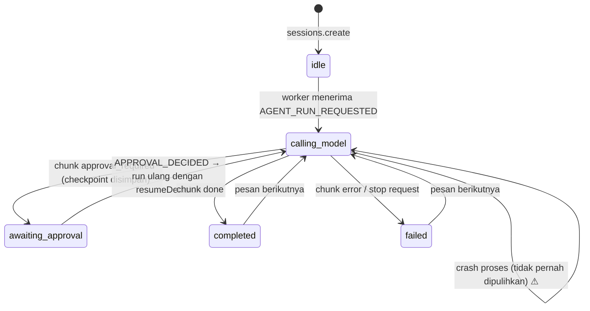
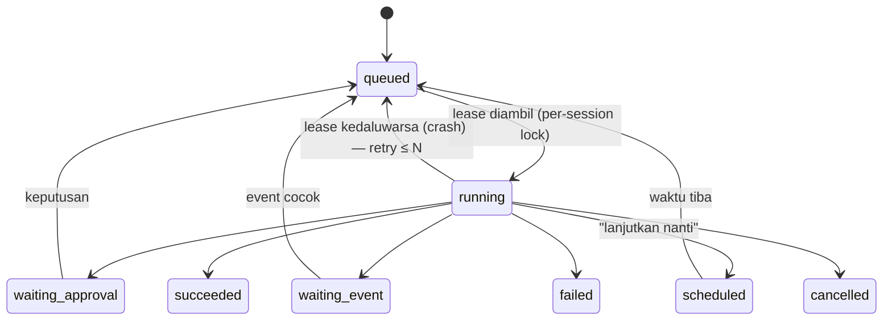

# 02 — Planning & Future Task Continuation

Prinsip audit: **rencana ≠ eksekusi otonom di masa depan.** Kapabilitas dinilai dari jalur kode yang benar-benar menjalankan, menjadwalkan, atau melanjutkan pekerjaan.

## 1. Komponen yang ada

| Komponen                | Lokasi                                                | Sifat                                                                                                      | Dipicu oleh                                                                                    |
| ----------------------- | ----------------------------------------------------- | ---------------------------------------------------------------------------------------------------------- | ---------------------------------------------------------------------------------------------- |
| Agent loop              | `agents/src/runtime.ts`                               | ReAct ≤5 iterasi                                                                                           | Pesan user / event                                                                             |
| Supervisor orchestrator | `agents/src/orchestrator.ts`, `task-planner.ts`       | DAG task, dependensi, retry, fan-in                                                                        | Pemanggil eksplisit (CLI/API/test)                                                             |
| Plan-Execute-Review     | `automation/src/planner-engine.ts`                    | 3 fase linear dari YAML                                                                                    | **Hanya CLI** `anvio planner run` (`apps/cli/src/main.ts:1210-1260`)                           |
| Goals                   | `goals/src/index.ts`                                  | Data: status `active/paused/completed/archived`, progress %, milestones                                    | Manual (CLI/API/slash), atau `skill_call` menaikkan progress (`platform/src/index.ts:921-926`) |
| Kanban                  | `kanban/src/kanban-engine.ts`, `lane-router.ts`       | Board: kolom `backlog/todo/doing/review/done`, status assignee `idle/assigned/working/blocked/review/done` | Tool `kanban_*` (default off)                                                                  |
| Automation              | `automation/src/automation-engine.ts`                 | Cron (tick 60 s), event, goal-event → aksi `agent/blueprint/hook/batch/learning`                           | Scheduler in-process                                                                           |
| Workflows               | `workflows/src/dag-executor.ts`                       | DAG workflow                                                                                               | Automation / goal `onComplete`                                                                 |
| Tool `todo`             | gateway built-in (default on)                         | Daftar tugas per sesi untuk model                                                                          | Model                                                                                          |
| Tool `cronjob`          | `platform/src/index.ts` `manageCronjob` (default off) | Model membuat automation YAML                                                                              | Model                                                                                          |

## 2. Kapabilitas planning

| Kapabilitas            | Status                               | Bukti / catatan                                                                                                              |
| ---------------------- | ------------------------------------ | ---------------------------------------------------------------------------------------------------------------------------- |
| Goal decomposition     | Model-driven                         | Tidak ada decomposer; model dapat memakai `todo`                                                                             |
| Task planning          | Partial                              | Orchestrator butuh plan yang sudah jadi (`OrchestrationPlan`); tidak ada generator plan dari LLM di runtime                  |
| Multi-step execution   | Implemented (≤5 ronde)               | G-03                                                                                                                         |
| Dependency management  | Implemented di orchestrator/workflow | `resolveTaskOrder` + cycle detection                                                                                         |
| Plan revision          | Missing                              | Plan orchestrator statis setelah `execute()` dimulai                                                                         |
| Prioritas              | Partial                              | `GoalStore.setOrder`, prioritas kanban — tidak dipakai scheduler                                                             |
| Progress tracking      | Partial                              | Goal percent manual/skill; event delegasi                                                                                    |
| Persistensi state task | Partial                              | Goal/kanban/automation state di file; **state orchestrator/planner in-memory**                                               |
| Checkpoint eksekusi    | Partial                              | Hanya approval checkpoint agent (G-04)                                                                                       |
| Verifikasi selesai     | Missing                              | Tidak ada verifier; `review` fase planner hanya teks                                                                         |
| Retry & recovery       | Partial                              | Orchestrator `retry`; automation tanpa retry                                                                                 |
| Human approval gate    | Partial                              | Harness/MCP gate; `PlannerConfig.spec.requireReviewApproval` **Configured Only** (tidak dibaca di `planner-engine.ts:67-87`) |

## 3. Future planning

| Kemampuan                         | Status             | Bukti                                                                                               |
| --------------------------------- | ------------------ | --------------------------------------------------------------------------------------------------- |
| Jadwalkan task masa depan         | Implemented (cron) | `CronScheduler.tick` (`automation-engine.ts:51-76`)                                                 |
| One-shot "jalankan besok jam 9"   | Missing            | Hanya ekspresi cron berulang                                                                        |
| Lanjutkan pekerjaan belum selesai | Partial            | Hanya approval resume di gateway                                                                    |
| Lanjut setelah restart            | **Missing**        | Tidak ada pemulihan sesi berstatus `calling_model`/`tool_executing` saat boot; run in-flight hilang |
| Tugas berulang                    | Implemented        | cron                                                                                                |
| Menunggu event eksternal          | Implemented        | trigger `event` / `goal`                                                                            |
| Lacak dependensi tertunda         | Partial            | Kanban `blocked` + link; tidak ada scheduler yang membuka blokir                                    |
| Replan saat keadaan berubah       | Missing            | —                                                                                                   |
| Notifikasi selesai                | Implemented        | `task_completed` untuk channel non-chat (`gateway-worker.ts:349-358`)                               |
| Cegah eksekusi ganda              | Partial            | Cron dedup per menit via `lastRunAt`                                                                |

### Temuan

**P2-PLAN-01 — Cron mengabaikan `timezone`.** _(Medium, code-read)_ Schema automation dan tool `cronjob` menulis `timezone`, tetapi `cronMatches(schedule, now)` tidak menerima zona (`automation/src/cron-parser.ts` — tidak ada referensi `timezone`/`tz`). Jadwal dievaluasi pada zona waktu proses host. Pengguna `Asia/Jakarta` di server UTC tereksekusi 7 jam meleset.

**P2-PLAN-02 — Cron tanpa catch-up, tanpa guard overlap, rawan drift.** _(Medium, code-read)_

- Hanya mencocokkan menit saat ini; run yang jatuh saat proses mati hilang tanpa jejak.
- `setInterval(60_000)` tanpa alignment ke batas menit; drift dapat membuat satu menit terlewat.
- `recordRun` ditulis **setelah** aksi selesai (`:201`). Aksi panjang + jadwal tiap menit → tick berikutnya memulai run kedua yang tumpang tindih (tidak ada flag `running`).
- Semua automation berjalan dengan `options.userId` tunggal.

**P2-PLAN-03 — Tidak ada recovery run setelah crash.** _(High)_ Sesi tertinggal `calling_model` selamanya; tidak ada sweep saat boot. User tidak diberi tahu.

**P2-PLAN-04 — Planner `requireReviewApproval` tidak ditegakkan.** _(Low; CLI-only)_

**P2-PLAN-05 — Dua konsep goal terputus.** `soul.longTermGoals` (teks prompt) vs `GoalEngine` (data). Goal aktif hanya memengaruhi agent lewat `activeGoalSkillsResolver` (skill ditambahkan ke prompt untuk **semua** agent, `platform/src/index.ts:470-473`), bukan lewat eksekusi.

## 4. State machine aktual

State yang benar-benar ada di kode (tidak menambah state baru):



Catatan:

- `AgentRunStatus` di `core/src/types/common.ts:22-30` juga mendefinisikan `assembling_context`, `tool_executing`, `storing_memory` — **tidak pernah ditulis** ke session store; hanya muncul sebagai teks `progress`.
- Stop menulis `failed` (`gateway-worker.ts:85-92`), sehingga "dibatalkan user" tidak dapat dibedakan dari error.
- Konkurensi: tidak ada lock; dua `AGENT_RUN_REQUESTED` untuk sesi sama dapat berjalan bersamaan pada event bus non-lokal (pada bus lokal, lihat P2-CH-01, keduanya terserialisasi secara global — bukan per sesi).

Kanban (state terpisah, tidak terhubung ke state sesi):

```text
column: backlog → todo → doing → review → done
assignee.status: idle → assigned → working → (blocked) → review → done
```

Tidak ada pengambil tugas otomatis maupun reclaim lease untuk `working` yang basi (`kanban/src` tidak memiliki logika heartbeat-timeout; tool `kanban_heartbeat` hanya mencatat).

## 5. Strategi planning: rekomendasi

| Strategi               | Cocok?                   | Alasan                                                                        |
| ---------------------- | ------------------------ | ----------------------------------------------------------------------------- |
| Direct execution       | Ya (default)             | Mayoritas pesan chat                                                          |
| ReAct (sudah ada)      | Ya                       | Perbaiki budget & penutup (G-03) daripada mengganti                           |
| Plan-and-execute       | Opsional per agent       | Sudah ada `PlanExecuteReviewEngine`; jadikan aksi automation, bukan hanya CLI |
| Reflection/replanning  | Ringan                   | Satu "self-check" pada langkah penutup budget sudah cukup                     |
| Hierarchical           | Sudah ada (orchestrator) | Tambahkan guard (G-18/G-19)                                                   |
| Multi-agent delegation | Sudah ada                | Sama                                                                          |

**Tidak** disarankan memperkenalkan framework planning baru. Gap terbesar bukan strategi, melainkan **durabilitas**: tidak ada "task" yang bertahan melewati restart.

## 6. Arsitektur yang diusulkan

Usulan state (terpisah dari state aktual di §4):



Komponen minimal (Level 1, filesystem):

1. `RunJournal` per sesi (`sessions/<id>/runs.jsonl`): `runId`, status, `leaseUntil`, attempt.
2. Boot sweep: run `running` dengan lease kedaluwarsa → `queued` (attempt+1) atau `failed` + notifikasi user.
3. Cron: evaluasi dengan `Intl.DateTimeFormat` sesuai `timezone`; simpan `lastScheduledAt`, catch-up opsional (`misfire: skip|run-once`); flag `running`.
4. One-shot schedule: `trigger.type: at` (ISO timestamp) — dipakai oleh tool `todo`/`cronjob` untuk "nanti".
