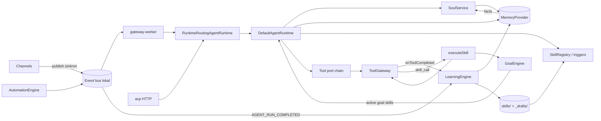

# 06 — Cross-Cutting Architecture Assessment

## 1. Peta interaksi

## 2. Interaksi yang dinilai

| Pasangan                             | Kondisi                                                                        | Masalah                                                                                                                                   |
| ------------------------------------ | ------------------------------------------------------------------------------ | ----------------------------------------------------------------------------------------------------------------------------------------- |
| Soul ↔ context                       | Soul dirender setelah skill; facts memory di dalam blok soul                   | Tidak ada hierarki kepercayaan (P2-SOUL-02)                                                                                               |
| Soul ↔ memory                        | `SoulEngineImpl` bergantung langsung ke `MemoryProvider.getByUser`             | Facts per user dibagi lintas soul                                                                                                         |
| Learning ↔ memory                    | Nudge menulis facts tanpa dedup/scan; ringkasan sesi tiap run                  | Polusi memory (P2-LRN-02)                                                                                                                 |
| Learning ↔ skills                    | Learning menulis langsung ke `skills/`                                         | Loop umpan balik tanpa validasi: skill auto → disuntik ke prompt → output → skill baru (P2-LRN-01)                                        |
| Skills ↔ tool permissions            | `skill_call` memakai `toolGateway` mentah                                      | Melewati harness/MCP gate; `permissions` skill tidak ditegakkan (P2-SKL-02)                                                               |
| Planning ↔ persistensi               | Goal/kanban/automation di file; run/orchestrator in-memory                     | Tidak ada recovery (P2-PLAN-03)                                                                                                           |
| Planning ↔ scheduling                | Cron terpisah dari goal/kanban; `cronjob` menulis YAML                         | Timezone diabaikan (P2-PLAN-01)                                                                                                           |
| Channels ↔ session                   | `channel-session-bridge.resolveOrCreate`; tanpa lock                           | Race (G-09)                                                                                                                               |
| Channels ↔ runtime                   | Turn dijalankan di dalam publish inbound                                       | HOL blocking, deadlock approval (P2-CH-01)                                                                                                |
| ACP ↔ channel adapters               | ACP bukan adapter channel; jalur sendiri di CLI (`main.ts:1644-1720`)          | Duplikasi logika sesi (create/resolve) dengan bridge                                                                                      |
| Model capabilities ↔ skill execution | Skill tidak mendeklarasikan kebutuhan kapabilitas model (native tools, vision) | Skill berlangkah bergantung tool port, bukan model — OK; skill prosa yang mengandalkan tool tertentu tidak dicek terhadap tool yang aktif |

## 3. Logika ganda, siklus, state bersama

| Jenis                                 | Temuan                                                                                                                          | Lokasi                                                                                                                  |
| ------------------------------------- | ------------------------------------------------------------------------------------------------------------------------------- | ----------------------------------------------------------------------------------------------------------------------- |
| Duplikasi                             | Pembuatan/resolusi sesi: ACP CLI, `delegateTask`, `mixtureOfAgents`, orchestrator, planner CLI, bridge channel — 6 implementasi | `apps/cli/src/main.ts`, `platform/src/index.ts`, `agents/src/orchestrator.ts`, `channels/src/channel-session-bridge.ts` |
| Duplikasi                             | Dua history (memory provider vs session store)                                                                                  | G-25                                                                                                                    |
| Duplikasi                             | Dua "goal" (soul.longTermGoals vs GoalEngine)                                                                                   | P2-PLAN-05                                                                                                              |
| Siklus                                | `ToolGateway` → `delegateTask` → `runtime` → tool port → `ToolGateway` (rekursi delegasi)                                       | G-18                                                                                                                    |
| Siklus                                | `executeSkill` ↔ `toolGateway` ↔ `skill_call`                                                                                   | dibatasi? tidak ada depth guard (Unverified)                                                                            |
| Siklus                                | Goal ↔ workflow executor (dikomentari di `platform/src/index.ts` sebagai "cycle", diselesaikan dengan getter)                   | —                                                                                                                       |
| Siklus                                | Learning → skills → prompt → output → learning                                                                                  | P2-LRN-01                                                                                                               |
| State bersama mutable                 | `ToolGateway.mergeContext` (`Object.assign` ke ctx bersama)                                                                     | `tools/src/gateway.ts:218-220`                                                                                          |
| State bersama mutable                 | `stopRequests` Set per runtime (G-10), `McpFirstCallGate.memory`, Telegram `offset`, Slack/Discord `ws`                         | —                                                                                                                       |
| Kepemilikan lifecycle tidak konsisten | Learning sesi memakai `defaultSoul`, tool-use memakai soul agent                                                                | P2-SOUL-03                                                                                                              |
| Kepemilikan lifecycle tidak konsisten | Worktree dibuat di worker, tidak di CLI/ACP; path tidak dipakai                                                                 | §4 rekonsiliasi                                                                                                         |

## 4. Bisa lewat ekstensi atau perlu perubahan struktural?

| Kebutuhan                 | Ekstensi cukup?      | Catatan                                                                                        |
| ------------------------- | -------------------- | ---------------------------------------------------------------------------------------------- |
| Policy tool & approval    | Ya                   | Decorator `RuntimeToolPort`                                                                    |
| Soul aman                 | Ya                   | Ubah `save()` + renderer + blok facts                                                          |
| Learning aman             | Ya                   | Gate default + sanitizer di `LearningEngine`                                                   |
| Skill versioning          | Ya                   | Ganti writer promote                                                                           |
| Recovery run & scheduling | **Struktural kecil** | Perlu `RunJournal` + antrean per sesi — mengubah kontrak worker (enqueue alih-alih run inline) |
| Isolasi channel           | **Struktural kecil** | Lepas turn dari jalur inbound (sama dengan di atas)                                            |
| ACP                       | Ya                   | Adapter baru di atas `AgentRuntime`                                                            |

Satu perubahan struktural — **antrean run per sesi yang dipisahkan dari jalur inbound** — membuka sekaligus: isolasi channel (P2-CH-01), serialisasi sesi (G-09), recovery (P2-PLAN-03), ack webhook cepat, dan cancel yang benar (G-10). Ini menjadi fondasi roadmap ([08](08-prioritized-implementation-roadmap.md)).
