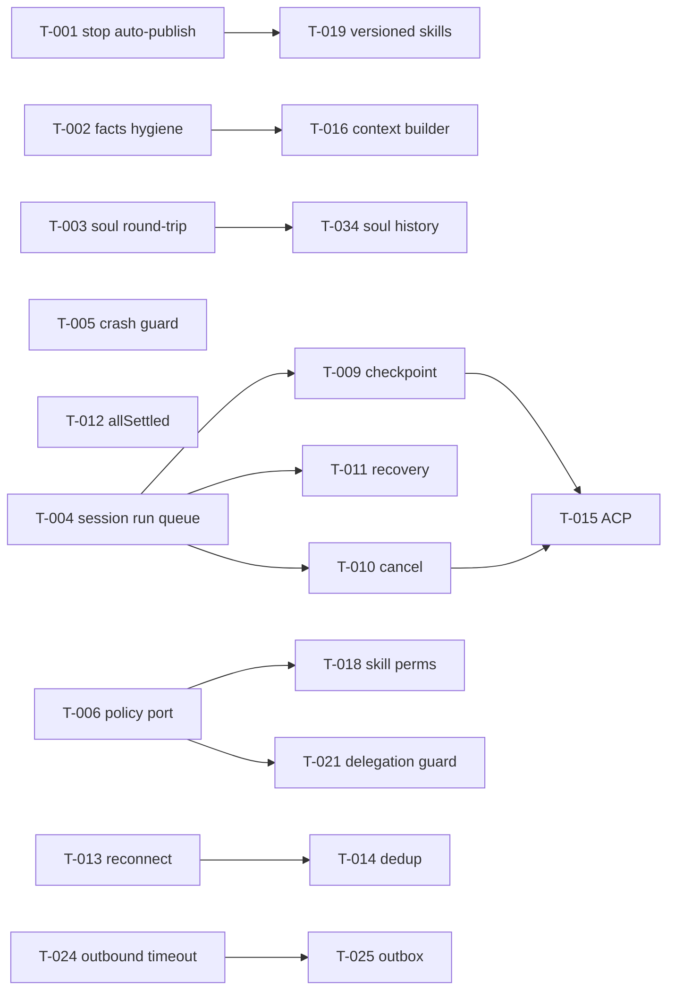

# 07 — Backlog Terpadu (Phase 1 + Phase 2)

Kolom: Task ID · Source · Finding · Priority · Component · Problem · Current behavior · Expected · Required changes · Deps · Complexity (S/M/L/XL) · Risk · Acceptance criteria · Status.

Status = status terverifikasi temuan saat ini (lihat [00](00-previous-audit-reconciliation.md)). Item FIXED (G-01, G-02) tidak dimasukkan.

Prioritas: **P0** korektness/keamanan yang sudah dapat dieksploitasi atau kehilangan data; **P1** fondasi fungsional & kompatibilitas; **P2** reliabilitas & ekstensibilitas; **P3** opsional.

## P0

| Task  | Src   | Finding               | Comp.                      | Problem                                                                                   | Current                                                                                          | Expected                                                                              | Required changes                                                                                                                            | Deps                             | Cx  | Risk                               | Acceptance                                                                                                           | Status    |
| ----- | ----- | --------------------- | -------------------------- | ----------------------------------------------------------------------------------------- | ------------------------------------------------------------------------------------------------ | ------------------------------------------------------------------------------------- | ------------------------------------------------------------------------------------------------------------------------------------------- | -------------------------------- | --- | ---------------------------------- | -------------------------------------------------------------------------------------------------------------------- | --------- |
| T-001 | P2    | P2-LRN-01, P2-SKL-01  | learning                   | Output tool tak tepercaya diterbitkan sebagai skill live                                  | `onToolUseCompleted` auto-promote bila `requireApproval` ≠ true; fallback menyalin output mentah | Tidak ada publish otomatis default; input berlabel untrusted                          | Default `requireApproval` efektif `true` (termasuk bila soul tidak ada); hapus fallback salin-mentah atau tandai + cap; scan pola injection | —                                | S   | Low (ubah default; update test l6) | Probe Q2: tidak ada file di `skills/`, draft berisi label untrusted                                                  | NOT FIXED |
| T-002 | P2    | P2-LRN-02, P2-SOUL-02 | learning, souls            | Facts duplikat & dari teks tak tepercaya disuntik ke blok soul                            | Regex atas semua pesan role user, tanpa dedup                                                    | Facts hanya dari pesan user asli, dedup, cap, dirender sebagai blok terpisah berlabel | Filter role/asal; dedup exact (normalisasi); cap 20 unik; render terpisah dari soul                                                         | —                                | S   | Low                                | Probe Q3: 1 fact dari user asli, 0 dari "tool", tidak ada duplikat                                                   | NOT FIXED |
| T-003 | P2    | P2-SOUL-01            | souls                      | Simpan soul menghapus evolution & policy                                                  | `renderSoulMd` tanpa frontmatter & bagian policy                                                 | Round-trip lossless                                                                   | Simpan frontmatter + bagian tak dikenal; atau tolak overwrite SOUL.md raw                                                                   | —                                | M   | Medium (format file)               | Probe Q1 dibalik: `allowAutoUpdate:false`, `## Approvers` & `## Mandate` tetap                                       | NOT FIXED |
| T-004 | P2    | P2-CH-01 + G-09       | platform, events, channels | Turn agent berjalan di jalur inbound: HOL blocking, deadlock approval, ack webhook lambat | `publish` menunggu seluruh turn                                                                  | Inbound kembali segera; run per sesi serial, antar sesi paralel                       | `SessionRunQueue` di worker (enqueue + return); webhook ack sebelum enqueue diproses                                                        | —                                | L   | Medium (kontrak worker)            | Probe Q4 versi worker: approval kedua terbaca saat run pertama berjalan; dua sesi berjalan paralel; satu sesi serial | NOT FIXED |
| T-005 | P2    | P2-CH-06 (crash)      | channels, apps             | Unhandled rejection dari WS handler mematikan proses                                      | `void handler()` tanpa catch; tidak ada handler global                                           | Error per pesan di-log, proses hidup                                                  | try/catch di `onmessage` (Slack, Discord, Mattermost); `process.on('unhandledRejection')` di entrypoint                                     | —                                | S   | Low                                | Frame JSON rusak & handler throw tidak menghentikan proses (test dengan WS mock)                                     | NOT FIXED |
| T-006 | P1→P0 | G-05                  | tools, tool-bus            | Policy tool/approval hanya di schema                                                      | `agent.spec.tools`, `approvals`, tool-bus tanpa konsumen                                         | Ditegakkan di satu titik                                                              | `PolicyToolPort` decorator; `skill_call` lewat rantai penuh                                                                                 | —                                | M   | Medium–High                        | Agent `tools:[file_read]` tidak bisa `web_fetch`; `skill_call` memicu gate yang sama                                 | NOT FIXED |
| T-007 | P1    | G-06                  | execution                  | Sandbox mewarisi env                                                                      | `...process.env`                                                                                 | Env allow-list                                                                        | Allow-list `PATH,HOME,LANG,TMPDIR` + `options.env`                                                                                          | —                                | S   | Medium                             | `echo $ANTHROPIC_API_KEY` kosong                                                                                     | NOT FIXED |
| T-008 | P1    | G-03                  | agents                     | Ronde tool terakhir tak diobservasi                                                       | 5 iterasi, tanpa penutup                                                                         | Budget configurable + final call + notice                                             | Lihat roadmap Phase 1 P0-3                                                                                                                  | —                                | M   | Low–Med                            | Probe P1: call ke-6 tanpa tools                                                                                      | NOT FIXED |
| T-009 | P1    | G-04                  | agents, platform           | Checkpoint approval membuang hasil tool                                                   | —                                                                                                | Checkpoint lengkap; eksekusi langsung                                                 | Lihat P0-4 Phase 1                                                                                                                          | T-004 (untuk resume via antrean) | M   | Medium                             | Probe P2: tool pertama tidak diulang                                                                                 | NOT FIXED |

## P1

| Task  | Src | Finding               | Comp.            | Problem                                                            | Required changes                                                                                           | Deps                | Cx  | Risk   | Acceptance                                                                    | Status    |
| ----- | --- | --------------------- | ---------------- | ------------------------------------------------------------------ | ---------------------------------------------------------------------------------------------------------- | ------------------- | --- | ------ | ----------------------------------------------------------------------------- | --------- |
| T-010 | P1  | G-10                  | agents, runtimes | Cancel tidak membatalkan I/O; flag basi                            | AbortController per run aktif; teruskan `signal`; stop no-op bila idle; forward ke vendor                  | T-004               | M   | Low    | Probe P4 dibalik; fetch provider ter-abort                                    | NOT FIXED |
| T-011 | P2  | P2-PLAN-03            | platform         | Run hilang saat crash, sesi macet `calling_model`                  | `RunJournal` + boot sweep (requeue/fail + notifikasi)                                                      | T-004               | M   | Low    | Kill proses saat run → setelah boot sesi `failed`/requeued + user diberi tahu | NOT FIXED |
| T-012 | P2  | P2-CH-02              | channels         | Satu channel gagal start menggagalkan semua                        | `Promise.allSettled` + status health per channel                                                           | —                   | S   | Low    | Probe Q5: `startAll` resolve, laporan channel gagal                           | NOT FIXED |
| T-013 | P2  | P2-CH-07 (reconnect)  | channels         | `stop()` memicu reconnect; backoff tetap; Discord tanpa resume/ACK | Flag `stopping`; backoff eksponensial+jitter; Discord resume + ACK watchdog; Slack `apps.connections.open` | —                   | M   | Medium | Test WS mock: stop tidak reconnect; reconnect menunda 1,2,4… s ±jitter        | NOT FIXED |
| T-014 | P2  | P2-CH-08 (dedup)      | channels         | Event duplikat diproses ulang                                      | LRU dedup per channel (event/message id); Telegram offset persisten                                        | —                   | M   | Low    | Mengirim event sama 2× → 1 run                                                | NOT FIXED |
| T-015 | P1  | G-07                  | acp              | Bukan Agent Client Protocol                                        | Adapter stdio `@agentclientprotocol/sdk`                                                                   | T-004, T-009, T-010 | L   | Low    | Test A1–A11 Phase 1 dok 05                                                    | NOT FIXED |
| T-016 | P1  | G-08, G-14            | agents, memory   | Context tanpa token budget; recall dibuang                         | ContextBuilder + injeksi recall berlabel                                                                   | T-002               | L   | Medium | Probe P6 dibalik; sesi 2× window tidak error                                  | NOT FIXED |
| T-017 | P1  | G-12, G-13            | integrations     | MCP schema dibuang; `isError` hilang                               | Teruskan `inputSchema`; `isError` → failed                                                                 | —                   | S   | Low    | Probe P7 → failed                                                             | NOT FIXED |
| T-018 | P2  | P2-SKL-02             | skills           | `permissions`/`toolRequirements` skill tidak ditegakkan            | Cek saat aktivasi & eksekusi                                                                               | T-006               | M   | Medium | Skill yang butuh tool nonaktif ditolak dengan pesan jelas                     | NOT FIXED |
| T-019 | P2  | P2-SKL-04/05          | learning, skills | Tanpa validasi/versi/rollback                                      | Versioned registry + validator + `SkillTestRunner` di promote; tulis atomik                                | T-001               | L   | Medium | Promote membuat `vN`; rollback memulihkan; draft invalid ditolak              | NOT FIXED |
| T-020 | P2  | P2-SOUL-03, P2-LRN-04 | platform         | Gate evolution beda per jalur                                      | Satu resolver soul (agent → default) untuk kedua hook                                                      | —                   | S   | Low    | Agent soul `allowAutoUpdate:false` → kedua hook skip                          | NOT FIXED |
| T-021 | P1  | G-18, G-19            | platform, agents | Guard delegasi                                                     | depth, userId, parentSessionId; `awaiting_approval` → blocked                                              | T-006               | S–M | Low    | Delegasi depth>2 ditolak; subagent memakai user pemanggil                     | NOT FIXED |
| T-022 | P1  | G-22                  | core, models     | `override` di-strip schema dan diabaikan `stream`                  | Tambah ke schema; hormati di `stream`                                                                      | —                   | S   | Low    | Agent dengan `override.provider` memakai provider itu di jalur stream         | NOT FIXED |
| T-023 | P1  | G-11                  | agents, models   | Native-tools tidak mengikuti provider akhir                        | Router mengembalikan target sebelum request; rebuild tools                                                 | —                   | M   | Medium | Failover ke provider non-native → instruksi fenced                            | NOT FIXED |

## P2

| Task  | Src | Finding              | Comp.           | Required changes                                                        | Cx  | Acceptance                                                            | Status    |
| ----- | --- | -------------------- | --------------- | ----------------------------------------------------------------------- | --- | --------------------------------------------------------------------- | --------- |
| T-024 | P2  | P2-CH-03, P2-CH-04   | channels        | Timeout per request, jitter, tidak retry POST 5xx tanpa idempotency key | S   | Probe Q6: 1 POST; request > timeout dibatalkan                        | NOT FIXED |
| T-025 | P2  | P2-CH-09 (outbox)    | platform        | Outbox persisten + DLQ + status delivery                                | M   | Delivery gagal tercatat & dapat di-replay                             | NOT FIXED |
| T-026 | P2  | P2-CH-05             | platform        | Pesan error ramah user + correlation id                                 | S   | User tidak melihat error HTTP mentah                                  | NOT FIXED |
| T-027 | P2  | P2-PLAN-01/02        | automation      | Timezone, guard overlap, misfire policy, alignment menit                | M   | Jadwal `Asia/Jakarta` tepat di host UTC; tidak ada run tumpang tindih | NOT FIXED |
| T-028 | P2  | P2-LRN-03, P2-SKL-03 | learning        | Batasi draft & panggilan LLM per tool; catat biaya learning             | S   | ≤1 draft aktif per (agent, tool); token learning tercatat             | NOT FIXED |
| T-029 | P2  | G-15                 | agents          | Tool read-only paralel                                                  | M   | Dua `web_fetch` berjalan bersamaan, urutan hasil terjaga              | NOT FIXED |
| T-030 | P2  | G-16, G-17, G-27     | tools           | Validasi argumen, timeout gateway, SSRF guard, path realpath            | M   | Request ke 169.254.169.254 ditolak; `/ws-other` ditolak               | NOT FIXED |
| T-031 | P2  | G-20                 | models          | Timeout adapter fetch                                                   | S   | Stream idle > N s → error retryable                                   | NOT FIXED |
| T-032 | P2  | G-23                 | agents          | Bungkus hasil tool mode fenced                                          | S   | Hasil tool ditandai "untrusted tool output"                           | NOT FIXED |
| T-033 | P2  | G-24                 | platform, tools | Peringatan keras degradasi diam                                         | S   | Boot tanpa key / YAML rusak mencetak WARN                             | NOT FIXED |
| T-034 | P2  | P2-SOUL-01 (history) | souls           | Riwayat versi soul + rollback                                           | S   | Simpan membuat `.history/<iso>.md`                                    | NOT FIXED |
| T-035 | P2  | §4 rekonsiliasi      | platform, tools | `worktreePath` dipakai tool/runtime; tidak tertimpa update `done`       | M   | Tool file berjalan di worktree sesi                                   | NOT FIXED |
| T-036 | P2  | G-32                 | agents          | Batas konkurensi orchestrator                                           | S   | fan-out 50 → maks K paralel                                           | NOT FIXED |

## P3

| Task  | Finding          | Item                                                                      |
| ----- | ---------------- | ------------------------------------------------------------------------- |
| T-037 | G-29             | Reasoning/thinking support                                                |
| T-038 | G-21             | Registry kapabilitas per model                                            |
| T-039 | G-30             | Wire spend budget                                                         |
| T-040 | G-25, P2-PLAN-05 | Satukan sumber history & konsep goal                                      |
| T-041 | G-31             | Pecah composition root                                                    |
| T-042 | G-26, G-28       | MCP stub status `simulated`; Gemini key via header                        |
| T-043 | P2-PLAN-04       | Tegakkan `requireReviewApproval` planner; planner sebagai aksi automation |
| T-044 | P2 skill §5      | Pattern detector + metrik reuse; auto-publish opt-in skill prosa private  |
| T-045 | S-9              | Sanitasi `cronjob create` (slug, YAML)                                    |

## Urutan implementasi (dependency-aware)

Gelombang 1 (bisa paralel, tanpa dependensi, S): T-001, T-002, T-003, T-005, T-007, T-012, T-017, T-020, T-022.
Gelombang 2 (fondasi): T-004 → T-010, T-011; T-006; T-008; T-009.
Gelombang 3: T-013, T-014, T-024, T-016, T-018, T-019, T-021, T-023.
Gelombang 4: T-015 (ACP), T-025, sisanya P2/P3.
