# 08 — Prioritized Implementation Roadmap

Prinsip urutan: **korektness & keamanan fondasi sebelum otonomi.** Pembelajaran otomatis dan skill otomatis bergantung pada sesi yang andal, tool yang dibatasi policy, dan channel yang tidak mati — jadi fitur "pintar" sengaja dijadwalkan belakangan, dan langkah pertamanya justru _mengurangi_ otonomi (mematikan auto-publish).

Detail setiap task (problem, perubahan, acceptance) ada di [07-remaining-gap-breakdown.md](07-remaining-gap-breakdown.md).

## Milestone

```mermaid
gantt
  dateFormat  X
  axisFormat  %s
  section M1 Hotfix keamanan & data
  T-001 stop auto-publish skill       :m1a, 0, 1
  T-002 facts hygiene                 :m1b, 0, 1
  T-003 soul round-trip lossless      :m1c, 0, 2
  T-005 crash guard WS + global       :m1d, 0, 1
  T-007 sandbox env allow-list        :m1e, 0, 1
  T-012 startAll allSettled           :m1f, 0, 1
  T-020 satu resolver soul learning   :m1g, 0, 1
  section M2 Fondasi eksekusi
  T-004 SessionRunQueue               :m2a, 2, 4
  T-010 cancel nyata                  :m2b, after m2a, 2
  T-011 recovery boot sweep           :m2c, after m2a, 2
  T-006 PolicyToolPort                :m2d, 2, 3
  T-008 budget + penutup              :m2e, 2, 2
  T-009 checkpoint lengkap            :m2f, after m2a, 2
  section M3 Reliabilitas channel & tool
  T-013 reconnect & stop              :m3a, 6, 2
  T-014 dedup inbound                 :m3b, after m3a, 2
  T-024 outbound timeout/jitter       :m3c, 6, 1
  T-017 MCP fidelity                  :m3d, 6, 1
  T-021 guard delegasi                :m3e, 6, 2
  T-022 override + stream             :m3f, 6, 1
  section M4 Kemampuan
  T-016 ContextBuilder + recall       :m4a, 9, 3
  T-019 versioned skills + validator  :m4b, 9, 3
  T-018 skill permissions             :m4c, after m4b, 2
  T-015 ACP stdio                     :m4d, 9, 4
  T-027 cron timezone/overlap         :m4e, 9, 2
  section M5 Learning terukur
  T-025 outbox + DLQ                  :m5a, 13, 3
  T-044 pattern detector + metrik     :m5b, 13, 3
```

(Satuan sumbu = urutan relatif, bukan estimasi minggu.)

## M1 — Hotfix keamanan & integritas data (semua S/M, independen)

| Task  | Kenapa sekarang                                                     | Regression risk                                    |
| ----- | ------------------------------------------------------------------- | -------------------------------------------------- |
| T-001 | Jalur aktif prompt-injection → skill permanen; default terbuka      | Rendah; ubah expectation test `phase-l6`           |
| T-002 | Facts tak tepercaya masuk blok identitas; duplikat memenuhi 20 slot | Rendah                                             |
| T-003 | Menyimpan soul diam-diam mematikan approval & policy                | Sedang (format file) — butuh fixture SOUL.md nyata |
| T-005 | Satu frame rusak mematikan semua channel                            | Rendah                                             |
| T-007 | Secret bocor bila tool eksekusi diaktifkan                          | Sedang (script user yang bergantung env)           |
| T-012 | Satu token kedaluwarsa = gateway tidak boot                         | Rendah                                             |
| T-020 | Gate evolution tidak konsisten                                      | Rendah                                             |

Exit criteria M1: probe Q1, Q2, Q3, Q5 berbalik; tidak ada test existing yang gagal kecuali yang sengaja diubah (`phase-l6` auto-promote).

## M2 — Fondasi eksekusi

**T-004 adalah keystone.** Desain minimal Level 1:

- `SessionRunQueue`: `Map<sessionId, Promise<void>>` chaining; handler `AGENT_RUN_REQUESTED` men-enqueue dan langsung return.
- Konkurensi global dibatasi (mis. 4 run paralel).
- Webhook mengembalikan 200 sebelum run.
- `RunJournal` (T-011) mencatat `queued/running/succeeded/failed/cancelled` + `leaseUntil` per run.

Lalu T-010 (AbortController ada di entri antrean), T-009 (resume = entri antrean baru dengan checkpoint), T-006 (policy), T-008 (budget).

Exit criteria M2: probe Q4 (versi worker) lulus tanpa deadlock; probe P1, P2, P4 berbalik; kill -9 saat run → sesi tidak macet.

## M3 — Reliabilitas channel & tool

Reconnect, dedup, outbound timeout, MCP fidelity, guard delegasi, override provider. Exit: test WS mock (stop tidak reconnect, backoff+jitter), probe Q6 & P7 berbalik.

## M4 — Kemampuan

ContextBuilder token-based (dengan recall berlabel), skill versioned + validator + permission, ACP stdio, cron timezone. Exit: test A1–A11 ACP; probe P6 berbalik; skill rollback teruji.

## M5 — Learning terukur

Hanya setelah M1–M4: outbox/DLQ, pattern detector, metrik reuse/failure, auto-publish **opt-in** untuk skill prosa private yang lulus validasi.

## Yang sengaja tidak dijadwalkan

- Evolusi soul otomatis (hanya proposal + approval, bagian dari T-034/M4 bila dibutuhkan).
- Framework planning baru; strategi ReAct + orchestrator yang ada cukup setelah T-008/T-021.
- Exactly-once delivery.

## Keputusan yang perlu dari pemilik proyek

1. **Auto-promote skill** (perilaku sengaja, diuji `phase-l6`): setuju diubah menjadi opt-in? Rekomendasi: ya.
2. **Format SOUL.md**: apakah `save()` boleh menolak overwrite file SOUL.md yang ditulis tangan (opsi paling aman), atau harus round-trip semua bagian?
3. **Target deploy channel**: apakah Level 1 (bus lokal) dimaksudkan untuk produksi multi-chat? Jika ya, T-004 adalah P0; jika hanya single-user lokal, P1.
