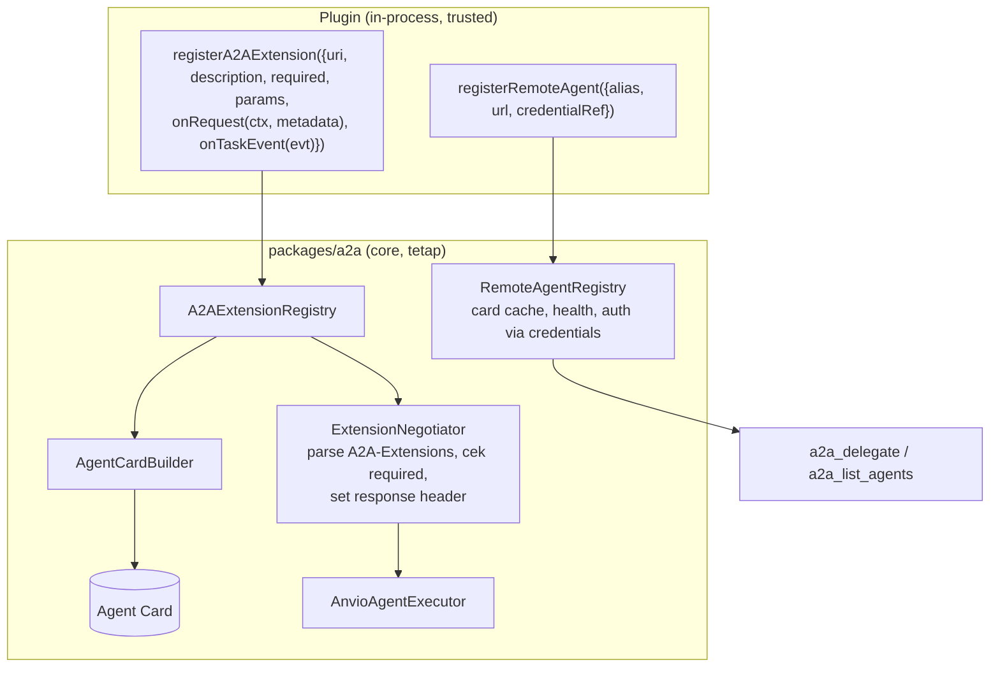

# 05 — A2A Plugin Integration

## 1. Dapatkah A2A diinstal/dikelola sebagai plugin tanpa mengubah core?

**Tidak, saat ini.** A2A terpasang langsung di composition root:

| Bagian         | Lokasi                                                                                       | Sifat                               |
| -------------- | -------------------------------------------------------------------------------------------- | ----------------------------------- |
| Server         | `platform/src/index.ts:1000-1015` → `bootstrapA2A` → di-route oleh `gateway-http.ts:308-316` | Hard-wired; aktif via `a2a.enabled` |
| Client/remotes | `platform/src/index.ts:1018-1037` → `toolGateway.mergeContext({ a2aDelegate })`              | Dibaca sekali saat boot             |
| Tool           | `a2a_delegate` built-in (`tools/src/builtins/a2a-delegate.ts`, default off)                  | Statis                              |

## 2. Kapabilitas yang ditanyakan

| Kapabilitas                   | Status                               | Catatan                                                                                                                   |
| ----------------------------- | ------------------------------------ | ------------------------------------------------------------------------------------------------------------------------- |
| Server adapter sebagai plugin | MISSING                              | —                                                                                                                         |
| Client adapter sebagai plugin | MISSING                              | —                                                                                                                         |
| Registrasi remote agent       | Configured (statis)                  | `a2a.remotes[]`                                                                                                           |
| Discovery Agent Card remote   | IMPLEMENTED (SDK, saat call pertama) | Tidak dipakai untuk memilih remote                                                                                        |
| Registry remote dinamis       | MISSING                              | Tambah remote = edit `anvio.yaml` + restart                                                                               |
| Capability discovery          | MISSING                              | `getAgentInfo` ada di `A2ATool` tetapi tidak dipanggil siapa pun                                                          |
| Delegasi task                 | IMPLEMENTED (tool `a2a_delegate`)    | Tanpa auth (P3-A2A-01), tanpa timeout                                                                                     |
| Health check remote           | MISSING                              | —                                                                                                                         |
| Registrasi A2A extension      | MISSING                              | `capabilities.extensions: []` hard-coded (`agent-card-builder.ts:45`)                                                     |
| Update capability Agent Card  | MISSING                              | Card dibangun sekali di konstruktor (`a2a-server.ts:49`)                                                                  |
| Konfigurasi per plugin        | n/a                                  | —                                                                                                                         |
| Kredensial per plugin         | Partial                              | `apiKey`/`bearerToken` per remote di `anvio.yaml` — **plaintext** di file konfigurasi, tidak memakai `@anvio/credentials` |

## 3. A2A extension ≠ plugin

Spec ([extensions](https://a2a-protocol.org/latest/topics/extensions/)) menetapkan:

- Extension dideklarasikan di `capabilities.extensions[]` (`uri`, `description`, `required`, `params`).
- Klien mengaktifkan via header `A2A-Extensions`; server **SHOULD** membalas header `A2A-Extensions` berisi yang benar-benar aktif.
- Extension tidak boleh menambah field ke struktur inti atau nilai enum baru; data tambahan masuk `metadata`.
- Versi melekat pada URI; versi tak didukung **diabaikan**, tidak boleh jatuh ke versi lain.
- `required: true` → server menolak klien yang tidak mengaktifkannya (`ExtensionSupportRequiredError`).
- Method extension baru wajib melewati authN/authZ yang sama.

Sebuah plugin dapat **menyediakan** extension, tetapi negosiasinya harus dimiliki core A2A agar aturan di atas berlaku seragam.

## 4. Desain yang disarankan

Aturan:

1. Registry hanya menerima URI absolut ber-versi; duplikat URI ditolak.
2. Plugin tidak boleh menandai `required: true` tanpa persetujuan operator (konfigurasi), karena itu memutus klien yang ada.
3. Hook extension hanya menerima/mengembalikan `metadata` (tidak menyentuh struktur inti).
4. Method extension (RPC baru) memakai middleware auth yang sama dengan core.
5. Perubahan card akibat enable/disable plugin memicu rebuild card (cache invalidation).

## 5. Acceptance criteria

- Plugin contoh "data-only extension" muncul di `capabilities.extensions` tanpa mengubah `packages/a2a`.
- Request dengan `A2A-Extensions: <uri>` → response header berisi `<uri>`; URI tak dikenal diabaikan.
- Extension `required: true` → klien tanpa header ditolak dengan error spec.
- Remote baru ditambah via CLI tanpa restart; `a2a_list_agents` menampilkan card + status health.
