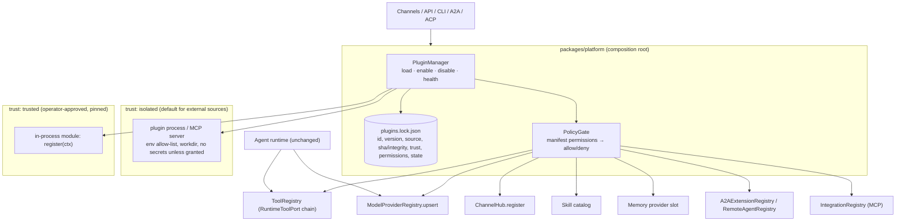

# 09 — Architecture Recommendations

## 1. Penilaian kandidat dari brief

Kandidat (Core → PluginManager → Registry → adapter A2A/MCP/Model/Tool/Skill/Channel) **sejalan** dengan codebase, dengan tiga koreksi:

1. **Plugin Manager tidak boleh dipanggil oleh Agent Runtime.** Di Anvio, composition root (`packages/platform`) yang merakit port; plugin manager harus berada di sana dan **menyuplai implementasi port** ke registry yang sudah ada. Agent brain (`packages/agents`) tidak berubah.
2. **MCP bukan "plugin di samping tool plugin"**, melainkan _jalur eksekusi yang direkomendasikan_ untuk tool pihak ketiga (out-of-process).
3. **A2A extension** dikelola core A2A (negosiasi), plugin hanya menyumbang definisi + handler.

## 2. Arsitektur target (adapter-based)



### Kontrak plugin minimal

```text
anvio.plugin.json
{
  "id": "acme-weather",                 // namespace untuk tool/channel/extension
  "version": "1.2.0",
  "anvio": { "pluginApi": "1", "minHostVersion": "2.11.0" },
  "trust": "isolated" | "trusted",
  "entry": { "mcp": { "command": "node", "args": ["dist/server.js"] } }   // isolated
         | { "module": "dist/index.js" },                                 // trusted
  "contributes": {
    "tools": ["forecast"], "skills": ["skills/weather"], "modelProviders": [],
    "channels": [], "memory": null,
    "a2a": { "extensions": [{ "uri": "https://acme.example/a2a/ext/geo/v1", "required": false }], "remotes": [] }
  },
  "permissions": { "network": ["api.weather.example"], "fs": [], "secrets": ["WEATHER_API_KEY"] }
}
```

`register(ctx)` untuk modul `trusted` hanya menerima API yang dibatasi `contributes` (mis. `ctx.tools.register` menolak nama di luar daftar).

## 3. Perubahan minimal, berurutan

| #   | Perubahan                                                                                                                                                                                                       | Lokasi                                            | Backward-compatible?            |
| --- | --------------------------------------------------------------------------------------------------------------------------------------------------------------------------------------------------------------- | ------------------------------------------------- | ------------------------------- |
| 1   | Perbaiki transport MCP stdio (pakai `@modelcontextprotocol/sdk` client)                                                                                                                                         | `packages/integrations`                           | Ya (mock test diganti)          |
| 2   | Env allow-list untuk semua proses anak; larang `${VAR}` di jalur agent                                                                                                                                          | `integrations`, `hooks`, `execution`              | Ya, dengan migrasi `secrets:`   |
| 3   | PolicyToolPort (T-006) — juga untuk tool plugin                                                                                                                                                                 | `tools`/`tool-bus`                                | Ya                              |
| 4   | Perbaiki A2A klien auth/timeout; server: session per `contextId`, identitas per caller, approval → `INPUT_REQUIRED`, cancel → `runtime.stop`, auth default on bila enabled, `securitySchemes`, push off default | `packages/a2a`, `platform/a2a-bootstrap.ts`       | Sebagian (default auth berubah) |
| 5   | `RemoteAgentRegistry` dinamis + `a2a_list_agents`                                                                                                                                                               | `packages/a2a`, `platform`                        | Ya                              |
| 6   | `PluginManager` + lockfile + CLI `anvio plugins install/enable/disable/update/uninstall/list` — fase 1 hanya `trust: isolated` (MCP-based) + skill + model OpenAI-compatible (data)                             | `packages/plugins` (baru), `platform`, `apps/cli` | Ya (aditif)                     |
| 7   | `A2AExtensionRegistry` + negotiator                                                                                                                                                                             | `packages/a2a`                                    | Ya                              |
| 8   | `trust: trusted` modules (channel/memory/model adapters)                                                                                                                                                        | `packages/plugins`                                | Ya; butuh `ChannelType` terbuka |

Tidak direkomendasikan: memuat kode plugin dari URL arbitrer, plugin in-process sebagai default, atau sandbox JS buatan sendiri (vm/isolated-vm) sebagai batas keamanan.
