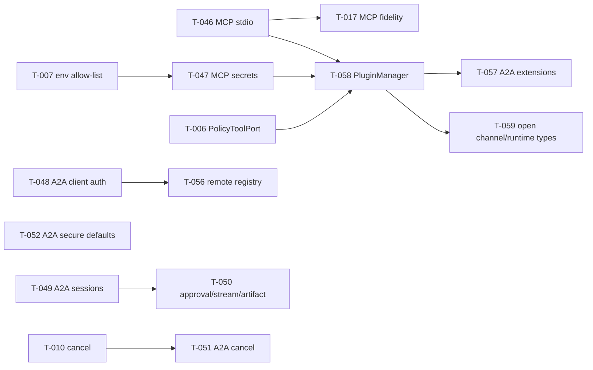

# 10 — Remaining Gap Breakdown (backlog terpadu)

Melanjutkan backlog Phase 2 ([07](../phase-2/07-remaining-gap-breakdown.md)): **T-001…T-045 tetap berlaku** dengan ID yang sama. T-001, T-002, T-003, T-005, T-012, T-020 → **FIXED** (PR #112). Task baru mulai **T-046**. Tidak ada duplikasi: bila temuan Phase 3 sudah tercakup task lama, task lama diperluas (kolom "Perluasan").

## 1. Perluasan task lama

| Task                           | Perluasan karena Phase 3                                                               |
| ------------------------------ | -------------------------------------------------------------------------------------- |
| T-007 (env allow-list sandbox) | Berlaku juga untuk **server MCP stdio** dan **hook script** (P3-SEC-01, P3-SEC-04)     |
| T-017 (MCP fidelity)           | Bergantung T-046; schema/`isError` juga harus benar di transport baru                  |
| T-042 / G-26 (stub MCP)        | Fallback stub dihapus dari jalur produksi (lebih mendesak karena G-33 memicu fallback) |
| T-030 (SSRF)                   | Termasuk push notification A2A                                                         |

## 2. Task baru

| Task  | Finding                 | Prio                                 | Komponen                      | Problem                                                                                                    | Current                                                                      | Expected                                                                                                                           | Required changes                                                                                                                                         | Deps                | Cx  | Risk                                                                 | Acceptance                                                                                                              | Status    |
| ----- | ----------------------- | ------------------------------------ | ----------------------------- | ---------------------------------------------------------------------------------------------------------- | ---------------------------------------------------------------------------- | ---------------------------------------------------------------------------------------------------------------------------------- | -------------------------------------------------------------------------------------------------------------------------------------------------------- | ------------------- | --- | -------------------------------------------------------------------- | ----------------------------------------------------------------------------------------------------------------------- | --------- |
| T-046 | G-33                    | **P0**                               | integrations                  | Klien MCP stdio memakai framing `Content-Length`; server MCP standar timeout                               | Probe M1: `initialize` timeout 30 s                                          | JSON-RPC newline-delimited sesuai spec                                                                                             | Ganti dengan `Client` + `StdioClientTransport` dari `@modelcontextprotocol/sdk` (sudah ada transitif) atau perbaiki framing; ganti `mock-mcp-server.mjs` | —                   | M   | Medium (perilaku MCP berubah, test mock diganti)                     | Probe M1 → `tools/list` mengembalikan `echo,fail`; `fail` → status `failed`                                             | NOT FIXED |
| T-047 | P3-SEC-01/02/03         | **P0**                               | integrations, core            | Proses MCP mewarisi semua secret; `${VAR}` di header/env bisa ekspor secret; allow-list command agent luas | `{...process.env}`; resolve bebas; `['npx','uvx','node','python3','docker']` | Env minimal + `secrets:[]` eksplisit per entri; jalur agent tanpa placeholder; allow-list default `[]`                             | Ubah `resolveEnv`, validasi `mcp_manage`, default schema                                                                                                 | T-007               | S–M | Medium (konfigurasi MCP yang bergantung env global perlu `secrets:`) | Server MCP tidak melihat `ANTHROPIC_API_KEY`; `mcp_manage add` dengan header `${…}` ditolak                             | NOT FIXED |
| T-048 | P3-A2A-01, P3-A2A-11    | **P1**                               | a2a, platform                 | Klien A2A tidak mengirim kredensial; `timeoutMs` diabaikan                                                 | Probe A4 gagal                                                               | Header auth & timeout dipasang di transport SDK                                                                                    | Interceptor/fetch kustom di `ClientFactory`; teruskan `timeoutMs`; kredensial via credential pool                                                        | —                   | S   | Low                                                                  | Probe A4 → klien berhasil; remote lambat → error setelah `timeoutMs`                                                    | NOT FIXED |
| T-049 | P3-A2A-05               | **P1**                               | platform (a2a-bootstrap)      | Tiap pesan sesi baru; semua caller `a2a-remote`                                                            | Probe A2                                                                     | Sesi per (`caller`, `contextId`); userId = identitas auth (`a2a:<name>`)                                                           | Map `contextId → sessionId` (persisten); pakai `context.user` dari SDK                                                                                   | T-004 (opsional)    | M   | Medium                                                               | Dua pesan `contextId` sama → satu sesi; caller berbeda → memory terpisah                                                | NOT FIXED |
| T-050 | P3-A2A-03, P3-A2A-08    | **P1**                               | platform, a2a                 | Approval → COMPLETED; streaming palsu; tanpa artifact                                                      | Code-read                                                                    | `INPUT_REQUIRED` + lanjut via pesan berikut; streaming delta via `runtime.stream`; jawaban akhir sebagai artifact                  | Pakai `agentStreamEventToA2A` yang sudah ada; publish `TaskArtifactUpdateEvent`                                                                          | T-049, T-009        | M   | Medium                                                               | `SendStreamingMessage` → ≥2 update + artifact; approval → INPUT_REQUIRED                                                | NOT FIXED |
| T-051 | P3-A2A-04               | P1                                   | a2a, platform                 | Cancel tidak menghentikan run                                                                              | Code-read                                                                    | `CancelTask` → `runtime.stop(sessionId)`                                                                                           | Map taskId→sessionId; panggil stop                                                                                                                       | T-010               | S   | Low                                                                  | Cancel saat WORKING → run berhenti, state CANCELED                                                                      | NOT FIXED |
| T-052 | P3-A2A-06/07, P3-SEC-05 | **P0** (bila gateway terekspos) / P1 | core, a2a                     | Auth default off; push default on; card tanpa `securitySchemes`                                            | Probe A1                                                                     | `a2a.enabled` tanpa kunci → boot gagal kecuali `allowAnonymous: true`; push default off + allow-list host; card mengiklankan skema | Ubah default schema; isi `securitySchemes`/`securityRequirements` dari config                                                                            | —                   | S   | Medium (konfigurasi existing)                                        | Card auth berisi skema; tanpa key → 401 bukan 500                                                                       | NOT FIXED |
| T-053 | P3-A2A-02               | P2                                   | a2a                           | Hanya agent pertama diekspos; `agents.json` 404                                                            | Probe A1                                                                     | Card per agent (path per agent) atau satu card multi-skill yang merutekan                                                          | Router per agent (`/a2a/<agent>`); `/.well-known/agents.json`                                                                                            | —                   | M   | Low                                                                  | Semua agent di `a2a.agents` dapat dipanggil                                                                             | NOT FIXED |
| T-054 | P3-A2A-09               | P2                                   | a2a                           | Task store in-memory                                                                                       | —                                                                            | Task store filesystem (Level 1)                                                                                                    | Implementasi `TaskStore` SDK di storage                                                                                                                  | —                   | M   | Low                                                                  | Restart → `GetTask` lama masih ditemukan                                                                                | NOT FIXED |
| T-055 | P3-A2A-10/11            | P2                                   | a2a, platform                 | Auth gagal → 500; boot gagal diam; `jwt`/`scopes` Configured Only                                          | Probe A4                                                                     | 401; log WARN; jwt diverifikasi atau dihapus dari schema                                                                           | —                                                                                                                                                        | —                   | S   | Low                                                                  | —                                                                                                                       | NOT FIXED |
| T-056 | §05                     | P2                                   | a2a                           | Remote agent statis; tanpa discovery/health                                                                | —                                                                            | `RemoteAgentRegistry` + `a2a_list_agents` + health/circuit breaker                                                                 | —                                                                                                                                                        | T-048               | M   | Low                                                                  | Remote ditambah via CLI tanpa restart; remote mati → breaker open                                                       | NOT FIXED |
| T-057 | P3-A2A-12               | P3                                   | a2a                           | Tidak ada registrasi A2A extension                                                                         | —                                                                            | `A2AExtensionRegistry` + negotiator sesuai spec                                                                                    | Lihat [05](05-a2a-plugin-integration.md)                                                                                                                 | T-058               | M   | Low                                                                  | Acceptance di [05 §5](05-a2a-plugin-integration.md#5-acceptance-criteria)                                               | NOT FIXED |
| T-058 | §03                     | P2                                   | plugins (baru), platform, cli | Tidak ada plugin manager                                                                                   | —                                                                            | Manifest, lockfile, CLI, enable/disable/update/uninstall, rollback, state                                                          | Lihat [09](09-architecture-recommendations.md); fase 1 hanya `isolated` (MCP) + skill + model data                                                       | T-046, T-047, T-006 | L   | Medium                                                               | `anvio plugins install <git>@<sha>` → tool muncul tanpa restart; `disable` mencabutnya; update gagal → versi lama aktif | NOT FIXED |
| T-059 | §08                     | P3                                   | core, channels, runtimes      | `ChannelType` & runtime provider enum tertutup                                                             | —                                                                            | Namespace terbuka untuk plugin `trusted`                                                                                           | Union → `string` ber-validasi; route webhook registry                                                                                                    | T-058               | M   | Medium                                                               | Channel plugin contoh terdaftar tanpa edit core                                                                         | NOT FIXED |
| T-060 | P3-SEC-06               | P2                                   | platform, credentials         | Kredensial remote A2A plaintext                                                                            | —                                                                            | Referensi credential pool                                                                                                          | `apiKeyRef`                                                                                                                                              | T-048               | S   | Low                                                                  | `anvio.yaml` tidak memuat secret                                                                                        | NOT FIXED |
| T-061 | §04                     | P2                                   | skills                        | Git import tanpa pin SHA                                                                                   | `--branch` saja                                                              | `--ref <sha40>` + catat SHA di manifest                                                                                            | `git fetch <sha>` + checkout                                                                                                                             | —                   | S   | Low                                                                  | Import dengan SHA tercatat di manifest                                                                                  | NOT FIXED |

## 3. Urutan dependensi

