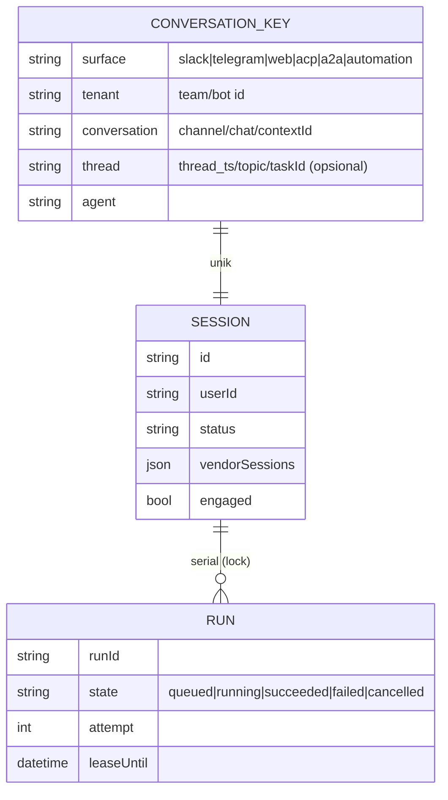

# 04 — Session & Context Comparison

## 1. Slaude

| Aspek                | Implementasi                                                                                                   | Bukti                                                |
| -------------------- | -------------------------------------------------------------------------------------------------------------- | ---------------------------------------------------- |
| Identitas thread     | `(slack_team_id, slack_channel_id, slack_thread_ts, persona_id)` **UNIQUE**                                    | `src/db/migrations/0002_sessions.sql:16-24`          |
| DM                   | Synthetic `thread_ts`                                                                                          | `CLAUDE.md` (pola Hermes); detail tidak diverifikasi |
| Pembuatan            | `findByThread` → `createForThread`                                                                             | `src/db/sessions.ts:12-65`                           |
| Persistensi          | DB (sqlite / PGLite / Postgres)                                                                                | `src/db/client.ts`, drivers                          |
| Resume SDK           | `claude_started` → `resume`; resume-miss → reboot tanpa resume; "already has transcript" → retry dengan resume | `sessions.ts:116-137`; `manager.ts:1297-1330`        |
| Idle timeout         | `env.idleMs()`; loop SDK ditutup diam-diam, pesan berikutnya boot ulang dengan resume                          | `manager.ts:711-727`                                 |
| Recovery restart     | Transkrip CLI di disk + `claude_started`; turn yang hilang di-redeliver oleh antrean                           | `queue/reaper.ts`, field note 2026-09-29             |
| Konkurensi           | Lock sesi Redis (`SET NX PX`, release/extend Lua) + coalescing pesan ke job pending                            | `queue/locks.ts:4-40`, `queue/turns.ts:1-30`         |
| Rekonstruksi context | Transkrip SDK (bukan rebuild dari DB) + `<memory-context>` prefetch                                            | `memory/provider.ts:5-6`                             |
| Engagement durable   | `sessions.engaged`                                                                                             | `sessions.ts:146-165`                                |

## 2. Anvio

| Aspek                | Implementasi                                                                 | Bukti / status                                                    |
| -------------------- | ---------------------------------------------------------------------------- | ----------------------------------------------------------------- |
| Identitas thread     | `channel-session-bridge.resolveOrCreate(channel, threadId, userId, agent)`   | `channels/src/channel-session-bridge.ts`                          |
| Persistensi          | Session store (jsonl/sqlite) + memory provider short-term (dua sumber, G-25) | —                                                                 |
| Resume vendor        | `metadata.vendorSessions[runtimeId]` → `resume`                              | `gateway-worker.ts` (issue #63), `claude-code-runtime.ts:306-311` |
| Idle timeout         | Tidak relevan (turn per `stream()`)                                          | —                                                                 |
| Recovery restart     | ✗ (P2-PLAN-03)                                                               | —                                                                 |
| Konkurensi           | ✗ lock (G-09); bus lokal serial global (P2-CH-01)                            | —                                                                 |
| Rekonstruksi context | Bangun ulang dari short-term memory tiap turn                                | `agents/src/runtime.ts`                                           |

## 3. Kontinuitas per permukaan

| Permukaan                        | Anvio                                                      | Catatan                         |
| -------------------------------- | ---------------------------------------------------------- | ------------------------------- |
| Slack thread                     | ✔ via bridge                                               | Tanpa lock & dedup durable      |
| Telegram                         | ✔ per chat/thread                                          | `offset` in-memory (P2-CH-08)   |
| Web                              | ✔ `sessionId` klien                                        | Pesan ke klien terputus dibuang |
| ACP                              | ✗ (sesi baru bila id tak dikenal; bukan ACP standar, G-07) | —                               |
| A2A                              | ✗ setiap pesan sesi baru (P3-A2A-05)                       | —                               |
| Background (automation/delegasi) | Sesi `detached` baru per run                               | Tidak ada kelanjutan            |

Slaude hanya punya Slack, sehingga model sesinya tidak perlu generik. Anvio butuh **model sesi lintas channel**.

## 4. Model sesi yang direkomendasikan (channel-independent)

- Kunci unik **komposit per surface** (mirip indeks unik Slaude) — dibuat oleh adapter, bukan oleh core; A2A memakai `contextId`, ACP memakai `sessionId` protokol, automation memakai slug + periode.
- **Run** terserialisasi per sesi (lock), dengan lease untuk recovery — ini T-004/T-011.
- Untuk runtime vendor: simpan `vendorSessions` (sudah ada) + idle TTL opsional untuk sesi SDK hidup.
- Jangan paksa semantik thread Slack ke channel lain (mis. Telegram tanpa topic = satu percakapan per chat).
