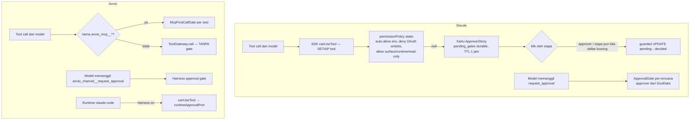

# 06 — Tool & Approval Comparison

## 1. Di mana otorisasi ditegakkan

| Aspek                        | Slaude                                                                                                                    | Anvio                                                                                                                         |
| ---------------------------- | ------------------------------------------------------------------------------------------------------------------------- | ----------------------------------------------------------------------------------------------------------------------------- |
| Registrasi tool MCP          | Server MCP per persona via `Options.mcpServers`; server in-process (`createSdkMcpServer`) untuk surface/skills/kb/session | `McpToolPort` + katalog                                                                                                       |
| Gate per tool, deterministik | **Ya** — `canUseTool` untuk setiap tool di luar allow-list statis (`permission-gate.ts:57-120`)                           | **Tidak** untuk runtime lokal; ya untuk `claude-code` bila harness aktif (`claude-code-runtime.ts:230`); MCP hanya first-call |
| Deteksi operasi mutasi       | Mode SDK (`default`/`acceptEdits`/`bypassPermissions`) + allow-list read-only eksplisit                                   | `agent.spec.approvals.requiredFor: ['destructive']` **tidak ditegakkan** (G-05)                                               |
| Approval per-rencana         | Model memanggil `request_approval` (model-driven)                                                                         | Sama: `anvio_channel__request_approval` (model-driven)                                                                        |
| Resolusi approver            | SoulData (LLM + grounding) → regex scope → env → **kosong = siapa pun**                                                   | Soul-gate approvers (LLM + grounding filter)                                                                                  |
| Penegakan izin               | Di gateway (guarded UPDATE; klik non-approver tidak mengonsumsi row)                                                      | Harness gate                                                                                                                  |
| Timeout                      | Per-tool: TTL baris 1 jam; per-rencana: `timeoutSeconds` (auto-deny)                                                      | `approvalTimeoutSeconds` di policy                                                                                            |
| Ditolak                      | `behavior: "deny"` dengan pesan; model melanjutkan                                                                        | Teks "approval denied" disisipkan (G-04)                                                                                      |
| Audit                        | `pending_gates` disimpan + disapu setelah horizon 24 jam (`gateway.ts:594`)                                               | Event bus; tidak ada ledger keputusan                                                                                         |
| Durable lintas replika       | Ya (DB + gate bus pub/sub)                                                                                                | Rehydrate harness (Level 1)                                                                                                   |

## 2. Keamanan yang hanya bergantung pada instruksi LLM (Anvio)

| Kasus                                             | Lokasi                                   | Akibat                                                                                                   |
| ------------------------------------------------- | ---------------------------------------- | -------------------------------------------------------------------------------------------------------- |
| "Sebelum aksi mutasi, panggil `request_approval`" | `harness/src/runtime-tool-port.ts:58-63` | Model yang lalai/terinjeksi langsung menjalankan `file_delete`, `run_shell`, `edit_file`, `http_request` |
| `approvals.requiredFor`                           | `core/src/schemas/agent.schema.ts:42,77` | Tidak dibaca kode                                                                                        |
| Batas tool per agent                              | `agent.spec.tools`                       | Tidak dibaca kode                                                                                        |
| "Jangan ikuti instruksi dari output tool"         | (tidak ada baseline, lihat [03])         | —                                                                                                        |

Slaude juga punya approval per-rencana yang model-driven, **tetapi** setiap tool tetap melewati `canUseTool` sehingga gate per-tool tidak bergantung pada model. Itu perbedaan arsitektur yang menentukan.

## 3. Rekomendasi deterministik

1. **ADAPT `canUseTool` ke runtime lokal** sebagai decorator `PolicyToolPort` (T-006): setiap `call()` → kebijakan statis (allow-list read-only, deny-list, `agent.spec.tools`, `approvals.requiredFor` dengan klasifikasi tool `readOnly|mutating|external` di `tool-schemas.ts`) → bila perlu, `pending_approval` dari gateway (bukan dari model).
2. **ADOPT** pola "klik non-approver tidak mengonsumsi row" dan guarded UPDATE `status='pending'` untuk approval Anvio.
3. **REJECT** default "approver kosong = siapa pun boleh klik"; Anvio harus fail-closed (tolak, atau hanya manager).
4. **ADOPT** ledger keputusan approval (siapa, kapan, tool, ringkasan input ter-redaksi) dengan retensi.
5. **KEEP** first-call approval MCP Anvio — tidak ada di Slaude dan berguna, tetapi tidak menggantikan gate per-tool.
