# 14 — Prioritized Roadmap

Melanjutkan [Phase 3 roadmap](../phase-3/11-implementation-roadmap.md). ID lama dipertahankan; task baru T-062…T-068 berasal dari rekomendasi Slaude ([13](13-adoption-recommendations.md)).

## 1. Task baru

| Task  | Rekomendasi                                          | Prio   | Komponen         | Cx  | Acceptance criteria                                                                              |
| ----- | ---------------------------------------------------- | ------ | ---------------- | --- | ------------------------------------------------------------------------------------------------ |
| T-062 | R-16 breaker `unhandledRejection`                    | P2     | platform         | S   | 5 rejection dalam 60 s → exit non-zero dengan log                                                |
| T-063 | R-08 integritas cache policy + mode strict grounding | P2     | soul-gate        | S   | Cache dimodifikasi → diabaikan & re-extract; `strict` menolak ekstraksi berisi id tak ter-ground |
| T-064 | R-03 runtime baseline immutable                      | **P1** | agents           | S   | Baseline dari kode selalu pertama di system prompt (runtime lokal & vendor `systemPrompt`)       |
| T-065 | R-06 approval durable guarded                        | P1     | harness, storage | M   | Approval bertahan restart; klik non-approver tidak menyelesaikan; approver kosong → fail-closed  |
| T-066 | R-14 auto-evolve dalam sesi                          | P3     | agents, learning | M   | Lihat [13]                                                                                       |
| T-067 | R-15 `/readyz`, boot guard, drain                    | P2     | platform, apps   | S   | `/readyz` 503 saat storage mati; worker drain pada SIGTERM                                       |
| T-068 | R-17 fake platform e2e                               | P2     | tests            | M   | Fake Slack + Telegram menjalankan gateway nyata di CI                                            |

## 2. Perluasan acceptance (ID lama)

Lihat [12 §2](12-previous-findings-reconciliation.md#2-temuan-yang-dikaitkan-dengan-pola-slaude-id-tidak-diubah): T-004 (coalescing), T-006 (fungsi kebijakan murni lintas runtime), T-007 (child `claude-code`), T-014 (dedup durable), T-026 (redaksi), T-027 (CAS), T-047 (placeholder literal), T-061 (lockfile `--check`).

## 3. Urutan

```mermaid
flowchart LR
  subgraph M1b["M1b — keamanan & protokol (kecil, paralel)"]
    T046[T-046 MCP stdio]
    T047[T-047 + T-007 env/secret]
    T048[T-048 A2A client auth]
    T052[T-052 A2A defaults]
    T064[T-064 runtime baseline]
  end
  subgraph M2["M2 — fondasi eksekusi"]
    T004[T-004 SessionRunQueue + coalescing]
    T006[T-006 PolicyToolPort deterministik]
    T010[T-010 cancel]
    T011[T-011 recovery]
    T065[T-065 approval durable]
    T008[T-008 budget]
    T009[T-009 checkpoint]
  end
  subgraph M3["M3 — channel & reliabilitas"]
    T014[T-014 dedup durable]
    T026[T-026 redaksi]
    T027[T-027 cron CAS + tz]
    T013[T-013 reconnect]
    T024[T-024 outbound]
    T067[T-067 readyz/drain]
    T068[T-068 fake e2e]
  end
  M1b --> M2 --> M3
  M3 --> M4["M4 — A2A semantik, plugin fase 1 (T-049..T-058, T-061)"]
  M4 --> M5["M5 — learning terukur, T-066, plugin trusted, T-057"]
  T004 --> T010
  T004 --> T011
  T006 --> T065
```

## 4. Rekomendasi langkah berikutnya

1. **M1b** (sudah direkomendasikan Phase 3) + **T-064** baseline: semuanya kecil, independen, dan menutup jalur kebocoran/penyalahgunaan yang paling langsung.
2. **T-006** sebagai item pertama M2 — inilah perbedaan keamanan terbesar terhadap Slaude.
3. **T-004** setelahnya — membuka cancel, recovery, dan isolasi channel sekaligus.

Keputusan pemilik proyek yang masih terbuka (dari Phase 2–3) tetap berlaku; tambahan dari Phase 4: apakah **klasifikasi tool mutasi** (R-01) boleh membuat agent existing meminta approval untuk tool yang sebelumnya berjalan bebas (`http_request` POST, `edit_file`, dll.)?
