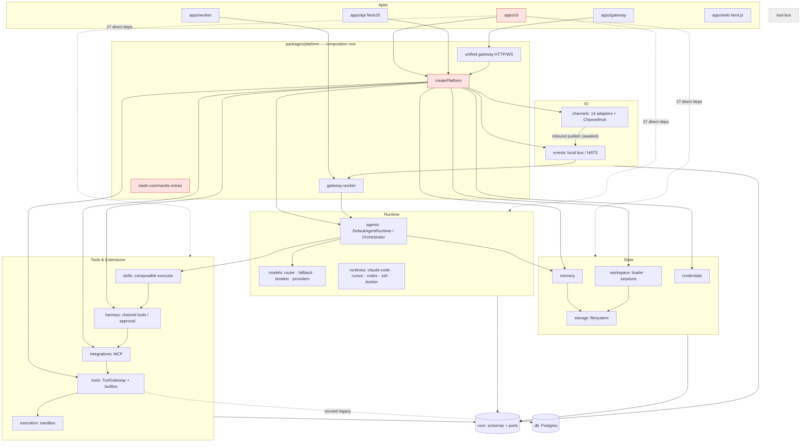

# 01 — Repository Architecture Map

Produced before any per-file evaluation. Sources: `package.json` files, `turbo.json`, `tsconfig.base.json`, `eslint.config.js`, `.github/workflows/ci.yml`, `CLAUDE.md`, `docs/02-architecture.md`, and direct reads of entry points. Line counts exclude `*.spec.ts`, `dist/`, `node_modules/`.

## 1. Repository structure

```
anvio (pnpm 9.15.9 workspace, turbo 2, TypeScript 5.8 strict, ESM/NodeNext, vitest 3)
├── apps/        cli · api (NestJS) · worker · gateway · web (Next.js 15) · desktop (README only)
├── packages/    36 workspace packages (+ graphify-out artefacts)
├── tests/integration/   ~40 *.integration.spec.ts (phase-named)
├── workspace/   runtime data / example agent workspace (agents, skills, souls, workflows)
├── configs/, docker/, evals/, scripts/
└── docs/        78 numbered docs, ADRs, docs/audit/phase-1..4 (prior audits)
```

Tooling facts relevant to quality:

| Concern | State |
|---|---|
| TS config | `strict`, `noUnusedLocals/Parameters`, `isolatedModules`, `composite` — good baseline |
| ESLint | flat config, `typescript-eslint` recommended, `no-explicit-any: warn`; **only ~20/40 packages define `lint`** (CQ-017) |
| Prettier | configured; **388 files non-compliant; not in CI** (CQ-017) |
| Tests | vitest at root; colocated `*.spec.ts` + `tests/integration`; 148 files / 800 tests pass |
| CI | lint → build+typecheck → test on Node 20 (EOL, CQ-029); no audit, no format check |
| Engines | `node >=20`, `pnpm >=9` |

## 2. Component inventory and status

Size = non-spec source lines. Status: **Active** (on a production path from an app entry point), **Partial** (wired but optional / thin), **Scaffold**, **Dead** (no importers).

| Package / app | Lines | Role | Status |
|---|---:|---|---|
| `apps/cli` | 2 883 (1 file) | Primary entry point, 42 commands | Active — god module (CQ-011) |
| `apps/api` | 724 | NestJS REST | Active, optional |
| `apps/gateway` | 18 | Starts `startUnifiedGateway` | Active (thin) |
| `apps/worker` | 27 | Starts `registerGatewayWorker` | Active (thin) |
| `apps/web` | 858 | Next.js dashboard | Active, optional |
| `apps/desktop` | 0 | README only | Scaffold |
| `platform` | 5 490 | Composition root, gateway worker, slash commands, HTTP gateway | Active — god functions (CQ-011) |
| `core` | 3 521 | Zod schemas, ports, types; no internal deps | Active |
| `agents` | 1 136 | `DefaultAgentRuntime` tool loop, `SupervisorOrchestrator` | Active — central |
| `models` | 2 844 | Provider adapters (Anthropic, OpenAI-compatible, Gemini), router, fallback, breaker, budget | Active |
| `tools` | 4 218 | `ToolGateway` + ~70 builtins | Active |
| `channels` | 5 094 | 14 adapters + `ChannelHub` + inbound handler | Active |
| `harness` | 1 740 | Channel tool surface, approval gate, engagement | Active |
| `runtimes` | 3 246 | Vendor CLI runtimes (claude-code, cursor, codex, antigravity), ssh, docker, singularity, modal | Active (vendor runtimes); remote ones Partial |
| `memory` | 1 280 | Filesystem/SQLite short+long term, FTS recall, gbrain/honcho | Active |
| `workspace` | 1 736 | Loader, session stores (fs/sqlite), mutations, trash | Active |
| `storage` | 116 | Filesystem storage provider | Active (fan-in 13) |
| `skills` | 1 130 | Catalog, registry, composable executor, triggers | Active |
| `learning` | 1 117 | Session-end memory nudge, summaries, skill drafts | Active |
| `souls`, `soul-gate`, `personas` | 414 / 351 / 26 | Identity, SOUL.md policy | Active |
| `integrations` | 1 241 | MCP registry, stdio client, MCP tool port | Active |
| `events` | 449 | Local bus + optional NATS | Active |
| `execution` | 277 | Code executor + process/docker sandbox | Active when `execute_code`/`run_shell` enabled |
| `credentials` | 265 | AES-GCM encrypted key pools | Active when passphrase set |
| `auth` | 92 | none / jwt / oauth2-stub | Active |
| `observability` | 226 | OTel init, `withSpan`, pino logger | Partial — logger unused (CQ-018) |
| `a2a`, `acp` | 769 / 203 | A2A server, editor integration | Partial (opt-in) |
| `automation`, `hooks`, `goals`, `kanban`, `batch`, `blueprints`, `workflows`, `knowledge`, `voice` | 215–581 each | Feature subsystems | Active/opt-in |
| `db` | 243 | Drizzle/Postgres (Level 3+) | Partial; leaked into `tools` (CQ-024) |
| `tool-bus` | 126 | Tool policy layer | **Dead** — zero importers (CQ-024) |
| `tools/src/legacy.ts` | 31 | Postgres audit logger + stub executor | **Dead** code, still exported |

Generated / excluded from scoring: `dist/`, `node_modules/`, `graphify-out/`, `packages/graphify-out/`, `.turbo/`, `workspace/` runtime data.

## 3. Dependency relationships (from package.json)

Computed over all workspace `package.json` files:

- **No cycles** between workspace packages.
- `@anvio/core` has no internal deps (fan-in 36) — rule respected.
- Highest fan-out: `platform` 30, `cli` 28, `agents` 8, `api`/`worker` 5.
- Highest fan-in: `core` 36, `storage` 13, `events` 9.
- Layer deviations:
  - `apps/cli` depends directly on 27 subsystem packages, not only `platform` (CQ-011).
  - `tools → db` (Postgres) for an unused legacy class (CQ-024).
  - `tools → voice`, `channels → voice`: domain packages coupled to an optional subsystem.

## 4. Agent execution lifecycle (as implemented)

```
Channel adapter (telegram/slack/…)            CLI `anvio chat`/`run`
  └─ onInbound (channels/create-channels.ts)      └─ platform.runtime.stream(...)
       ├─ slash command dispatch (platform)
       ├─ harness.handleInbound (engagement / 1on1 / approvals)
       └─ eventBus.publish(AGENT_RUN_REQUESTED)   ← awaited; local bus runs subscriber inline (CQ-007)
            └─ gateway-worker subscriber (platform/gateway-worker.ts:153)
                 ├─ sessions.update(status: calling_model)
                 ├─ RuntimeRoutingAgentRuntime → DefaultAgentRuntime | vendor runtime
                 │    DefaultAgentRuntime.stream (agents/runtime.ts:114)
                 │      1. assembleSystemPrompt: persona + skills (+goal/trigger skills) + soul
                 │      2. build tool port: ComposableSkillRegistry → McpToolPort → HarnessAwareToolPort → ToolGateway
                 │      3. choose provider (explicit route or agent provider)
                 │      4. loop ≤ maxToolIterations (5):
                 │           model stream (via ModelRouter: fallback chain + breaker before first chunk)
                 │           → native tool_use or fenced anvio_tool parse
                 │           → execute sequentially; pending_approval → checkpoint + return
                 │      5. memoryStore.storeConversation; yield done
                 ├─ publish progress / chunks / completion events → ChannelHub.send*
                 └─ AGENT_RUN_COMPLETED subscriber (platform/index.ts ~940): token audit, learning loop, draft prompt
```

State transitions are implicit: `StoredSession.status` strings set by the worker (`calling_model`, `awaiting_approval`, `idle`) and yielded chunk types; no explicit state machine type exists. Termination: iteration cap (silent, CQ-005), stop flag (cooperative only, CQ-006), approval pause, provider error.

## 5. Architectural boundaries identified

| Boundary | Where | Health |
|---|---|---|
| Ports in `core` (`ModelProvider`, `RuntimeToolPort`, `MemoryStore`, `SessionStore`, `StorageProvider`) | `packages/core/src/ports` | Good — runtime depends on interfaces |
| Provider isolation | `models/providers/*` + `provider-error.ts` normalization | Good; error details normalized at adapter |
| Tool trust boundary (LLM → action) | `ToolGateway.call` / harness approval | Weak — enable/disable only; no egress or argument policy (CQ-002/003) |
| Channel boundary | `BaseChannelAdapter` + `ChannelHub` | Reasonable contract; lifecycle per adapter inconsistent (CQ-008) |
| Composition root | `createPlatform` | Single place, but one ~810-line function (CQ-011) |
| Storage tiers | `storage.provider` fs/sqlite, `db` for L3 | Mostly respected; `tools → db` leak (CQ-024) |

## 6. Mermaid diagram


