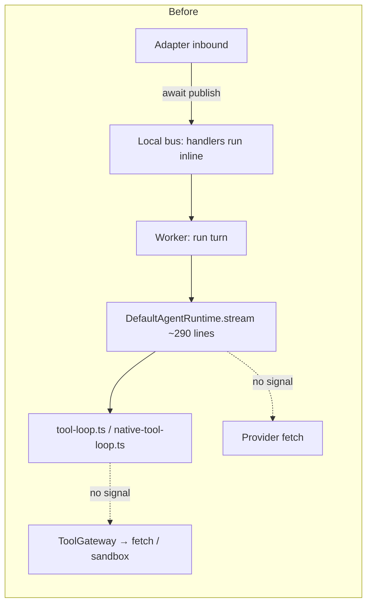
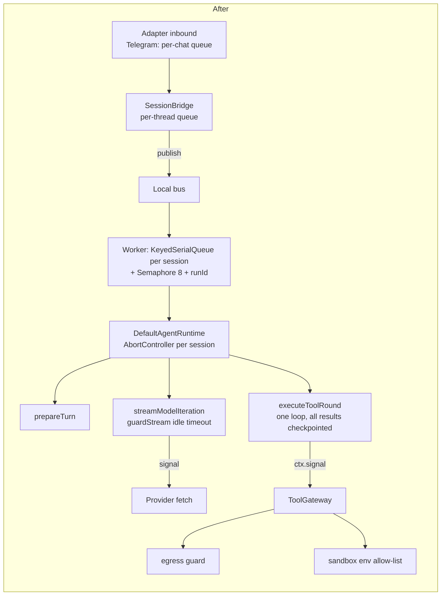

# 02 — Architecture Changes

No new architectural layer was introduced. Changes are new small shared primitives in `core`, clearer ownership of cancellation and concurrency, and smaller modules where the audit found defects concentrated.

## 1. Before / after — turn execution path

## 2. New shared primitives (`@anvio/core`, no new dependencies)

| Module | Purpose | Replaces |
|---|---|---|
| `fs-paths.ts` | `resolveInsideRoot`, `resolveRealInsideRoot` | 4 copies of a prefix-bug check; 6 unchecked `path.join`s |
| `fs-atomic.ts` | `writeFileAtomic`, `IN_FLIGHT_WRITE_SUFFIX` | direct `writeFile` in storage; colliding pid-only temp files in harness |
| `sandbox-env.ts` | `buildSandboxEnv` | `{ ...process.env }` in two spawn sites |
| `concurrency.ts` | `KeyedSerialQueue`, `Semaphore` | none (concurrency was unbounded) |

`core` still has no internal dependencies; these are pure Node-stdlib helpers.

## 3. Module boundary changes

| Area | Before | After |
|---|---|---|
| Agent loop | `runtime.ts` (stream generator + barrel re-export of orchestrator), `tool-loop.ts`, `native-tool-loop.ts` | `runtime.ts` (phases as private methods + `guardStream`), `tool-round.ts` (single tool round), `run-checkpoint.ts` (validated, versioned) |
| Tool egress | none | `tools/src/builtins/egress.ts`, policy in `ToolGatewaySpec.network` |
| Skill conditions | `new Function` inside `executor.ts` | `skills/src/condition-expression.ts` |
| Channel reconnects | inline `setTimeout(start)` per adapter | `channels/src/reconnect.ts` (`ReconnectScheduler`, `RecentIds`) |
| Remote exec | `spawnSync` per runtime | `runtimes/src/exec-command.ts` |
| Platform | session-completed closure + mock provider inside `createPlatform` | `platform/src/handlers/run-completed.ts`, `platform/src/mock-model-provider.ts` |
| Shutdown | ad-hoc per app | `runShutdownSteps`, `exitOnShutdownSignals` in `platform/src/process-guards.ts` |
| CLI | `main.ts` 2 883 lines | `main.ts` (dispatch + help, 262 lines), `cli-context.ts`, `commands/{sessions,identity,planning,runtime,skills,gateway}.ts` |
| Memory | three copies of "store last two messages" | `memory/src/conversation-entries.ts` used by all three |

## 4. Dependency changes

- **Removed:** `@anvio/tools → @anvio/db` (and its tsconfig reference). `@anvio/tools` no longer pulls drizzle/postgres into Level-1 installs.
- **Added (workspace-internal):** `@anvio/agents → zod` (same major as core) for checkpoint validation.
- **Added (direct):** `@anvio/runtimes → @modelcontextprotocol/sdk ^1.32.0` (satisfies the Claude Agent SDK peer at a patched version; it was already installed transitively).
- **Upgraded:** `next` ^15.5.28; OpenTelemetry `api` ^1.10, `sdk-node`/`exporter-trace-otlp-http` ^0.300, `auto-instrumentations-node` ^0.82, `resources` ^3; zod 4 consumers ^4.6.6.
- **Overrides:** `brace-expansion >=5.0.12`, `multer@<2.3.0 → >=2.3.0`, `proxy-addr@<2.0.8`, `source-map-js@<1.2.2`, `qs@<6.16.0`, `ip-address@<10.3.1 → >=10.7.4`, `body-parser@>=2 <2.4`, `@modelcontextprotocol/sdk@<1.32.0`, `zod@>=4 <4.6.6`.
- Package graph still has **no cycles**.

## 5. Major design decisions

1. **Serialize per session, don't decouple the bus.** Making inbound publish fire-and-forget would have changed the awaited semantics many call sites and tests rely on. Instead the worker serializes per session and bounds global concurrency; Telegram stops awaiting across chats. A run queued behind another turn does not block its publisher, which rules out the approval-answered-mid-turn deadlock.
2. **Egress policy secure by default without changing the tool default.** Private/metadata targets are refused unless allow-listed; the tool itself stays enabled (default flip needs approval).
3. **Restricted expression evaluator instead of a sandbox.** `vm` is not a security boundary (host objects leak the `Function` constructor). A ~400-line parser for the documented subset has no escape surface and needs no dependency.
4. **AsyncLocalStorage for skill recursion.** Skill re-entry happens through three different paths (composable step, `skill_call`, `skill__` tool); one async-context stack covers all of them without threading a parameter through tool ports.
5. **Idle timeout, not total timeout.** Long answers are legitimate; silence is not. 300 s default accounts for reasoning models that think before the first token.
6. **Verbatim, tool-assisted CLI split.** Moved with a TypeScript-compiler script that resolved cross-references by symbol and pruned imports with the language service, so no function body was retyped.

## 6. Compatibility considerations

- Public stream events: `done` gains `provider`, `model`, `stopReason`; `error` gains `code`, `retryable` (all optional).
- `OrchestrationTaskResult.status` gains `awaiting_approval` (consumers switching exhaustively over the union must handle it).
- `@anvio/tools` no longer exports `executeCode`, `PostgresToolAuditLogger`, `StubToolExecutor` (no in-repo consumers).
- `@anvio/agents` exports `AgentRunError`, `RunStoppedError`, `ModelIdleTimeoutError`, `DEFAULT_MODEL_IDLE_TIMEOUT_MS`, `DEFAULT_MAX_TOOL_ITERATIONS`, `isRetryableRunError`, orchestration defaults; `runtime.ts` no longer re-exports the orchestrator (the package index still does).
- `DefaultAgentRuntime.run()` throws `AgentRunError` (subclass of `Error`, same message) instead of a plain `Error`.
- Behaviour changes for confirmed defects are listed in `03-refactoring-and-rewrites.md` §4.
