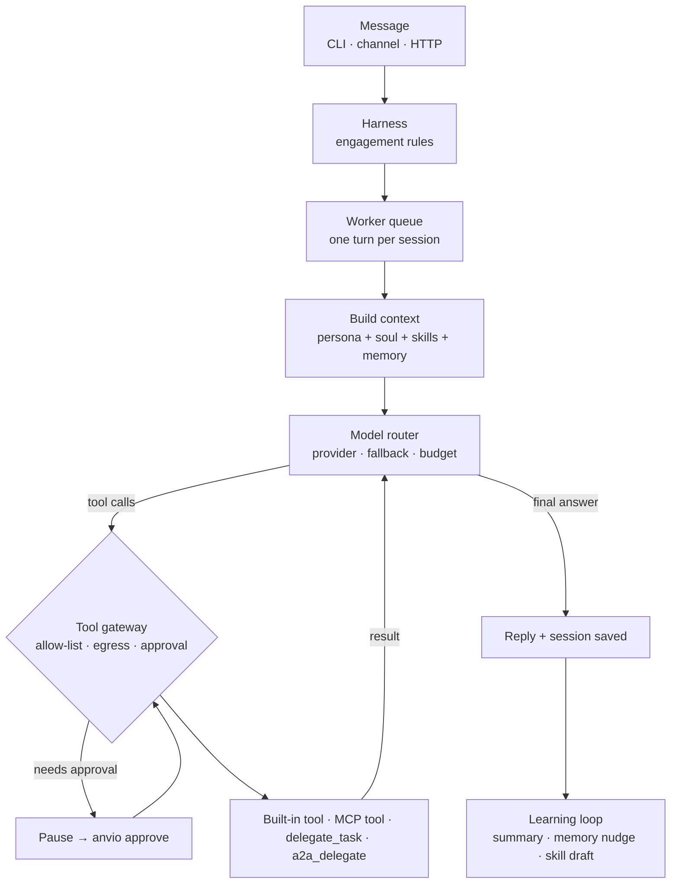

# Getting started

From zero to a running agent in about five minutes. Every command here is checked against `package.json` scripts and `anvio --help`.

## Prerequisites

| Requirement   | Version                 | Notes                                                           |
| ------------- | ----------------------- | --------------------------------------------------------------- |
| Node.js       | 20+ (CI runs 22 and 24) | Slack/Discord adapters need the global `WebSocket` from Node 22 |
| pnpm          | 9+                      | The repo pins `pnpm@9.15.9`                                     |
| git           | any                     |                                                                 |
| Model API key | optional                | Without one, agents answer with a mock provider                 |

Docker, PostgreSQL, Redis and NATS are **not** needed for the default tier.

## 1. Install

::: code-group

```bash [From source]
git clone https://github.com/viantonugroho11/Anvio.git
cd Anvio
pnpm install
pnpm build
# use: pnpm anvio <args>
```

```bash [Install script]
curl -fsSL https://raw.githubusercontent.com/viantonugroho11/Anvio/main/scripts/install.sh | bash
source ~/.anvio/env
# use: anvio <args>
```

:::

## 2. Create a workspace and a first agent

`anvio init` creates the folder structure but **no agents**. An agent needs a persona; the persona body is the system prompt.

```bash
pnpm anvio init ~/my-agents
export ANVIO_WORKSPACE=~/my-agents

cat > ~/my-agents/personas/assistant.md <<'EOF'
---
name: assistant
description: Concise general-purpose assistant
version: "1.0.0"
---

You are a concise, helpful assistant.
EOF

cat > ~/my-agents/agents/assistant.md <<'EOF'
---
persona: assistant
description: General-purpose assistant
model:
  provider: anthropic
  model: claude-sonnet-4-20250514
---

General-purpose assistant.
EOF
```

::: tip Sample workspace
The repository's `./workspace` already contains an `architect` agent. Point `ANVIO_WORKSPACE` at it to skip this step.
:::

## 3. Configure a model (optional)

::: code-group

```bash [API key]
export ANTHROPIC_API_KEY=...   # or OPENAI_API_KEY, DEEPSEEK_API_KEY, OPENROUTER_API_KEY, ...
```

```bash [Vendor subscription (OAuth)]
pnpm anvio setup-token --claude   # or --cursor, --codex, --antigravity
# then set `runtime.provider: claude-code` in the agent frontmatter
```

:::

::: warning
Do not combine both for Claude: `ANTHROPIC_API_KEY` shadows the Claude Code OAuth login and bills API credits. See [environment variables](./reference/environment-variables.md).
:::

## 4. Run and verify

```bash
pnpm anvio workspace validate        # → Workspace OK: ...
pnpm anvio agents list               # → assistant — General-purpose assistant
pnpm anvio run assistant "Say hello"
pnpm anvio chat --agent assistant    # interactive
pnpm anvio sessions list
```

Without an API key, `run` prints `[Mock — set a model API key] You said: Say hello`.

## 5. Start the gateway (optional)

One daemon for channels, HTTP API, WebSocket and A2A routes:

```bash
pnpm anvio gateway start --foreground     # 127.0.0.1:3001 (ANVIO_GATEWAY_PORT)
curl http://127.0.0.1:3001/health         # → {"status":"ok",...}
```

## How a turn runs



The loop runs up to 5 tool rounds per turn by default. See [03 — Agent runtime](./03-runtime.md) for the full lifecycle.

## Next steps

- Enable more tools: [built-in tool catalog](./reference/builtin-tools.md)
- Connect an MCP server: [MCP reference](./reference/mcp.md) · [71 — MCP setup guide](./71-mcp-setup-guide.md)
- Route between providers: [36 — Provider routing](./36-provider-routing.md)
- Hook up Slack or Telegram: [10 — Channels](./10-channels.md)
- Deploy: [14 — Deployment](./14-deployment.md)
