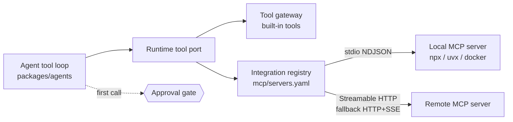

# MCP reference

::: info What Anvio is, in MCP terms
Anvio is an **MCP client** (host). It connects agents to external MCP servers over **stdio** or **HTTP** and exposes their tools to the model next to the [built-in tools](./builtin-tools.md).

Anvio does **not** ship a standalone MCP server. You cannot point Claude Desktop, Cursor or VS Code at Anvio as an MCP server. To call Anvio agents from another system, use the [A2A server](../78-a2a-protocol.md), the gateway HTTP API, or the [ACP editor bridge](../39-editor-integration.md).

The one MCP server in the codebase is an **in-process** bridge named `anvio`, created only for the Claude Code runtime (see [below](#in-process-server-for-the-claude-code-runtime)).
:::



## Configuration — `workspace/mcp/servers.yaml`

Schema: `packages/core/src/schemas/mcp.schema.ts`.

```yaml
apiVersion: anvio.io/v1
kind: McpConfig
metadata:
  name: default
spec:
  firstCallApproval: true # default — first call to each MCP tool needs a human OK
  agentAllowedCommands: [npx, uvx, node, python3, docker] # what mcp_manage may spawn
  servers:
    github: # local server over stdio
      command: npx
      args: ['-y', '@modelcontextprotocol/server-github']
      env:
        GITHUB_TOKEN: ${GITHUB_TOKEN}
      enabled: true
    docs: # remote server over HTTP
      transport: http
      url: https://mcp.example.com/mcp
      headers:
        Authorization: Bearer ${DOCS_MCP_TOKEN}
      allowedTools: [search, fetch_page]
```

### Server fields

| Field          | Type                        | Default | Notes                                                            |
| -------------- | --------------------------- | ------- | ---------------------------------------------------------------- |
| `transport`    | `stdio` \| `http` \| `stub` | `stdio` | `http` tries Streamable HTTP, then falls back to legacy HTTP+SSE |
| `command`      | string                      | —       | Required for `stdio` / `stub`                                    |
| `args`         | string[]                    | `[]`    |                                                                  |
| `env`          | map                         | `{}`    | Values may use `${VAR}` placeholders                             |
| `url`          | URL                         | —       | Required for `http`                                              |
| `headers`      | map                         | `{}`    | Values may use `${VAR}` placeholders                             |
| `allowedTools` | string[]                    | all     | Only these tool names are exposed to the agent                   |
| `enabled`      | boolean                     | `true`  |                                                                  |

Keep secrets as `${VAR}` placeholders — never literal values in the workspace.

## Capabilities used

| MCP capability               | Supported | Where                                                                 |
| ---------------------------- | --------- | --------------------------------------------------------------------- |
| `tools/list`, `tools/call`   | Yes       | `packages/integrations/src/mcp-stdio-client.ts`, `mcp-http-client.ts` |
| `resources/*`                | No        | Not consumed by the agent loop                                        |
| `prompts/*`                  | No        | Not consumed by the agent loop                                        |
| Sampling, roots, elicitation | No        | —                                                                     |

Tools are discovered at startup (`loadMcpToolCatalog` in `packages/platform`) and when `mcp_manage` adds a server; new tools appear on the agent's **next turn**.

## Managing servers

| How                     | Command / tool                                                                                         |
| ----------------------- | ------------------------------------------------------------------------------------------------------ |
| List configured servers | `anvio mcp list`                                                                                       |
| Connect and list tools  | `anvio mcp test <id>`                                                                                  |
| Health of all servers   | `anvio mcp health`                                                                                     |
| Ready-made presets      | `anvio mcp preset` — examples in `workspace/mcp/presets/*.yaml.example`                                |
| From inside an agent    | `mcp_manage` tool: `{ "action": "list"\|"add"\|"remove", ... }` — restricted to `agentAllowedCommands` |

## Permissions and safety

- **First-call approval** (`firstCallApproval: true`): the first call to each MCP tool pauses the run for a human decision, resumed with `anvio approve <session> <id>` or a channel approval.
- **`allowedTools`** narrows what a server exposes.
- **Agent-registered servers** may only spawn executables listed in `agentAllowedCommands`.
- **Known gap:** stdio MCP servers currently inherit the full process environment ([ROADMAP T-047](../ROADMAP.md#p0-security-and-correctness)). Run untrusted servers in `docker` until this is closed.

## In-process server for the Claude Code runtime

When an agent runs on `runtime.provider: claude-code`, `packages/runtimes/src/claude-code/claude-code-tool-bridge.ts` wraps Anvio's runtime tool port (built-in tools + channel harness tools such as `anvio_channel__reply` and `anvio_channel__request_approval`) in an SDK MCP server named **`anvio`** via `createSdkMcpServer`. It lives only inside that run's process; it is not reachable over a transport.

Tool results come back as one `text` content item (JSON-encoded output); a failed tool sets `isError: true` with the error message.

## Related

- [07 — MCP architecture](../07-mcp.md)
- [71 — MCP setup guide](../71-mcp-setup-guide.md)
- [38 — Integration architecture](../38-integration-architecture.md)
